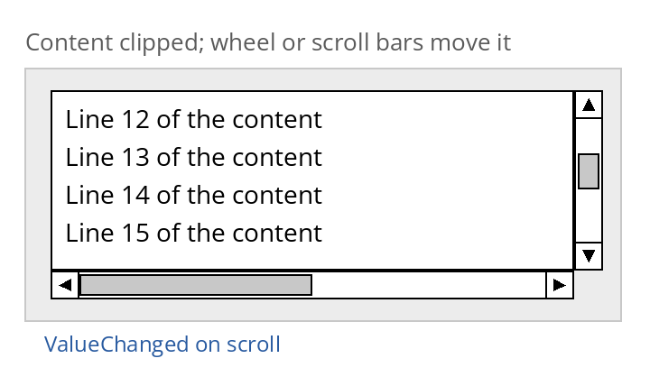
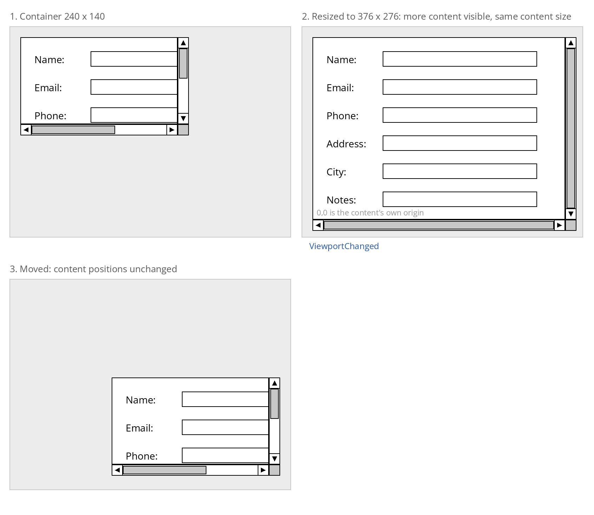

# Container: widget roadmap

> **Issue:** [#58](https://github.com/KenSuenobu/rust-pushrod/issues/58) (5.3) · **Epic 5:** Composition, clipping, and layout managers · **Release:** MVP (v1) · **Size:** M
> **User docs:** `pushrod-docs/docs/widgets/container.md` · **Overview:** [main roadmap](../ROADMAP_EXTENSIBLE_WIDGET_LIBRARY.md) · **Rules:** [design philosophy](../../DESIGN_PHILOSOPHY.md)

This file is the specification for this widget: what it is, what it does, and how it responds. To change its look or behavior, edit this file in a pull request (and its mockup in [`docs/mockups/generate.py`](../mockups/generate.py) if the picture changes), then bring the issue in line. If this file and the issue disagree, this file wins.

## What it is

A widget whose children live on a content area with its own size and 0,0 origin; the container's frame is a viewport panned by scroll bars.

Applications with scrollable areas (long settings pages, document views, canvases, large forms) need a place to put widgets that is larger than the space on screen. The content must behave like a form: it has its own width, height, and 0,0 origin, and resizing or moving the container must not change the content or shift widgets within it.

*Ideas from:* Scrolling windows and panes on every desktop system; designed forms with their own 0,0 origin. Names and behavior are Pushrod's own.

## What it does

Add `Container`, a widget that holds children on a **content area**: `Container::new(origin, viewport_size, content_size)`; children are added with `add_child` at positions relative to the content's 0,0, exactly like a form. The container's frame is the **viewport**: resizing the container (`set_size`) changes only how much content is visible; `content_size` stays the same unless the application changes it (`set_content_size`). Moving the container (`set_origin`) moves the viewport on screen; content positions never shift. The viewport is panned by `scroll_offset` (the content point shown at the viewport's upper-left corner), clamped to the content bounds: vertical and horizontal scroll bars appear automatically when the content is larger than the viewport (or `ScrollBars::Always/Never`), and the mouse wheel, Page Up/Down, Home/End, and arrow keys (when focused) pan it too. API: `scroll_offset()`, `scroll_to(point)`, `scroll_by(dx, dy)`, `ensure_visible(rect)` (also used to keep the focused widget in view), `viewport()` (the visible content rectangle). Children are clipped to the viewport ([5.1](https://github.com/KenSuenobu/rust-pushrod/issues/56)) and hit-tested through it. On the GPU, panning only changes which part of the content is blitted: children that didn't change are not repainted. Content size can be `Fixed` (default), `FitChildren` (grows to the children's extent), or `FollowWidth` (content width follows the viewport, height fixed or fit: for long vertical forms); a layout manager ([5.5](https://github.com/KenSuenobu/rust-pushrod/issues/116)) can also arrange the content. A form loaded from a file ([6.4](https://github.com/KenSuenobu/rust-pushrod/issues/63)) can be placed in a container. **Parts ([5.2](https://github.com/KenSuenobu/rust-pushrod/issues/57)):** `ContainerParts { content, vertical, horizontal, corner }`. Emits `ViewportChanged { id, offset }` whenever the viewport pans or resizes.

```text
content (fixed size, its own 0,0)            screen
+-----------------------------------+
|0,0                                |       container origin (anywhere)
|      +------------------+         |            +------------------+-+
|      | viewport         |  ---------------->  | visible content  |^|
|      | (scroll_offset   |         |            |                  |#|
|      |  = top-left)     |         |            +------------------+v+
|      +------------------+         |            |<|####          |>| |
|                                   |            +--------------------+
+-----------------------------------+
resize container -> viewport grows/shrinks; content size unchanged
move container   -> viewport moves on screen; content positions unchanged
```

## How it looks

Each image shows the widget step by step, drawn in Pushrod's current style; blue notes name the event emitted. Mockups come from [`docs/mockups/generate.py`](https://github.com/KenSuenobu/rust-pushrod/blob/main/docs/mockups/generate.py): edit a frame there and re-run it to change the design,.

**Panning: the viewport moves over fixed content**



**Resizing and moving the container: the content keeps its size and layout**



Drawn flat, in the standard Pushrod style: fills, one-pixel borders, and text; inverted when pressed or selected, dithered when disabled, a dotted outline when focused. No bevels, gradients, shadows, glass, or rounded corners (see the [design philosophy](../../DESIGN_PHILOSOPHY.md)).

## How it responds

### Events and callbacks

| Event emitted | When | Application callback |
|---|---|---|
| `ViewportChanged { id, offset }` | The viewport pans (scroll bar, wheel, keys, or code) or the container is resized | `on_viewport_change(id, ..)` |
| (part events) | Scroll bars and other parts | callbacks on part IDs |

Like every widget, it can also receive application-defined custom events in `handle_event` and emit its own (1.13 (#78)).

### Shared behavior

Like every Pushrod widget, it gets these from the core rather than implementing them itself:

- behavior flags (selectable, default, exit, disabled, hidden, ...) and visual states ([1.1](https://github.com/KenSuenobu/rust-pushrod/issues/19))
- per-state appearance (normal, selected, hovered, pressed, drag-over, disabled), with `MouseEntered` / `MouseExited` ([1.17](https://github.com/KenSuenobu/rust-pushrod/issues/104))
- keyboard focus, Tab order, Return/Escape ([1.4](https://github.com/KenSuenobu/rust-pushrod/issues/20))
- callbacks registered by widget ID ([1.6](https://github.com/KenSuenobu/rust-pushrod/issues/22))
- custom application events with payloads, received in `handle_event` ([1.13](https://github.com/KenSuenobu/rust-pushrod/issues/78))
- composite parts the application can retrieve and modify ([5.2](https://github.com/KenSuenobu/rust-pushrod/issues/57))
- engine events for every internal action ([9.10](https://github.com/KenSuenobu/rust-pushrod/issues/109))
- live or outline drawing modes, switchable at run time ([10.1](https://github.com/KenSuenobu/rust-pushrod/issues/105))

## Acceptance criteria

- [ ] Children positioned relative to the content's 0,0; content size independent of the container size
- [ ] Resizing the container changes only the visible area; moving it doesn't shift content
- [ ] Scroll bars appear when needed (or always/never); wheel and keyboard pan; offset clamped to content bounds
- [ ] `scroll_to`, `scroll_by`, `ensure_visible`, `viewport()`; focused widgets scrolled into view
- [ ] Children clipped to and hit-tested through the viewport; panning doesn't repaint unchanged children
- [ ] Content size modes Fixed, FitChildren, FollowWidth; works with a layout manager and with a loaded form
- [ ] `ViewportChanged` emitted on pan and resize

## Depends on

Requires [3.1 Scroll Bar](scroll-bar.md), [5.1](https://github.com/KenSuenobu/rust-pushrod/issues/56), [5.2](https://github.com/KenSuenobu/rust-pushrod/issues/57).

## Implementation notes

- **Crate:** `pushrod-widgets`, using only the public API of the `pushrod` core. Shared behavior (states, focus, events) comes from the core; anything the widget needs that the core doesn't expose is added to the core first.
- **Modules:** `pushrod-widgets/src/container.rs (new)`, `src/cache.rs`
- **Stack:** Rust
- **Drawing:** paints into its own GPU texture only when invalidated; frames are composed by blitting. No OS-native controls; no per-frame CPU pixel work.
