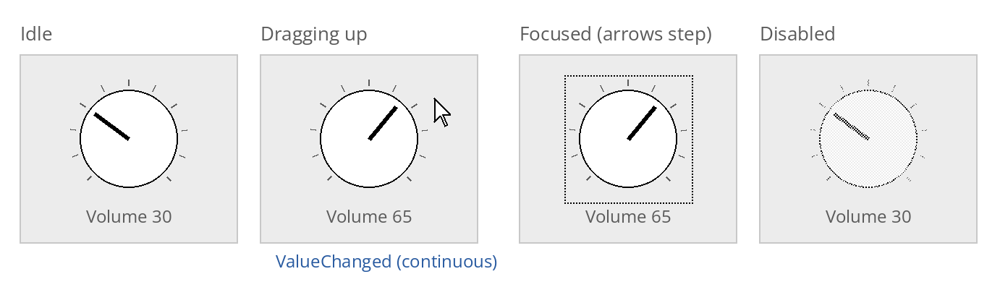

# Dial: widget roadmap

> **Issue:** [#127](https://github.com/KenSuenobu/rust-pushrod/issues/127) (3.12) · **Epic 3:** Value and choice controls · **Release:** after the MVP · **Size:** S
> **User docs:** `pushrod-docs/docs/widgets/dial.md` · **Overview:** [main roadmap](../ROADMAP_EXTENSIBLE_WIDGET_LIBRARY.md) · **Rules:** [design philosophy](../../DESIGN_PHILOSOPHY.md)

This file is the specification for this widget: what it is, what it does, and how it responds. To change its look or behavior, edit this file in a pull request (and its mockup in [`docs/mockups/generate.py`](../mockups/generate.py) if the picture changes), then bring the issue in line. If this file and the issue disagree, this file wins.

## What it is

A round control turned by dragging, the wheel, or the keyboard, for values like volume, pan, or angle.

Some values are naturally rotary (volume, pan, gain, angle), and a dial takes less space than a slider.

*Ideas from:* Dials in Qt and in audio and instrument software. Names and behavior are Pushrod's own.

## What it does

`Dial { min, max, value, step, wrapping, notches }`: circle with an indicator line and optional notch marks around the rim; drag vertically or circularly to turn, mouse wheel and arrow keys step, Page Up/Down page. `wrapping` lets the value roll over (angles). Optional value text below. Emits `ValueChanged` continuously and `EditingFinished` on release; outline drawing mode defers dependent work to release ([10.1](https://github.com/KenSuenobu/rust-pushrod/issues/105)).

## How it looks

Each image shows the widget step by step, drawn in Pushrod's current style; blue notes name the event emitted. Mockups come from [`docs/mockups/generate.py`](https://github.com/KenSuenobu/rust-pushrod/blob/main/docs/mockups/generate.py): edit a frame there and re-run it to change the design,.

**Turning a dial: idle, dragging, focused, disabled**

Drawn flat, in the standard Pushrod style: fills, one-pixel borders, and text; inverted when pressed or selected, dithered when disabled, a dotted outline when focused. No bevels, gradients, shadows, glass, or rounded corners (see the [design philosophy](../../DESIGN_PHILOSOPHY.md)).

## How it responds

### Events and callbacks

| Event emitted | When | Application callback |
|---|---|---|
| `ValueChanged { id }` | While turning | `on_value_change(id, ..)` |
| `EditingFinished { id }` | Drag released | `on_editing_finished(id, ..)` |

Like every widget, it can also receive application-defined custom events in `handle_event` and emit its own (1.13 (#78)).

### Shared behavior

Like every Pushrod widget, it gets these from the core rather than implementing them itself:

- behavior flags (selectable, default, exit, disabled, hidden, ...) and visual states ([1.1](https://github.com/KenSuenobu/rust-pushrod/issues/19))
- per-state appearance (normal, selected, hovered, pressed, drag-over, disabled), with `MouseEntered` / `MouseExited` ([1.17](https://github.com/KenSuenobu/rust-pushrod/issues/104))
- keyboard focus, Tab order, Return/Escape ([1.4](https://github.com/KenSuenobu/rust-pushrod/issues/20))
- callbacks registered by widget ID ([1.6](https://github.com/KenSuenobu/rust-pushrod/issues/22))
- custom application events with payloads, received in `handle_event` ([1.13](https://github.com/KenSuenobu/rust-pushrod/issues/78))
- composite parts the application can retrieve and modify ([5.2](https://github.com/KenSuenobu/rust-pushrod/issues/57))
- engine events for every internal action ([9.10](https://github.com/KenSuenobu/rust-pushrod/issues/109))
- live or outline drawing modes, switchable at run time ([10.1](https://github.com/KenSuenobu/rust-pushrod/issues/105))

## Acceptance criteria

- [ ] Drag, wheel, and keys change the value within range
- [ ] Wrapping mode for angles
- [ ] Notches and optional value text

## Depends on

Requires [1.6](https://github.com/KenSuenobu/rust-pushrod/issues/22), [9.4](https://github.com/KenSuenobu/rust-pushrod/issues/96).

## Implementation notes

- **Modules:** `dial.rs (new)`
- **Stack:** Rust
- **Drawing:** paints into its own GPU texture only when invalidated; frames are composed by blitting. No OS-native controls; no per-frame CPU pixel work.
