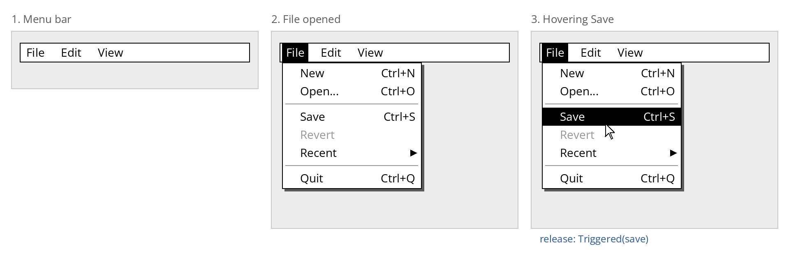

# Menu Bar and Menus: widget roadmap

> **Issue:** [#37](https://github.com/KenSuenobu/rust-pushrod/issues/37) (2.11) · **Epic 2:** Core dialog widgets · **Release:** after the MVP · **Size:** L
> **User docs:** `pushrod-docs/docs/widgets/menu-bar-and-menus.md` · **Overview:** [main roadmap](../ROADMAP_EXTENSIBLE_WIDGET_LIBRARY.md) · **Rules:** [design philosophy](../../DESIGN_PHILOSOPHY.md)

This file is the specification for this widget: what it is, what it does, and how it responds. To change its look or behavior, edit this file in a pull request (and its mockup in [`docs/mockups/generate.py`](../mockups/generate.py) if the picture changes), then bring the issue in line. If this file and the issue disagree, this file wins.

## What it is

Menu bar with drop-down menus, separators, check marks, submenus, shortcuts, and mnemonics.

Desktop applications need menus that look and behave the same on every platform.

*Ideas from:* Menus on every desktop system; shared actions from Qt. Names and behavior are Pushrod's own.

## What it does

`MenuBar` and `Menu` widgets built as composites ([5.2](https://github.com/KenSuenobu/rust-pushrod/issues/57)). Items come from actions ([9.5](https://github.com/KenSuenobu/rust-pushrod/issues/97)) or plain labels; support separators, check/radio items, disabled items, submenus, shortcut text, and mnemonics ([1.12](https://github.com/KenSuenobu/rust-pushrod/issues/76)). Menus open on click, track the pointer, draw in the overlay layer above all widgets, and close on outside click or Escape. Never uses the OS menu bar or native menus. **Parts ([5.2](https://github.com/KenSuenobu/rust-pushrod/issues/57)):** `MenuBar::menus()`, `Menu::items()`, `add_item`, `insert_item`, `remove_item`, `add_separator`; each item is a part with its own font and color. Every part can be retrieved and restyled (font, color, text). Emits its engine event ([9.10](https://github.com/KenSuenobu/rust-pushrod/issues/109)).

## How it looks

Each image shows the widget step by step, drawn in Pushrod's current style; blue notes name the event emitted. Mockups come from [`docs/mockups/generate.py`](https://github.com/KenSuenobu/rust-pushrod/blob/main/docs/mockups/generate.py): edit a frame there and re-run it to change the design,.

**1. Idle 2. File opened (overlay) 3. Hovering Save 4. Release: Save triggered**

Drawn flat, in the standard Pushrod style: fills, one-pixel borders, and text; inverted when pressed or selected, dithered when disabled, a dotted outline when focused. No bevels, gradients, shadows, glass, or rounded corners (see the [design philosophy](../../DESIGN_PHILOSOPHY.md)).

## How it responds

### Events and callbacks

| Event emitted | When | Application callback |
|---|---|---|
| `Triggered { action }` | Item chosen by mouse, shortcut, or mnemonic | `on_action(action, ..)` ([9.5](https://github.com/KenSuenobu/rust-pushrod/issues/97)) or `on_click(item_id, ..)` |

Like every widget, it can also receive application-defined custom events in `handle_event` and emit its own (1.13 (#78)).

### Shared behavior

Like every Pushrod widget, it gets these from the core rather than implementing them itself:

- behavior flags (selectable, default, exit, disabled, hidden, ...) and visual states ([1.1](https://github.com/KenSuenobu/rust-pushrod/issues/19))
- per-state appearance (normal, selected, hovered, pressed, drag-over, disabled), with `MouseEntered` / `MouseExited` ([1.17](https://github.com/KenSuenobu/rust-pushrod/issues/104))
- keyboard focus, Tab order, Return/Escape ([1.4](https://github.com/KenSuenobu/rust-pushrod/issues/20))
- callbacks registered by widget ID ([1.6](https://github.com/KenSuenobu/rust-pushrod/issues/22))
- custom application events with payloads, received in `handle_event` ([1.13](https://github.com/KenSuenobu/rust-pushrod/issues/78))
- composite parts the application can retrieve and modify ([5.2](https://github.com/KenSuenobu/rust-pushrod/issues/57))
- engine events for every internal action ([9.10](https://github.com/KenSuenobu/rust-pushrod/issues/109))
- live or outline drawing modes, switchable at run time ([10.1](https://github.com/KenSuenobu/rust-pushrod/issues/105))

## Acceptance criteria

- [ ] Menus open, track, select, and close correctly
- [ ] Submenus and keyboard navigation
- [ ] No OS-native menu APIs on any platform
- [ ] Parts are retrievable and modifiable as described
- [ ] Emits the corresponding `EngineEvent` ([9.10](https://github.com/KenSuenobu/rust-pushrod/issues/109))

## Depends on

Requires [1.1](https://github.com/KenSuenobu/rust-pushrod/issues/19), [1.12](https://github.com/KenSuenobu/rust-pushrod/issues/76), [5.1](https://github.com/KenSuenobu/rust-pushrod/issues/56), [5.2](https://github.com/KenSuenobu/rust-pushrod/issues/57), [9.5](https://github.com/KenSuenobu/rust-pushrod/issues/97).

## Implementation notes

- **Crate:** `pushrod-widgets`, using only the public API of the `pushrod` core. Shared behavior (states, focus, events) comes from the core; anything the widget needs that the core doesn't expose is added to the core first.
- **Modules:** `pushrod-widgets/src/menu.rs (new)`, `src/cache.rs`, `src/engine.rs`
- **Stack:** Rust
- **Drawing:** paints into its own GPU texture only when invalidated; frames are composed by blitting. No OS-native controls; no per-frame CPU pixel work.

## Sources

- [Qt: QAction (shared commands for menus, toolbars, shortcuts)](https://doc.qt.io/qt-6/qaction.html)
