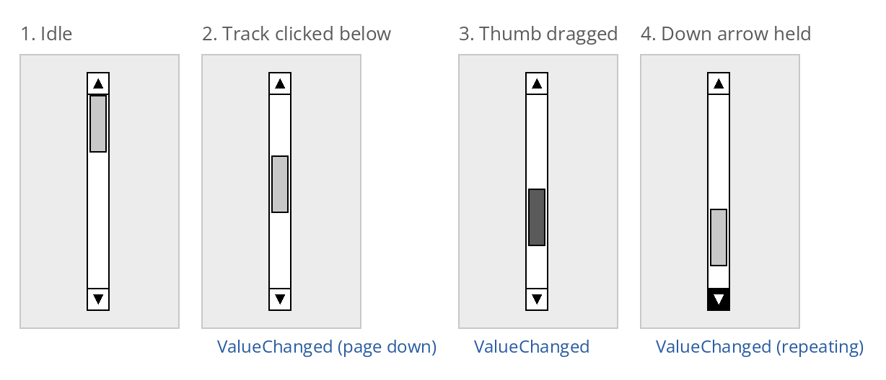
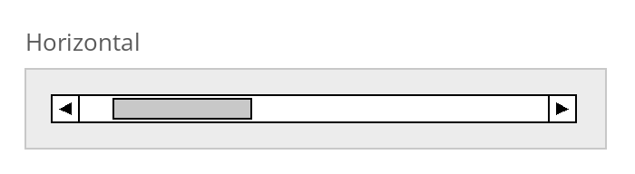

# Scroll Bar: widget roadmap

> **Issue:** [#39](https://github.com/KenSuenobu/rust-pushrod/issues/39) (3.1) · **Epic 3:** Value and choice controls · **Release:** MVP (v0.1) · **Size:** M
> **User docs:** `pushrod-docs/docs/widgets/scroll-bar.md` · **Overview:** [main roadmap](../ROADMAP_EXTENSIBLE_WIDGET_LIBRARY.md) · **Rules:** [design philosophy](../../DESIGN_PHILOSOPHY.md)

This file is the specification for this widget: what it is, what it does, and how it responds. To change its look or behavior, edit this file in a pull request (and its mockup in [`docs/mockups/generate.py`](../mockups/generate.py) if the picture changes), then bring the issue in line. If this file and the issue disagree, this file wins.

## What it is

Vertical/horizontal scroll bar with arrows and a proportional thumb.

Containers, lists, and text areas need scroll bars; older systems made applications assemble them by hand.

*Ideas from:* Proportional scroll bars on AmigaOS, Motif, NeXTSTEP, and later the Mac. Names and behavior are Pushrod's own.

## What it does

`ScrollBar` composite ([5.2](https://github.com/KenSuenobu/rust-pushrod/issues/57)): two glyph buttons (activate-on-press with auto-repeat), a track, and a draggable thumb sized by `visible / total`. Value 0.0 to 1.0 plus page size; clicking the track pages. Emits `ValueChanged`. **Parts ([5.2](https://github.com/KenSuenobu/rust-pushrod/issues/57)):** `ScrollBarParts { up, down, track, thumb }` (colors and glyphs customizable). Every part can be retrieved and restyled (font, color, text).

## How it looks

Each image shows the widget step by step, drawn in Pushrod's current style; blue notes name the event emitted. Mockups come from [`docs/mockups/generate.py`](https://github.com/KenSuenobu/rust-pushrod/blob/main/docs/mockups/generate.py): edit a frame there and re-run it to change the design,.

**1. Idle 2. Track clicked below thumb (page down) 3. Thumb dragged 4. Down arrow held**

**Horizontal**

Drawn flat, in the standard Pushrod style: fills, one-pixel borders, and text; inverted when pressed or selected, dithered when disabled, a dotted outline when focused. No bevels, gradients, shadows, glass, or rounded corners (see the [design philosophy](../../DESIGN_PHILOSOPHY.md)).

## How it responds

### Events and callbacks

| Event emitted | When | Application callback |
|---|---|---|
| `ValueChanged { id }` | Position changes; read `value()` | `on_value_change(id, ..)` |

Like every widget, it can also receive application-defined custom events in `handle_event` and emit its own (1.13 (#78)).

### Shared behavior

Like every Pushrod widget, it gets these from the core rather than implementing them itself:

- behavior flags (selectable, default, exit, disabled, hidden, ...) and visual states ([1.1](https://github.com/KenSuenobu/rust-pushrod/issues/19))
- per-state appearance (normal, selected, hovered, pressed, drag-over, disabled), with `MouseEntered` / `MouseExited` ([1.17](https://github.com/KenSuenobu/rust-pushrod/issues/104))
- keyboard focus, Tab order, Return/Escape ([1.4](https://github.com/KenSuenobu/rust-pushrod/issues/20))
- callbacks registered by widget ID ([1.6](https://github.com/KenSuenobu/rust-pushrod/issues/22))
- custom application events with payloads, received in `handle_event` ([1.13](https://github.com/KenSuenobu/rust-pushrod/issues/78))
- composite parts the application can retrieve and modify ([5.2](https://github.com/KenSuenobu/rust-pushrod/issues/57))
- engine events for every internal action ([9.10](https://github.com/KenSuenobu/rust-pushrod/issues/109))
- live or outline drawing modes, switchable at run time ([10.1](https://github.com/KenSuenobu/rust-pushrod/issues/105))

## Acceptance criteria

- [x] Drag, arrows with repeat, track paging
- [x] Thumb size reflects proportion
- [x] Parts are retrievable and modifiable as described

## Depends on

Requires [1.5](https://github.com/KenSuenobu/rust-pushrod/issues/21), [1.6](https://github.com/KenSuenobu/rust-pushrod/issues/22), [2.2 Glyph Button](glyph-button.md), [5.2](https://github.com/KenSuenobu/rust-pushrod/issues/57).

## Implementation notes

- **Crate:** `pushrod-widgets`, using only the public API of the `pushrod` core. Shared behavior (states, focus, events) comes from the core; anything the widget needs that the core doesn't expose is added to the core first.
- **Modules:** `pushrod-widgets/src/scroll_bar.rs (new)`
- **Stack:** Rust
- **Drawing:** paints into its own GPU texture only when invalidated; frames are composed by blitting. No OS-native controls; no per-frame CPU pixel work.

## Sources

- [AmigaOS GadTools autodoc (gadget kinds, underlined keyboard equivalents)](https://amigadev.grimore.org/Includes_and_Autodocs_2._guide/node05a3.html)
- [ICS: Motif widget descriptions](https://motif.ics.com/book/export/html/341)
- [OpenStep specification: controls and target/action](https://www.ict.griffith.edu.au/teaching/2501ICT/archive/resources/OpenStepSpec/ApplicationKit/Classes/NSControl.html)
