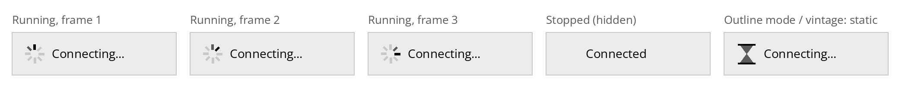

# Spinner: widget roadmap

> **Issue:** [#128](https://github.com/KenSuenobu/rust-pushrod/issues/128) (4.10) · **Epic 4:** Lists, tables, progress, spin boxes, and tabs · **Release:** after the MVP · **Size:** S
> **User docs:** `pushrod-docs/docs/widgets/spinner.md` · **Overview:** [main roadmap](../ROADMAP_EXTENSIBLE_WIDGET_LIBRARY.md) · **Rules:** [design philosophy](../../DESIGN_PHILOSOPHY.md)

This file is the specification for this widget: what it is, what it does, and how it responds. To change its look or behavior, edit this file in a pull request (and its mockup in [`docs/mockups/generate.py`](../mockups/generate.py) if the picture changes), then bring the issue in line. If this file and the issue disagree, this file wins.

## What it is

A small animated indicator for work of unknown length, for use inline or on buttons.

Short waits of unknown length (connecting, loading a list) need a compact busy indicator that fits next to a label or inside a button, where a progress bar doesn't fit.

*Ideas from:* Busy spinners on the Mac, in Qt and GTK, and the indeterminate HTML progress element. Names and behavior are Pushrod's own.

## What it does

`Spinner { running, size }`: a ring of segments with one highlighted segment rotating, driven by timer ticks ([1.5](https://github.com/KenSuenobu/rust-pushrod/issues/21)) only while running and visible (no ticks when stopped, so idle applications stay idle). `start()`, `stop()`, optional `hide_when_stopped`. In outline drawing mode ([10.1](https://github.com/KenSuenobu/rust-pushrod/issues/105)) and on vintage backends it shows a static hourglass glyph instead of animating. Display only.

## How it looks

Each image shows the widget step by step, drawn in Pushrod's current style; blue notes name the event emitted. Mockups come from [`docs/mockups/generate.py`](https://github.com/KenSuenobu/rust-pushrod/blob/main/docs/mockups/generate.py): edit a frame there and re-run it to change the design,.

**Spinner frames while running, stopped, and the outline-mode fallback**

Drawn flat, in the standard Pushrod style: fills, one-pixel borders, and text; inverted when pressed or selected, dithered when disabled, a dotted outline when focused. No bevels, gradients, shadows, glass, or rounded corners (see the [design philosophy](../../DESIGN_PHILOSOPHY.md)).

## How it responds

### Events and callbacks

| Event emitted | When | Application callback |
|---|---|---|
| (none) | Display only; control with `start()` / `stop()` | n/a |

Like every widget, it can also receive application-defined custom events in `handle_event` and emit its own (1.13 (#78)).

### Shared behavior

Like every Pushrod widget, it gets these from the core rather than implementing them itself:

- behavior flags (selectable, default, exit, disabled, hidden, ...) and visual states ([1.1](https://github.com/KenSuenobu/rust-pushrod/issues/19))
- per-state appearance (normal, selected, hovered, pressed, drag-over, disabled), with `MouseEntered` / `MouseExited` ([1.17](https://github.com/KenSuenobu/rust-pushrod/issues/104))
- keyboard focus, Tab order, Return/Escape ([1.4](https://github.com/KenSuenobu/rust-pushrod/issues/20))
- callbacks registered by widget ID ([1.6](https://github.com/KenSuenobu/rust-pushrod/issues/22))
- custom application events with payloads, received in `handle_event` ([1.13](https://github.com/KenSuenobu/rust-pushrod/issues/78))
- composite parts the application can retrieve and modify ([5.2](https://github.com/KenSuenobu/rust-pushrod/issues/57))
- engine events for every internal action ([9.10](https://github.com/KenSuenobu/rust-pushrod/issues/109))
- live or outline drawing modes, switchable at run time ([10.1](https://github.com/KenSuenobu/rust-pushrod/issues/105))

## Acceptance criteria

- [ ] Animates only while running and visible
- [ ] Static fallback in outline mode
- [ ] Fits inline with text and inside buttons

## Depends on

Requires [1.5](https://github.com/KenSuenobu/rust-pushrod/issues/21).

## Implementation notes

- **Crate:** `pushrod-widgets`, using only the public API of the `pushrod` core. Shared behavior (states, focus, events) comes from the core; anything the widget needs that the core doesn't expose is added to the core first.
- **Modules:** `pushrod-widgets/src/spinner.rs (new)`
- **Stack:** Rust
- **Drawing:** paints into its own GPU texture only when invalidated; frames are composed by blitting. No OS-native controls; no per-frame CPU pixel work.
