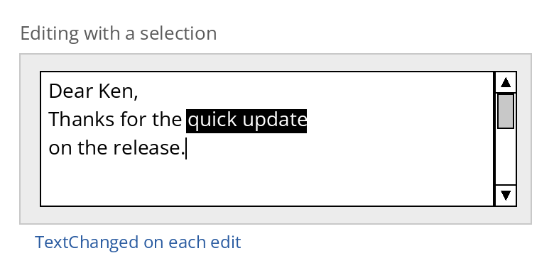

# Text Area: widget roadmap

> **Issue:** [#87](https://github.com/KenSuenobu/rust-pushrod/issues/87) (2.18) · **Epic 2:** Core dialog widgets · **Release:** after the MVP · **Size:** L
> **User docs:** `pushrod-docs/docs/widgets/text-area.md` · **Overview:** [main roadmap](../ROADMAP_EXTENSIBLE_WIDGET_LIBRARY.md) · **Rules:** [design philosophy](../../DESIGN_PHILOSOPHY.md)

This file is the specification for this widget: what it is, what it does, and how it responds. To change its look or behavior, edit this file in a pull request (and its mockup in [`docs/mockups/generate.py`](../mockups/generate.py) if the picture changes), then bring the issue in line. If this file and the issue disagree, this file wins.

## What it is

Multi-line plain-text editing with scrolling, selection, clipboard, and undo.

Notes, descriptions, and logs need multi-line text, which a single-line field can't provide.

*Ideas from:* Plain-text editors in Qt, GTK, the classic Mac, and Windows. Names and behavior are Pushrod's own.

## What it does

`TextArea` in a container: line wrapping, caret and selection across lines, clipboard, undo ([1.15](https://github.com/KenSuenobu/rust-pushrod/issues/81)), read-only mode for logs, `append` for log output. Only visible lines are painted from the glyph atlas.

## How it looks

Each image shows the widget step by step, drawn in Pushrod's current style; blue notes name the event emitted. Mockups come from [`docs/mockups/generate.py`](https://github.com/KenSuenobu/rust-pushrod/blob/main/docs/mockups/generate.py): edit a frame there and re-run it to change the design,.

**Editing with a selection**

Drawn flat, in the standard Pushrod style: fills, one-pixel borders, and text; inverted when pressed or selected, dithered when disabled, a dotted outline when focused. No bevels, gradients, glass, or rounded corners (see the [design philosophy](../../DESIGN_PHILOSOPHY.md)).

## How it responds

### Events and callbacks

| Event emitted | When | Application callback |
|---|---|---|
| `TextChanged { id }` | Every edit | `on_text_change(id, ..)` |
| `EditingFinished { id }` | Focus loss | `on_editing_finished(id, ..)` |

Like every widget, it can also receive application-defined custom events in `handle_event` and emit its own (1.13 (#78)).

### Shared behavior

Like every Pushrod widget, it gets these from the core rather than implementing them itself:

- behavior flags (selectable, default, exit, disabled, hidden, ...) and visual states ([1.1](https://github.com/KenSuenobu/rust-pushrod/issues/19))
- per-state appearance (normal, selected, hovered, pressed, drag-over, disabled), with `MouseEntered` / `MouseExited` ([1.17](https://github.com/KenSuenobu/rust-pushrod/issues/104))
- keyboard focus, Tab order, Return/Escape ([1.4](https://github.com/KenSuenobu/rust-pushrod/issues/20))
- callbacks registered by widget ID ([1.6](https://github.com/KenSuenobu/rust-pushrod/issues/22))
- custom application events with payloads, received in `handle_event` ([1.13](https://github.com/KenSuenobu/rust-pushrod/issues/78))
- composite parts the application can retrieve and modify ([5.2](https://github.com/KenSuenobu/rust-pushrod/issues/57))
- engine events for every internal action ([9.10](https://github.com/KenSuenobu/rust-pushrod/issues/109))
- live or outline drawing modes, switchable at run time ([10.1](https://github.com/KenSuenobu/rust-pushrod/issues/105))

## Acceptance criteria

- [ ] Editing, selection, clipboard, undo
- [ ] Smooth with 10,000 lines

## Depends on

Requires [2.6 Text Field](text-field.md), [5.3 Container](container.md), [1.7](https://github.com/KenSuenobu/rust-pushrod/issues/3).

## Implementation notes

- **Modules:** `text_area.rs (new)`
- **Stack:** Rust
- **Drawing:** paints into its own GPU texture only when invalidated; frames are composed by blitting. No OS-native controls; no per-frame CPU pixel work.
