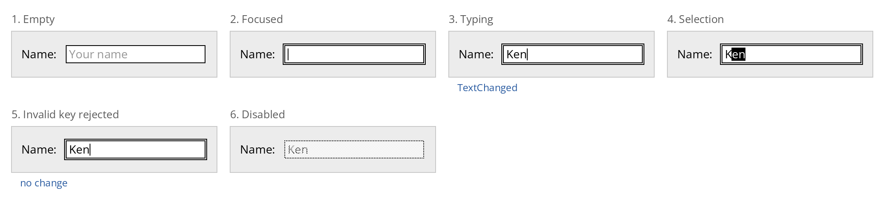
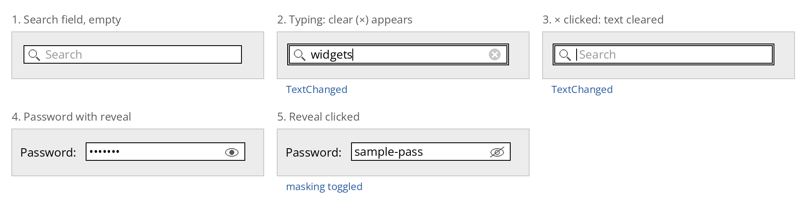

# Text Field: widget roadmap

> **Issue:** [#32](https://github.com/KenSuenobu/rust-pushrod/issues/32) (2.6) · **Epic 2:** Core dialog widgets · **Release:** MVP (v1) · **Size:** L
> **User docs:** `pushrod-docs/docs/widgets/text-field.md` · **Overview:** [main roadmap](../ROADMAP_EXTENSIBLE_WIDGET_LIBRARY.md) · **Rules:** [design philosophy](../../DESIGN_PHILOSOPHY.md)

This file is the specification for this widget: what it is, what it does, and how it responds. To change its look or behavior, edit this file in a pull request (and its mockup in [`docs/mockups/generate.py`](../mockups/generate.py) if the picture changes), then bring the issue in line. If this file and the issue disagree, this file wins.

## What it is

Single-line text entry with caret, selection, clipboard, input mask, validator, and numeric mode.

There is no text input. Fields need a caret, selection, clipboard, and a way to restrict and validate input.

*Ideas from:* Template-and-validation fields in GEM; numeric fields on AmigaOS; validators and input masks in Qt; combined label+field controls in Haiku. Names and behavior are Pushrod's own.

## What it does

Add `TextField`: caret (blinking via timers), selection with Shift+arrows and mouse drag, Home/End, word movement, clipboard via SDL, max length, placeholder text, password mode. Restrict input with an input mask (`"99/99/9999"`, `9` digit, `A` letter, `X` any) or a `Validator` trait (`validate(&str) -> Valid | Intermediate | Invalid`); `IntegerField`/`NumberField` presets with range. Optional built-in label (`with_label("Name:")`). Uses SDL text input events. Emits `TextChanged` on each edit and `EditingFinished` on Return or focus loss. Input method composition is handled per [1.19](https://github.com/KenSuenobu/rust-pushrod/issues/112). **Accessories:** a text field can show glyph buttons *inside* its editable area, at the leading and/or trailing edge (`with_leading(Accessory)`, `with_trailing(Accessory)`); text never runs underneath them. Built-in accessories: `Clear` (×, shown only when the field has text; clears it and emits `TextChanged`), `Search` (magnifier, leading, decorative or clickable), `RevealPassword` (eye, toggles password masking), and `Custom(glyph)` (emits `AccessoryClicked { id, which }`). `TextField::search()` is a preset: search glyph leading, clear trailing, `EditingFinished` on Return.

## How it looks

Each image shows the widget step by step, drawn in Pushrod's current style; blue notes name the event emitted. Mockups come from [`docs/mockups/generate.py`](https://github.com/KenSuenobu/rust-pushrod/blob/main/docs/mockups/generate.py): edit a frame there and re-run it to change the design,.

**1. empty 2. focused 3. typing 4. selection 5. rejected character 6. disabled**

**Input mask `99/99/9999`**

**Accessories: search field with clear button, password with reveal**

Drawn flat, in the standard Pushrod style: fills, one-pixel borders, and text; inverted when pressed or selected, dithered when disabled, a dotted outline when focused. No bevels, gradients, shadows, glass, or rounded corners (see the [design philosophy](../../DESIGN_PHILOSOPHY.md)).

## How it responds

### Events and callbacks

| Event emitted | When | Application callback |
|---|---|---|
| `TextChanged { id }` | Every edit; read `text()` | `on_text_change(id, ..)` |
| `EditingFinished { id }` | Return or focus loss (validate here) | `on_editing_finished(id, ..)` |
| `KeyPressed { id, key, modifiers }` | Keys while focused | `on_key_press(id, ..)` |
| `AccessoryClicked { id, which }` | A custom accessory glyph is clicked (Clear and RevealPassword act on their own) | `on_event(..)` |

Like every widget, it can also receive application-defined custom events in `handle_event` and emit its own (1.13 (#78)).

### Shared behavior

Like every Pushrod widget, it gets these from the core rather than implementing them itself:

- behavior flags (selectable, default, exit, disabled, hidden, ...) and visual states ([1.1](https://github.com/KenSuenobu/rust-pushrod/issues/19))
- per-state appearance (normal, selected, hovered, pressed, drag-over, disabled), with `MouseEntered` / `MouseExited` ([1.17](https://github.com/KenSuenobu/rust-pushrod/issues/104))
- keyboard focus, Tab order, Return/Escape ([1.4](https://github.com/KenSuenobu/rust-pushrod/issues/20))
- callbacks registered by widget ID ([1.6](https://github.com/KenSuenobu/rust-pushrod/issues/22))
- custom application events with payloads, received in `handle_event` ([1.13](https://github.com/KenSuenobu/rust-pushrod/issues/78))
- composite parts the application can retrieve and modify ([5.2](https://github.com/KenSuenobu/rust-pushrod/issues/57))
- engine events for every internal action ([9.10](https://github.com/KenSuenobu/rust-pushrod/issues/109))
- live or outline drawing modes, switchable at run time ([10.1](https://github.com/KenSuenobu/rust-pushrod/issues/105))

## Acceptance criteria

- [ ] Typing, deleting, caret movement, selection, copy/paste
- [ ] Masks and validators reject invalid input
- [ ] Numeric mode with range
- [ ] `EditingFinished` on Return and focus loss
- [ ] Leading/trailing accessories inside the edit area; text never overlaps them
- [ ] `Clear`, `Search`, `RevealPassword`, and custom accessories; `TextField::search()` preset

## Depends on

Requires [1.4](https://github.com/KenSuenobu/rust-pushrod/issues/20), [1.5](https://github.com/KenSuenobu/rust-pushrod/issues/21), [1.6](https://github.com/KenSuenobu/rust-pushrod/issues/22), [1.19](https://github.com/KenSuenobu/rust-pushrod/issues/112).

## Implementation notes

- **Crate:** `pushrod-widgets`, using only the public API of the `pushrod` core. Shared behavior (states, focus, events) comes from the core; anything the widget needs that the core doesn't expose is added to the core first.
- **Modules:** `pushrod-widgets/src/text_field.rs (new)`, `src/paint.rs`
- **Stack:** Rust, SDL2 text input and clipboard
- **Drawing:** paints into its own GPU texture only when invalidated; frames are composed by blitting. No OS-native controls; no per-frame CPU pixel work.

## Sources

- [GEM AES object structure (flags, states, object tree)](https://www.seasip.info/Gem/aestruct.html)
- [AmigaOS GadTools autodoc (gadget kinds, underlined keyboard equivalents)](https://amigadev.grimore.org/Includes_and_Autodocs_2._guide/node05a3.html)
