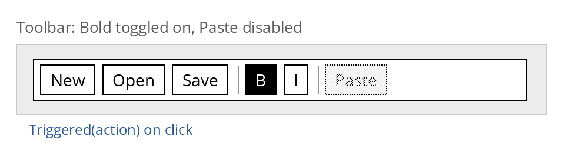

# Toolbar: widget roadmap

> **Issue:** [#84](https://github.com/KenSuenobu/rust-pushrod/issues/84) (2.15) · **Epic 2:** Core dialog widgets · **Release:** after the MVP · **Size:** M
> **User docs:** `pushrod-docs/docs/widgets/toolbar.md` · **Overview:** [main roadmap](../ROADMAP_EXTENSIBLE_WIDGET_LIBRARY.md) · **Rules:** [design philosophy](../../DESIGN_PHILOSOPHY.md)

This file is the specification for this widget: what it is, what it does, and how it responds. To change its look or behavior, edit this file in a pull request (and its mockup in [`docs/mockups/generate.py`](../mockups/generate.py) if the picture changes), then bring the issue in line. If this file and the issue disagree, this file wins.

## What it is

A row of icon/text buttons bound to actions.

Frequent commands should be one click away.

*Ideas from:* Toolbars in Windows, the Mac, Qt, and GTK. Names and behavior are Pushrod's own.

## What it does

`Toolbar` composite of tool buttons created from actions ([9.5](https://github.com/KenSuenobu/rust-pushrod/issues/97)): icon and/or text, toggle actions stay pressed, disabled actions gray out, tooltips from the action. Overflow items move into a '>>' menu. **Parts ([5.2](https://github.com/KenSuenobu/rust-pushrod/issues/57)):** `items()`, `add_action`, `insert_action`, `remove_item`; each tool button is a part. Every part can be retrieved and restyled (font, color, text). Tool buttons are image buttons ([2.21 Image Button](image-button.md)).

## How it looks

Each image shows the widget step by step, drawn in Pushrod's current style; blue notes name the event emitted. Mockups come from [`docs/mockups/generate.py`](https://github.com/KenSuenobu/rust-pushrod/blob/main/docs/mockups/generate.py): edit a frame there and re-run it to change the design,.

**Toolbar with a toggled Bold and a disabled Paste**

Drawn flat, in the standard Pushrod style: fills, one-pixel borders, and text; inverted when pressed or selected, dithered when disabled, a dotted outline when focused. No bevels, gradients, shadows, glass, or rounded corners (see the [design philosophy](../../DESIGN_PHILOSOPHY.md)).

## How it responds

### Events and callbacks

| Event emitted | When | Application callback |
|---|---|---|
| `Triggered { action }` | A tool button is clicked | `on_action(action, ..)` |

Like every widget, it can also receive application-defined custom events in `handle_event` and emit its own (1.13 (#78)).

### Shared behavior

Like every Pushrod widget, it gets these from the core rather than implementing them itself:

- behavior flags (selectable, default, exit, disabled, hidden, ...) and visual states ([1.1](https://github.com/KenSuenobu/rust-pushrod/issues/19))
- per-state appearance (normal, selected, hovered, pressed, drag-over, disabled), with `MouseEntered` / `MouseExited` ([1.17](https://github.com/KenSuenobu/rust-pushrod/issues/104))
- keyboard focus, Tab order, Return/Escape ([1.4](https://github.com/KenSuenobu/rust-pushrod/issues/20))
- callbacks registered by widget ID ([1.6](https://github.com/KenSuenobu/rust-pushrod/issues/22))
- custom application events with payloads, received in `handle_event` ([1.13](https://github.com/KenSuenobu/rust-pushrod/issues/78))
- composite parts the application can retrieve and modify ([5.2](https://github.com/KenSuenobu/rust-pushrod/issues/57))
- engine events for every internal action ([9.10](https://github.com/KenSuenobu/rust-pushrod/issues/109))
- live or outline drawing modes, switchable at run time ([10.1](https://github.com/KenSuenobu/rust-pushrod/issues/105))

## Acceptance criteria

- [ ] Buttons reflect action state
- [ ] Overflow menu when too narrow
- [ ] Parts are retrievable and modifiable as described

## Depends on

Requires [9.5](https://github.com/KenSuenobu/rust-pushrod/issues/97), [5.2](https://github.com/KenSuenobu/rust-pushrod/issues/57), [2.21 Image Button](image-button.md).

## Implementation notes

- **Modules:** `toolbar.rs (new)`
- **Stack:** Rust
- **Drawing:** paints into its own GPU texture only when invalidated; frames are composed by blitting. No OS-native controls; no per-frame CPU pixel work.

## Sources

- [Qt: QAction (shared commands for menus, toolbars, shortcuts)](https://doc.qt.io/qt-6/qaction.html)
