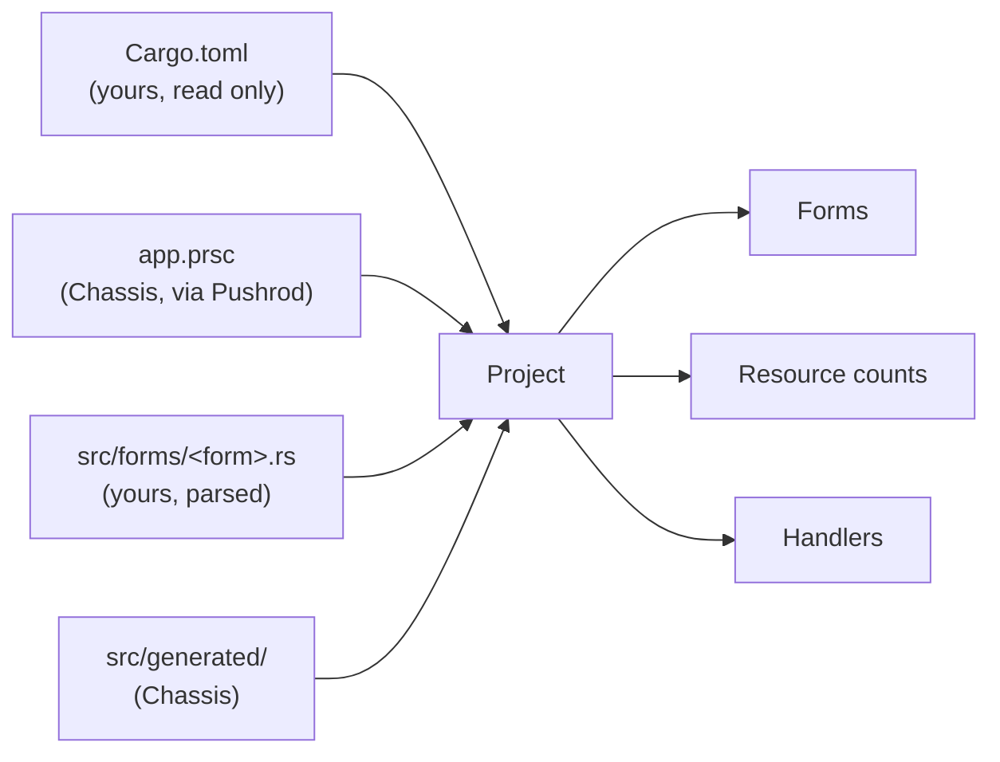
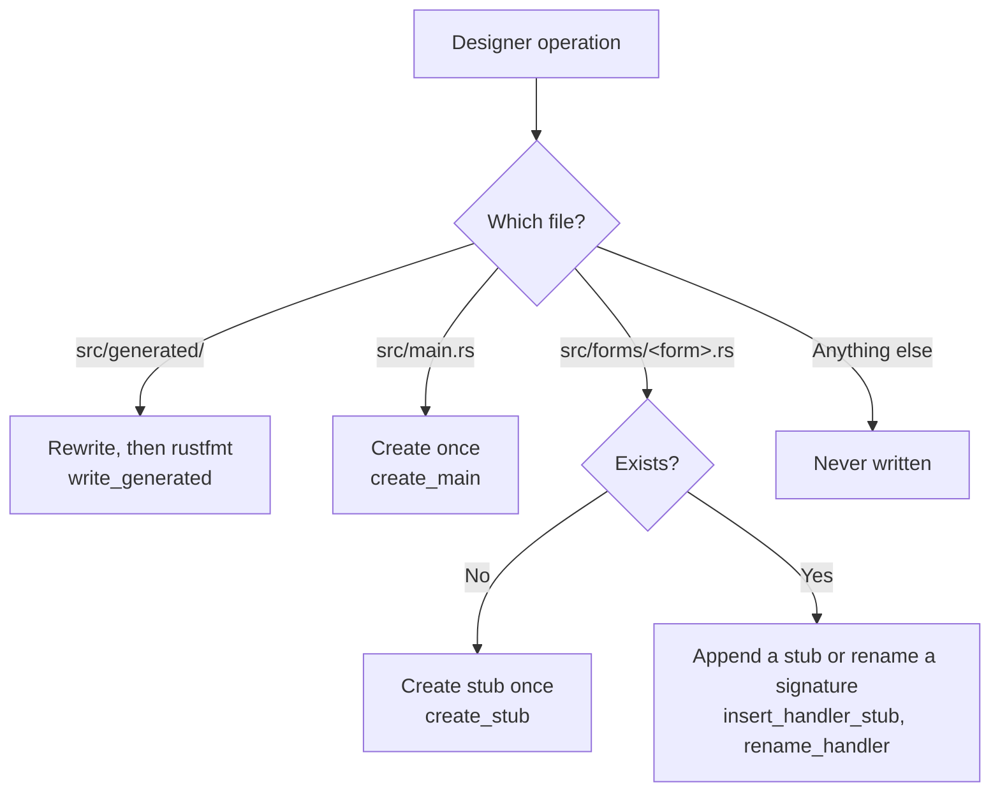

# Projects and resources

A Chassis **project** is an ordinary Cargo crate. Chassis has to know which of its files it may write and which are yours, so it can never overwrite your code. The `chassis` crate's `Project` type holds that knowledge. It has no window and is fully unit-tested.



## What a project contains

| Path | Owner | What Chassis may do |
|---|---|---|
| `Cargo.toml` | You | Read it. |
| `*.prsc` (the resource file) | Chassis | Read and write it, through Pushrod's form reader and writer. |
| `src/forms/<form>.rs` | You | Create a starter stub once, when the file does not exist. Never overwrite it. |
| `src/generated/**` | Chassis | Write and replace freely; it is regenerated. |
| Everything else | You | Read it. |

The resource file holds the forms, strings, images, icons, files, menus, and alerts. Its name comes from `[package.metadata.chassis] resources` in `Cargo.toml`; without that key, the project's only `*.prsc` file is used. A project with no resource file simply has no forms yet, and several `*.prsc` files without a named choice is an error.

A form's handler file is its name in lowercase words: `MainWindow` is `src/forms/main_window.rs`.

## Loading a project

```rust
use chassis::Project;

let project = Project::load("path/to/project")?;

println!("{} {}", project.package().name, project.package().version);

for form in project.forms() {
    for handler in project.handlers_for(&form.name) {
        println!("{}: {}", form.name, handler.signature);
    }
}
# Ok::<(), chassis::ProjectError>(())
```

`Project::load` reads `Cargo.toml` (with `toml_edit`), the resource file, and every `.rs` file in `src/forms` (with tree-sitter). A **handler** is a top-level `fn` in a handler file: its name, its signature as written, the file, and the line. The model reads the code on disk each time it loads, never a cached copy, so it matches what you wrote. `reload_handlers` re-reads the files after an edit. A handler file with syntax errors is reported as `ProjectError::Handlers`, naming the file.

## Ownership is enforced

`Project::ownership(path)` says who owns a path (`User`, `Handler`, `Resource`, or `Generated`). Chassis writes only through three methods, and each refuses what it must not touch with `ProjectError::Ownership`:

- `write_generated` writes under `src/generated` only; a path that leaves the folder (for example `src/generated/../main.rs`) is refused.
- `create_stub` creates a form's handler file only if it does not exist. If it exists, it is yours and stays untouched.
- `save_resources` and `create_resource_file` write the resource file, after checking it is valid.

## Code generation rules

Chassis follows written rules when it writes code, and tests in `chassis/tests/codegen.rs` enforce them. The functions live in `chassis::codegen`.



| Rule | Function |
|---|---|
| Chassis rewrites only `src/generated/`, and formats what it writes with `rustfmt`. Source that `rustfmt` rejects is not written. | `write_generated` |
| `src/main.rs` and `src/forms/<form>.rs` are created once. A file that exists is yours and is never overwritten. | `create_main`, `create_stub` |
| After that, Chassis only appends a handler stub. A function with the same name is never replaced. | `insert_handler_stub` |
| Or it renames a handler in its signature. Only the bytes of the name change; the new name must be a valid identifier that the file does not already use. | `rename_handler` |
| Chassis never edits a function body. Comments, spacing, and code outside the changed name are kept exactly. | all of the above |

A call to the old name inside a body (a recursive call, for example) is not updated; that code is yours. Every edit is parsed again before it is written, and a refused request leaves the file untouched.

## Try it

```bash
cargo run -p chassis --example project -- path/to/project
```

prints the project's name, its resource counts, each form with its handler file, and the handlers found in it.

To see the rules work on a copy of your project, add a handler stub to a form with:

```bash
cargo run -p chassis --example codegen -- path/to/project MainWindow "pub fn on_close() {}"
```

The example appends the stub to the form's handler file and lists the handlers. Running it again with the same function is refused, because the function already exists.
