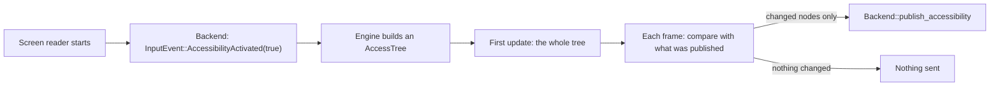

# Accessibility

Pushrod draws every control itself, so the operating system cannot see a button or a text field. To work with a screen reader, an application publishes an **accessibility tree**: each widget's role, name, value, and state, plus the actions it accepts. Pushrod builds that tree from the widget tree, sends only what changed, and builds nothing until a screen reader is running.

## What a widget tells a screen reader

`Widget::accessibility()` returns an `AccessInfo`:

| Field | Meaning |
|---|---|
| `role` | `Role::Button`, `CheckBox`, `RadioButton`, `TextInput`, `PasswordInput`, `Slider`, `ScrollBar`, `ProgressIndicator`, `Label`, `Image`, `Group`, `Dialog`, `Separator`, `Window`, or `Generic` |
| `name` | The label that is read aloud. A mnemonic underscore is removed (`"_Save"` is read as "Save"). |
| `description` | Extra help, usually the tooltip. |
| `value` | A text field's text, or a slider's value as text. A password field reports only `*` for each character, never the password. |
| `numeric` | A slider, scroll bar, or determinate progress bar's value with its minimum, maximum, and step. |
| `toggled` | `True`, `False`, or `Mixed` for check boxes, radio buttons, and toggle buttons. |
| `selection` | The caret and selection of a text field, in characters. |
| `actions` | `CLICK`, `FOCUS`, `SET_VALUE`, `SET_TEXT`. |
| `disabled` | Set for disabled widgets. |

The default implementation is a `Generic` node named by the tooltip, with the checked state of a toggle and `FOCUS` when the widget is focusable. Every standard widget overrides it. A custom widget builds on the defaults:

```rust,ignore
fn accessibility(&self) -> AccessInfo {
    AccessInfo::of(self, Role::Button)
        .with_name(&self.label)
        .with_actions(AccessActions::CLICK | AccessActions::FOCUS)
}
```

Hidden widgets, and everything inside them, are left out of the tree. Composite parts are ordinary child widgets, so they appear as children of their composite.

## Lazy and incremental



- **Lazy:** until `AccessibilityActivated(true)` (or `Engine::set_accessibility_active(true)`), no tree exists and `Engine::accessibility_update()` returns `None`.
- **Keyed by `WidgetId`:** a node's identity is its widget's stable ID.
- **Incremental:** `AccessTree::update` compares each visible widget's `AccessInfo`, bounds, children, and focus with what it published last, and returns an `AccessUpdate` holding only the nodes that changed. `AccessUpdate::removed` lists the IDs that left the tree, and `AccessUpdate::focus` the focused widget. Only the first update (`full: true`) holds every node.

The engine publishes at the end of each frame, in `Engine::run` and in `Engine::next_event`, by calling `Backend::publish_accessibility`.

## Actions

A screen reader's request arrives as `InputEvent::AccessAction { id, action }`, or by calling `Engine::perform_access_action(id, action, state)`. It takes the same paths user input takes, so the same callbacks run:

| `AccessAction` | What happens |
|---|---|
| `Click` | The widget receives `Event::Activated`, as with Return or a mnemonic: a button clicks (`on_click`), a check box toggles (`on_toggle`). |
| `Focus` | Keyboard focus moves to the widget (`on_focus_change`). |
| `SetValue(f64)` | The `value` property is set, then `ValueChanged` is sent (`on_value_change`). |
| `SetText(String)` | The `text` property is set, then `TextChanged` is sent (`on_text_change`). |

A disabled or hidden widget, or one behind a modal dialog, refuses every action, and so does a widget without the property. `perform_access_action` returns `false` then. Each performed action emits `EngineEvent::AccessActionPerformed { id, action }`, and turning the tree on or off emits `EngineEvent::AccessibilityChanged { active }`. See [Engine events](../events/engine-events.md).

## Connecting a platform adapter

The core has no windowing dependency, so the platform adapter lives in the backend. Enable the `accesskit` cargo feature (`pushrod/accesskit`, also forwarded by `pushrod-widgets` and `pushrod-sdl2`), then:

- Convert each update with `AccessUpdate::to_accesskit()` and give it to an [AccessKit](https://github.com/AccessKit/accesskit) adapter.
- Convert the adapter's `ActionRequest` with `pushrod::accessibility::from_request`, and report it as `InputEvent::AccessAction`.
- Report `InputEvent::AccessibilityActivated(true)` when the adapter says assistive technology is active.

A text field is published as a text-input node with a text-run child that carries its characters, so the selection is exact for multi-byte text.

:::note
`pushrod-sdl2` does not yet bundle a platform adapter: it needs a native window handle on each platform. The tree, the conversion, and the action mapping are in the core and are tested without a window; the adapter wiring is the remaining step for a backend.
:::

## Try it

`cargo run -p pushrod-widgets --example accessibility` plays the part of the adapter on a small form: it prints the announced nodes, then performs `Focus`, `Click`, and `SetText` and prints only what changed. The tests are `pushrod-widgets/tests/accessibility.rs` and, with `--features accesskit`, `pushrod-widgets/tests/accesskit.rs`.
