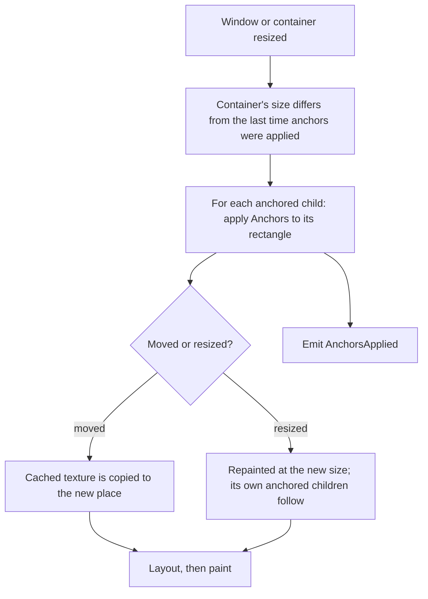

# Autoresizing

Forms are absolutely positioned, which is simple, but nothing adapts when a window or pane is resized. **Anchors** say how a child follows its container: keep a margin to an edge, or stretch. Absolute positioning stays the default, and there is no constraint solver: each axis is worked out from how much the container grew or shrank.

Anchors apply to containers **without a layout manager**. A container with a [layout](../layouts/layouts-overview.md) is arranged by the layout instead, and anchors on its children are ignored.



## Anchors

`Anchors` is a set of flags. Set it with `widget.set_anchors(anchors)`; read it with `widget.anchors()`.

| Flag | Meaning |
|---|---|
| `LEFT` | Keep the margin to the container's left edge. |
| `RIGHT` | Keep the margin to the right edge. |
| `TOP` | Keep the margin to the top edge. |
| `BOTTOM` | Keep the margin to the bottom edge. |
| `STRETCH_WIDTH` | Grow and shrink in width with the container. |
| `STRETCH_HEIGHT` | Grow and shrink in height with the container. |

On each axis:

| Anchored | Result when the container grows by `d` |
|---|---|
| Nothing, or only the near edge (`LEFT`, `TOP`) | The child stays where it is. This is the default. |
| Only the far edge (`RIGHT`, `BOTTOM`) | The child moves by `d`, keeping its distance to that edge. |
| Both edges (`LEFT \| RIGHT`, `TOP \| BOTTOM`), or the stretch flag | The child grows by `d`, keeping both margins. |

A size never goes below zero. The margins are the ones the child had when the container's size was first seen, so shrinking and growing back returns the child to where it started.

## Example

```rust checked title="src/main.rs"
use pushrod::backend::headless::HeadlessBackend;
use pushrod::cache::WidgetCache;
use pushrod::geometry::{point, size};
use pushrod::layout::Anchors;
use pushrod::root_widget::RootWidget;
use pushrod::widget::Widget;

fn main() {
    let mut cache = WidgetCache::new();
    let mut backend = HeadlessBackend::new(size(200, 100));

    cache.add(Box::new(RootWidget::new(size(200, 100))));

    // A status bar: stays at the bottom and stretches across.
    let mut bar = RootWidget::new(size(200, 20));

    bar.set_origin(point(0, 80));
    bar.set_anchors(Anchors::LEFT | Anchors::RIGHT | Anchors::BOTTOM);

    let bar = cache.add_child(0, Box::new(bar));

    // The first frame records the starting size; resizing the root moves the bar.
    cache.draw_loop(&mut backend);
    cache.get_mut(0).unwrap().set_size(size(300, 150));
    cache.draw_loop(&mut backend);

    assert_eq!(cache.get(bar).unwrap().get_origin(), point(0, 130));
    assert_eq!(cache.get(bar).unwrap().get_size(), size(300, 20));
}
```

In an engine, resizing the window resizes the root, and the anchors follow on the next frame. Nested containers follow in the same frame.

## Rules

- **Starting size.** The first frame after a container gets an anchored child records the container's size; nothing moves then. Later size changes move the children.
- **Cheap moves.** A child that only moved is not repainted; its cached texture is copied to the new place. A child that was resized is repainted.
- **Application size.** The size an application asked for with `set_size` is not changed by anchors.
- **Form files.** Anchors are stored in the `anchors` field of each object and restored by the loader. See [Form file format](../forms/form-file-format.md) and [Loading forms](../forms/loading-forms.md).

## Engine event

`AnchorsApplied { container, children }` is emitted once for each container that moved or resized `children` of its children. See [Engine events](../events/engine-events.md).

## Example program

`cargo run -p pushrod-widgets --example anchors` resizes a window headlessly and prints where a title, a stretching notes area, and a corner OK button end up.
