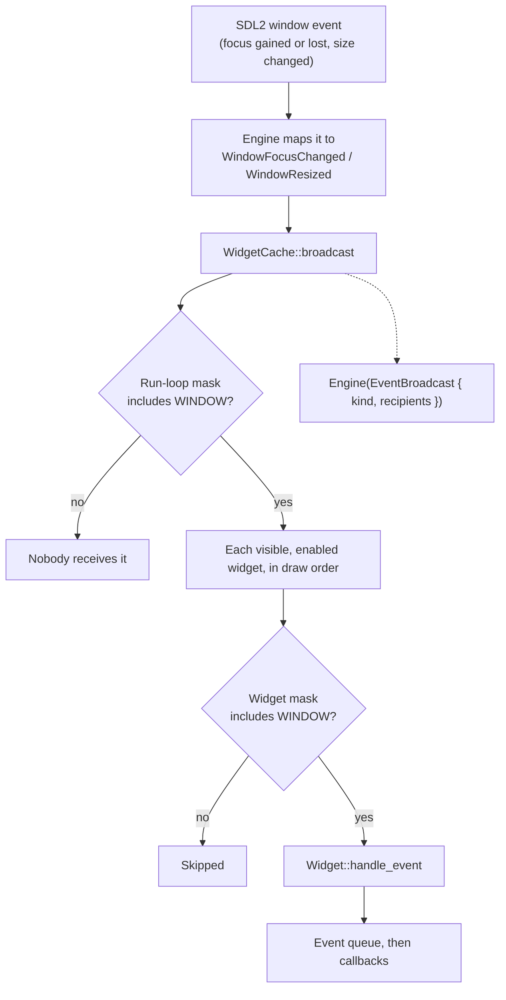

# Broadcast events to all interested widgets

Most events have a single target: a click goes to the widget under the pointer. Some events belong to no one widget. When the window gains or loses focus, or changes size, every widget that cares should hear about it. Pushrod **broadcasts** these events.

## Who receives a broadcast

`WidgetCache::broadcast(&event)` delivers the event to a widget when **all** of these are true:

- The widget is **visible**: neither it nor any of its ancestors is hidden.
- The widget is **enabled**.
- The event's class (see [event masks](./event-masks-for-the-run-loop-and-for-widgets.md)) is in both the run-loop mask and the widget's own mask. Window events use `EventMask::WINDOW`.

Delivery is in **draw order**: parents before children, siblings in the order they were added. The order is the same every time.



## Window events

| SDL2 | Widgets receive |
|---|---|
| Window gains focus | `Event::WindowFocusChanged { focused: true }` |
| Window loses focus | `Event::WindowFocusChanged { focused: false }` |
| Window size changes | `Event::WindowResized { size }` |

Exposure (the window needs repainting) is not broadcast. Resizing and exposure also repaint every widget, as before.

:::note
Keyboard events are **not** broadcast. They go to the focused widget and bubble up, once keyboard focus is in place.
:::

## Asking for broadcasts

A widget asks for window events by putting `WINDOW` in its mask, then handles them in `handle_event`:

```rust checked title="src/lib.rs"
use pushrod::event::{Event, EventCtx, EventMask};
use pushrod::geometry::{Point, Size};
use pushrod::paint::Painter;
use pushrod::widget::{Widget, WidgetCore};

/// A widget that reports whether the window has focus.
pub struct FocusBanner {
    core: WidgetCore,
    focused: bool,
}

impl Default for FocusBanner {
    fn default() -> Self {
        Self::new()
    }
}

impl FocusBanner {
    pub fn new() -> Self {
        let mut core = WidgetCore::new(Point::new(0, 0), Size::new(100, 20));

        core.set_event_mask(EventMask::WINDOW);

        Self {
            core,
            focused: true,
        }
    }
}

impl Widget for FocusBanner {
    fn core(&self) -> &WidgetCore {
        &self.core
    }

    fn core_mut(&mut self) -> &mut WidgetCore {
        &mut self.core
    }

    fn paint(&self, _p: &mut dyn Painter) {}

    fn handle_event(&mut self, event: &Event, _ctx: &mut EventCtx) {
        if let Event::WindowFocusChanged { focused } = event {
            self.focused = *focused;
            self.set_invalidated(true);
        }
    }
}
```

## The broadcast engine event

Every broadcast emits `Event::Engine(EngineEvent::EventBroadcast { kind, recipients })` after delivery: `kind` is the broadcast event's `EventKind` and `recipients` is how many widgets received it. See [Engine events](../events/engine-events.md). Engine events are never broadcast through this path again, so it cannot loop.

## Broadcasting your own events

`WidgetCache::broadcast` is public, so a library can send any [`Event`](../events/event-reference.md) to every interested widget. Custom application events with a broadcast target arrive with the custom-events feature.
