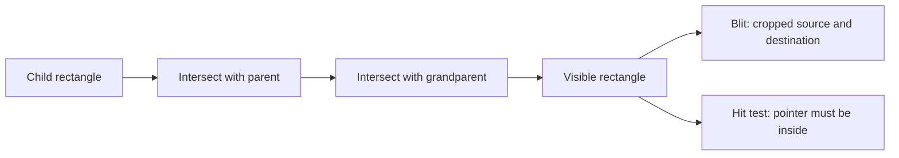

# Clip children to their parent's bounds

A child never draws or receives the pointer outside its parent. A widget's **visible rectangle** is its own rectangle intersected with each of its ancestors' rectangles, in window coordinates.



## Rules

- **Drawing.** `draw_loop` copies only the visible part of each widget's cached texture. `Backend::draw_widget(id, source, dest)` receives the cropped `source` (relative to the widget's corner) and `dest` (window coordinates), which are the same size. A widget with no visible part is not blitted. Widgets are still painted once into their own texture; clipping costs no repainting.
- **Input.** `WidgetCache::widget_at(x, y)` tests the visible rectangle, so the cropped part of a child does not catch the pointer, and whatever is underneath it does.
- **Overlays opt out.** A widget with `Behavior::OVERLAY` (menus, tooltips, pop-ups) is not clipped by its ancestors. Its own children are still clipped to it.

## Asking for the visible rectangle

```rust checked
use pushrod::cache::WidgetCache;
use pushrod::geometry::{Rect, point, size};
use pushrod::root_widget::RootWidget;
use pushrod::widget::Widget;

fn main() {
    let mut cache = WidgetCache::new();

    cache.add(Box::new(RootWidget::new(size(100, 100))));

    let mut child = RootWidget::new(size(30, 30));

    child.set_origin(point(90, 80));

    let id = cache.add_child(0, Box::new(child));

    // Only the 10 x 20 pixels inside the window remain.
    assert_eq!(cache.visible_rect(id), Some(Rect::new(90, 80, 10, 20)));
}
```

`visible_rect` returns `None` when the widget does not exist or none of it is visible.

## Marking an overlay

```rust checked
use pushrod::geometry::size;
use pushrod::root_widget::RootWidget;
use pushrod::widget::{Behavior, Widget};

fn main() {
    let mut popup = RootWidget::new(size(80, 20));

    popup.set_behavior(Behavior::OVERLAY);

    assert!(popup.behavior().contains(Behavior::OVERLAY));
}
```

See `examples/clipping.rs` (`cargo run --example clipping`) for a panel, a child that sticks out, and an overlay pop-up. Related: [Widget tree and IDs](widget-tree-and-ids.md), [Drawing](drawing.md), [Widget behavior flags and visual states](widget-behavior-flags-and-visual-states.md).
