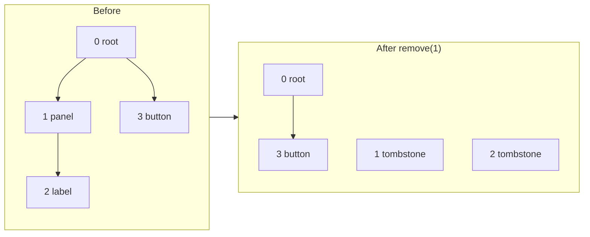

# Edit the widget tree at run time

Dialogs open and close, list rows come and go, and a form designer moves controls between containers. The `WidgetCache` has three calls for changing the [widget tree](widget-tree-and-ids.md) while the application runs. None of them changes the ID of any widget that is still in the window.

| Call | Does | Emits |
|---|---|---|
| `widgets.remove(id)` | Removes the widget and all of its descendants. Returns the removed IDs, `id` first. | `WidgetRemoved` and `Removed` for each removed widget, parents first |
| `widgets.reparent(id, new_parent)` | Moves the widget, with its descendants, to a new parent. It becomes the new parent's top-most child. | `WidgetReparented { id, old_parent, new_parent }` |
| `widgets.set_stacking_index(id, index)` | Moves the widget among its siblings. `0` is the bottom-most; past the end means top-most. Returns the index it ended at. | `WidgetRestacked { id, parent, old_index, new_index }` |
| `widgets.stacking_index(id)` | Returns the widget's position among its siblings, or `None` for the root. | Nothing |

From a callback, reach the cache with `ui.widgets()`; outside the run loop, with `engine.widgets()`. Each call returns a `Result`, and each event is an [engine event](../events/engine-events.md), delivered after the change is done.

## Removing widgets

The cache is a flat list addressed by ID, so a removed widget leaves an empty slot, a **tombstone**, behind. Every other widget keeps its slot, and its ID:



- `widgets.get(id)` returns `None` for a removed ID, and the ID is never given out again. The next widget added gets a new ID.
- Keyboard focus, hover, and mouse capture that point into the removed subtree are cleared. Losing the focus emits `FocusChanged { old, new: None }`.
- Each removed widget's GPU texture is destroyed by the backend before the next frame is drawn (`Backend::release_widget`).
- Callbacks registered on a removed widget are dropped after its `Removed` event, so they never run again.
- The parent lays its children out again, so a [row or column](../layouts/layouts-overview.md) closes the gap.
- Removing a [composite](../guides/composite-widgets.md)'s part also takes it out of the composite, as `remove_part` does.

## Moving and restacking

`reparent` keeps the widget's origin, which is now relative to the new parent, so the widget moves on screen with its new parent. Both parents lay their children out again. Moving a widget to the parent it already has changes nothing.

Siblings draw in order, so `set_stacking_index` changes which widget draws on top, and which one the pointer hits where they overlap. A layout arranges children in this order too, so restacking a row changes the order of its items.

## What is not allowed

These return an error and leave the tree as it was:

| Case | Error |
|---|---|
| Removing, moving, or restacking the root (ID `0`) | `Error::Tree` |
| Moving a widget into itself or one of its own descendants | `Error::Tree` |
| Moving a composite's part to another parent (the composite owns where its parts go) | `Error::Tree` |
| An ID that does not exist or was already removed | `Error::UnknownWidget` |

## Example

A button that adds a box the first time it is clicked and removes it the next time:

```rust checked
use pushrod::engine::Engine;
use pushrod::event::EngineEvent;
use pushrod::geometry::size;
use pushrod::widget::WidgetId;
use pushrod_widgets::button::Button;
use pushrod_widgets::frame::Frame;

/// The box the button shows, if it is shown.
#[derive(Default)]
struct AppState {
    shown: Option<WidgetId>,
}

fn main() {
    let mut engine: Engine<AppState> = Engine::new(size(320, 200), 30);
    let button = engine.add_widget(Button::new("Toggle box").at(20, 20).size(120, 24));

    engine.on_click(button, |state, ui| {
        state.shown = match state.shown.take() {
            Some(id) => {
                // Its texture is destroyed before the next frame; its ID is never reused.
                let _ = ui.widgets().remove(id);
                None
            }
            None => Some(ui.widgets().add(Box::new(Frame::new().at(20, 60).size(100, 100)))),
        };
    });

    engine.on_engine_event(|_state, _ui, event| {
        if let EngineEvent::WidgetRemoved { id, parent } = event {
            println!("widget {id} removed from {parent}");
        }
    });
}
```

The `tree_editing` example also moves boxes between two panels and brings the bottom one to the front:

```bash
cargo run -p pushrod-sdl2 --example tree_editing
```

## See also

- [Widget tree and IDs](widget-tree-and-ids.md)
- [Engine events](../events/engine-events.md)
- [Composite widgets](../guides/composite-widgets.md)
