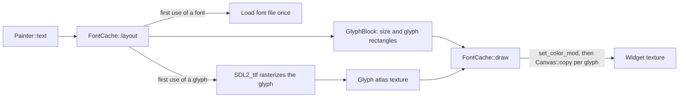

# GPU text

Pushrod draws text from a **glyph atlas**: a texture on the GPU that holds one picture of each glyph. Text is drawn by copying small rectangles out of that texture, so repainting a label never rasterizes anything.



## What is cached

| What | Key | When it is created |
| --- | --- | --- |
| A loaded font | font file path, size in points, style | The first time text is drawn with it. Never loaded again. |
| A glyph in the atlas | font, character | The first time the character is drawn in that font. |
| An atlas page | none | When the existing pages have no room left (the first page is created with the first glyph). Pages are 1024 x 1024 pixels. |

Spaces and control characters have no pixels, so they take no atlas space.

After warm-up, repainting text is only texture copies:

- Changing the **text** rasterizes only characters never drawn before.
- Changing the **color** rasterizes nothing: glyphs are stored white and tinted with `set_color_mod` (and `set_alpha_mod` for the alpha channel) when copied.
- Text widths use the font's own metrics, including kerning, and text wraps at spaces to the width of the widget, and breaks at newlines.

## Who owns the cache

The [`WidgetCache`](../concepts/widget-tree-and-ids.md) owns the one `FontCache`. A widget never touches it: it calls `paint::text`, and the `Sdl2Painter` the engine hands to `paint` uses the cache. A widget that is not drawn never loads a font.

`WidgetCache::fonts()` returns the cache, and `FontCache::stats()` reports what it has done:

| Field | Counts |
| --- | --- |
| `fonts_loaded` | Fonts loaded from disk |
| `glyphs_rasterized` | Glyphs rasterized into the atlas |
| `atlas_pages` | Atlas textures created |

## Engine events

Loading a font and adding an atlas page are internal actions, so each emits an [engine event](../events/engine-events.md): `FontLoaded { font_name, font_size }` and `GlyphAtlasPageAdded { pages }`.

## Using the cache directly

Most code uses `paint::text`. Tools that draw into their own SDL2 canvas can use the cache directly, as the `gpu_text` example does (`cargo run --example gpu_text`), which prints the counters after the first and second frame: the second frame loads and rasterizes nothing.

```rust checked
use pushrod::font::FontCache;
use pushrod::geometry::Point;
use sdl2::pixels::Color;
use sdl2::render::Canvas;
use sdl2::ttf::FontStyle;
use sdl2::video::Window;

fn draw_label(canvas: &mut Canvas<Window>, fonts: &mut FontCache) {
    let block = fonts.layout(canvas, "assets/OpenSans-Regular.ttf", 16, FontStyle::NORMAL, "Total: 42", 200);

    fonts.draw(canvas, &block, Point::new(4, 4), Color::RGBA(0, 0, 0, 255));
}
```

A `FontCache` belongs to one renderer: its atlas textures are released with it, so do not reuse a cache with a different canvas.

The [Text](./text.md) page covers layout engines, which decide where glyphs go; this page covers how the SDL2 backend draws them.
