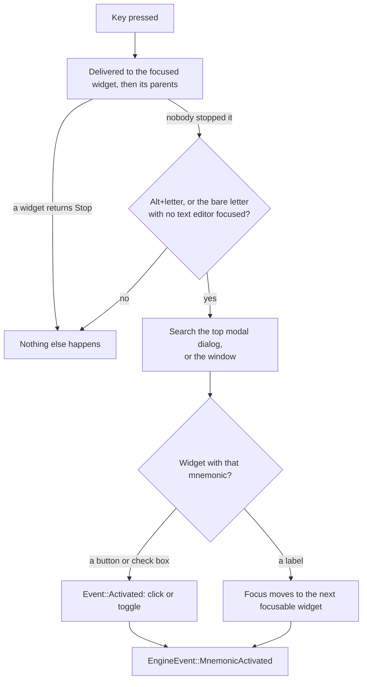

# Keyboard mnemonics

Keyboard users need a way to reach a control without tabbing through every field. A **mnemonic** is a letter in a label that is underlined and acts as the control's keyboard equivalent.

## Writing a mnemonic

Put `_` before the character:

| Label | Drawn as | Mnemonic |
|---|---|---|
| `"_Save"` | <u>S</u>ave | `s` |
| `"Save _as"` | Save <u>a</u>s | `a` |
| `"Snake__case"` | Snake_case | none (`__` is a literal underscore) |
| `"Done_"` | Done | none (a `_` at the end marks nothing) |

The marker is never drawn: `paint::text` removes it and draws a one-pixel underline under the character. Matching ignores case. With several markers in one label, the first counts. A label that is shortened with an ellipsis draws no underline when the character was cut off.

`paint::parse_mnemonic(label)` returns the text to draw and the character's byte offset; `paint::mnemonic_of(label)` returns the lowercased character.

## What a key press does



| Widget | Mnemonic does | Application hears |
|---|---|---|
| `Button` | Clicks it | `Clicked { id }`, so `on_click(id, ..)` |
| `CheckBox` | Toggles it | `Toggled { id, checked }`, so `on_toggle(id, ..)` |
| `Text` (a label) | Focuses the next focusable widget after the label, wrapping to the first | `FocusGained { id }`, so `on_focus_change(id, ..)` |

Ctrl and Cmd never trigger a mnemonic. Key repeat does not. While a text field has focus, only Alt plus the letter works, so typing is not stolen.

Hidden and disabled widgets are skipped. While a [modal dialog](../forms/modal-dialogs.md) is open, only widgets inside the topmost dialog are searched, so a button behind it is never pressed by mistake.

## Duplicates

When two widgets in the same form declare the same letter, the lowest `WidgetId` wins. `WidgetCache::mnemonic_conflicts()` returns each duplicated letter with its widgets, in any build, and debug builds also emit `EngineEvent::MnemonicConflict { key, ids }` when the key is pressed. See [Engine events](../events/engine-events.md).

## Giving your own widget a mnemonic

Override two `Widget` methods:

```rust checked title="src/lib.rs"
use pushrod::paint::{self, Painter};
use pushrod::widget::{Widget, WidgetCore};

/// A widget with a labeled shortcut.
pub struct Tool {
    core: WidgetCore,
    label: String,
}

impl Widget for Tool {
    fn core(&self) -> &WidgetCore { &self.core }
    fn core_mut(&mut self) -> &mut WidgetCore { &mut self.core }
    fn paint(&self, _p: &mut dyn Painter) {}

    /// The letter after the `_` in the label.
    fn mnemonic(&self) -> Option<char> {
        paint::mnemonic_of(&self.label)
    }

    /// `true` (the default) means the widget receives `Event::Activated`.
    /// Return `false` for a label, so focus moves on instead.
    fn mnemonic_activates(&self) -> bool {
        true
    }
}
```

Draw the label with `paint::text` so the underline appears. A widget that returns `true` handles `Event::Activated { id }` for its own id, as `Button` and `CheckBox` do.

## Try it

`pushrod-widgets/examples/mnemonics.rs` builds a small form and presses Alt+N, Alt+R and Alt+S: `cargo run -p pushrod-widgets --example mnemonics`.
