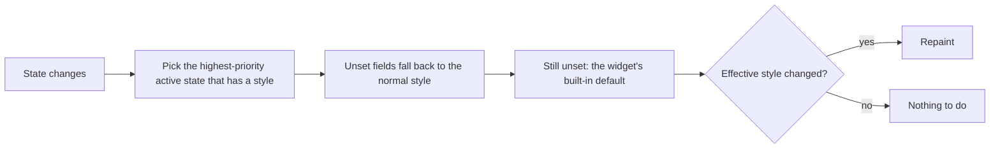

# Per-state appearance

A widget's look depends on its state: normal, pressed, hovered, focused, disabled, checked, or under a drag. **Per-state appearance** lets your application say "this button turns blue on hover" or "this field gets a thicker border when focused" without any widget code.

Every widget carries an `Appearance`: one `StateStyle` for each visual state. A `StateStyle` is a set of optional overrides:

| Field | What it changes |
|---|---|
| `background` | The fill color. |
| `foreground` | The text color. |
| `border_color` | The border color. |
| `border_width` | The border width in pixels. |
| `font` | The font, size, and alignment (`Option<TextStyle>`). |

A field you leave as `None` is not overridden.

## How the style is chosen



When several states are active at once, the first of these that is active **and** has a style wins:

1. `DISABLED`
2. `DRAG_OVER`
3. `PRESSED`
4. `CHECKED`
5. `HOVERED`
6. `FOCUSED`

Fields that style leaves unset come from the `normal` style, and fields still unset use the widget's built-in look. The built-in look is unchanged, so a widget with no styles set draws exactly as before. For example, a `ButtonWidget` still inverts its colors while pressed unless you style `PRESSED`.

## Who sets the state

The `WidgetCache` sets and clears the flags for you:

- `HOVERED` while the pointer is over the widget.
- `PRESSED` while a mouse button is held on it with the pointer still inside. Dragging out clears it; dragging back in sets it again.
- `FOCUSED`, `DISABLED` and `CHECKED` as described in [Widget behavior flags and visual states](./widget-behavior-flags-and-visual-states.md).

`DRAG_OVER` is not set automatically yet, because drag and drop is not built. You can set it yourself with `set_state`.

A widget is repainted only when its look can change. A `HOVERED` or `DRAG_OVER` change repaints only if the effective style changed, so hovering a widget that has no hover style costs nothing. Changes to `PRESSED`, `CHECKED`, `INDETERMINATE`, `DISABLED` and `FOCUSED` always repaint, because built-in looks and the [generic overlay](./widget-behavior-flags-and-visual-states.md#the-generic-overlay) depend on them.

## Setting styles

| Method | What it does |
|---|---|
| `set_style(state, style)` | Replaces the style for one state (`VisualState::empty()` styles `normal`). Repaints only if the current look changes. |
| `style()` | Returns the effective style for the current state. Call it from `paint`. |
| `appearance()` | Reads the whole `Appearance`. |
| `appearance_mut()` | Edits the whole `Appearance` in place, and repaints. |

```rust checked title="src/main.rs"
use pushrod::appearance::StateStyle;
use pushrod::color::Color;
use pushrod::geometry::{point, size};
use pushrod::paint::{self, Painter};
use pushrod::widget::{VisualState, Widget, WidgetCore};

struct Swatch {
    core: WidgetCore,
}

impl Widget for Swatch {
    fn core(&self) -> &WidgetCore { &self.core }
    fn core_mut(&mut self) -> &mut WidgetCore { &mut self.core }

    fn paint(&self, p: &mut dyn Painter) {
        // The effective style for the current state; `None` means "use the default".
        let style = self.style();

        paint::fill(p, style.background.unwrap_or(self.get_color()));
    }
}

fn main() {
    let mut swatch = Swatch { core: WidgetCore::new(point(0, 0), size(100, 20)) };

    swatch.set_style(
        VisualState::HOVERED,
        StateStyle { background: Some(Color::BLUE), ..StateStyle::default() },
    );

    assert_eq!(swatch.style().background, None);

    swatch.set_state(VisualState::HOVERED);
    assert_eq!(swatch.style().background, Some(Color::BLUE));
}
```

## What it looks like

One button through its states, with hover set to blue and pressed to dark blue:


A drop target in its drag-over state:


## Using it in your own widgets

Read `self.style()` in `paint` and use the field if it is set, otherwise your default. The standard widgets do this: `BaseWidget` (background), `BoxWidget` (background, border color and width), `TextWidget` (background, text color, font) and `ButtonWidget` (all of them).

## Not yet

- **Form files.** Appearance is plain data and comparable, so it can be stored once property introspection is built. It is not saved yet.
- **Automatic `DRAG_OVER`.** The style slot exists; the engine sets the flag when drag and drop arrives.

## Try it

`pushrod-widgets/examples/base.rs` has a **Hover me** button that turns blue on hover and dark blue when pressed. Run it with `cargo run -p pushrod-widgets --example base`.
