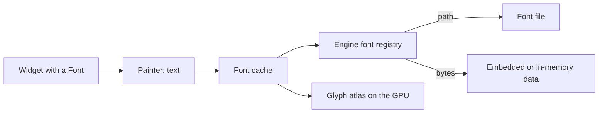

# Text and fonts

Every widget that draws text takes a **`Font`**: a family name, a size in points, and a style. A `Font` is a small handle that is cheap to clone, so one value can be shared by many widgets. No widget constructor takes a file path.

:::tip[TL;DR]
`Font::default()` works with no files at all. To use your own font, register it once with `engine.fonts().load("Body", path)?`, then use `Font::new("Body", 14, FontStyle::NORMAL)`.
:::

## The built-in font

Pushrod embeds **Open Sans Regular** in the `pushrod` crate. That is why the [quick start](../getting-started/quick-start.mdx) runs from any directory: there is no `assets/` folder to find.

```rust checked
use pushrod::color::{Color, FontStyle};
use pushrod::font::Font;
use pushrod::geometry::{point, size};
use pushrod::engine::Engine;
use pushrod_widgets::text_widget::{TextJustify, TextWidget};

fn built_in_font() {
    let mut engine: Engine = Engine::new(size(300, 100), 60);

    // Font::default() is the engine's default family at 14 points.
    let plain = TextWidget::new(
        point(10, 10),
        size(200, 20),
        Font::default(),
        Color::BLACK,
        TextJustify::Left,
        "Plain".into(),
    );

    // Change the size or style of any handle; the family is kept.
    let heading = TextWidget::new(
        point(10, 40),
        size(200, 30),
        Font::default().with_size(22).with_style(FontStyle::BOLD),
        Color::BLACK,
        TextJustify::Left,
        "Heading".into(),
    );

    engine.add_widget(plain);
    engine.add_widget(heading);
}
```

### License

Open Sans is copyright 2020 The Open Sans Project Authors and is licensed under the **SIL Open Font License, Version 1.1**. The license text ships with Pushrod as `assets/OFL.txt`, next to the font file `assets/OpenSans-Regular.ttf`. If you redistribute an application that uses the built-in font, include that license with it.

## Using your own font

Register a font once, under a family name, then refer to it by name anywhere.

```rust checked
use pushrod::color::FontStyle;
use pushrod::engine::Engine;
use pushrod::font::Font;
use pushrod::geometry::size;

fn own_font() -> Result<(), pushrod::error::Error> {
    let engine: Engine = Engine::new(size(300, 100), 60);

    // From a file (the path is checked now; the file is read when text is first drawn).
    engine.fonts().load("Body", "fonts/Body-Regular.ttf")?;

    // Or from bytes already in memory, such as include_bytes!("Body-Bold.ttf").to_vec().
    // engine.fonts().load_bytes("Body Bold", bytes)?;

    let body = Font::new("Body", 14, FontStyle::NORMAL);
    assert_eq!(body.family(), "Body");

    Ok(())
}
```

`load` returns `Error::Font` if the path is not a file or the family name is empty. A font whose family was never registered is reported the same way when text is drawn, as an `Error` [engine event](../events/engine-events.md), not a panic.

## Changing the default

A `Font` with an empty family means "the engine's default family". Widgets created with `Font::default()` therefore follow the default, and changing it restyles them all.

```rust checked
use pushrod::engine::Engine;
use pushrod::geometry::size;

fn change_default() -> Result<(), pushrod::error::Error> {
    let engine: Engine = Engine::new(size(300, 100), 60);

    engine.fonts().load("Body", "fonts/Body-Regular.ttf")?;
    engine.fonts().set_default("Body")?;

    assert_eq!(engine.fonts().default_family(), "Body");
    assert_eq!(engine.fonts().families(), vec!["Body", "Open Sans"]);

    Ok(())
}
```

## How a font is resolved



The engine owns the registry and shares it with the backend when the run loop starts. The backend's font cache loads each `(family, size, style)` once, the first time text is drawn with it, and emits a `FontLoaded` [engine event](../events/engine-events.md). After that, text is drawn from the [glyph atlas](./gpu-text.md).

## API summary

| Item | Does |
|---|---|
| `Font::new(family, size, style)` | Creates a handle. An empty family is the default family. |
| `Font::default()` | The default family, 14 points, normal style. |
| `font.with_size(n)`, `font.with_style(s)` | Copies the handle with a new size or style. |
| `engine.fonts().load(family, path)` | Registers a font file. |
| `engine.fonts().load_bytes(family, bytes)` | Registers font data in memory; the data lives for the rest of the process. |
| `engine.fonts().set_default(family)` | Makes a registered family the default. |
| `engine.fonts().default_font()` | The default family at 14 points, named explicitly. |
| `engine.fonts().families()` | The registered family names, sorted. |

See also [Text](./text.md) for layout engines and [GPU text](./gpu-text.md) for the glyph atlas.
