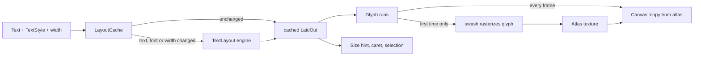

# Text

Pushrod separates **laying out** text from **drawing** it.

- A **layout engine** works out how big the text is, where each line breaks, where each glyph goes, and where the caret and selection sit. It never draws.
- The **painter** draws: each glyph is rasterized once into a texture atlas on the GPU, and every later frame copies rectangles from that atlas.



Steady-state text drawing does no CPU rasterization: once the text on screen has been drawn once, a frame is texture copies and nothing else.

## The `TextLayout` trait

`pushrod::text::TextLayout` takes a string, a `TextStyle` and a maximum width, and returns a `LaidOut`:

| Field or method | Meaning |
| --- | --- |
| `size` | Width and height of the text in pixels. |
| `min_width` | The narrowest width the text can wrap to (its longest word). |
| `size_hint()` | `(min_width, size)`, for layout managers. |
| `lines` | Each line's byte range in the text and its bounds. |
| `runs` | Glyph runs to draw (font, size, glyph ids and positions). |
| `geometry.caret_rect(index)` | The caret rectangle for a byte index, for text fields. |
| `geometry.selection_rects(range)` | The rectangles to fill for a selection (several per line in mixed-direction text). |
| `geometry.hit_test(point)` | The byte index nearest a point, for mouse clicks. |

Two engines ship with Pushrod:

| Engine | Cargo feature | What it does |
| --- | --- | --- |
| `TtfLayout` | none (default) | Measures with SDL2_ttf: left-to-right text wrapped at spaces, with caret and selection geometry. It returns no glyph runs because the SDL2 painter draws its text with SDL2_ttf. |
| `ParleyLayout` | `parley` (off by default) | Uses [Parley](https://github.com/linebender/parley): shaping, right-to-left and mixed-direction text, line breaking, and font fallback for glyphs the font lacks (CJK, emoji). It returns glyph runs. |

Applications can implement `TextLayout` for another engine, such as Cosmic Text or a bitmap font.

## Layout caching

Laying text out is the expensive part, so give each widget a `LayoutCache`. It keeps the last `LaidOut` and lays out again only when the text, font name, font size, font style or width changes. Changing only the color or the justification does not.

```rust checked
use pushrod::color::{Color, FontStyle};
use pushrod::geometry::{Point, Rect, Size};
use pushrod::paint::{TextJustify, TextStyle};
use pushrod::text::{LaidOut, LayoutCache, Line, TextGeometry, TextLayout};
use std::ops::Range;

struct Fixed;

impl TextGeometry for Fixed {
    fn caret_rect(&self, index: usize) -> Rect {
        Rect { x: index as i32 * 8, y: 0, w: 1, h: 16 }
    }
    fn selection_rects(&self, range: Range<usize>) -> Vec<Rect> {
        vec![Rect { x: range.start as i32 * 8, y: 0, w: range.len() as u32 * 8, h: 16 }]
    }
    fn hit_test(&self, point: Point) -> usize {
        (point.x.max(0) as usize + 4) / 8
    }
}

/// A made-up engine: every character is 8 pixels wide and 16 tall.
struct FixedWidth;

impl TextLayout for FixedWidth {
    fn layout(&mut self, text: &str, _style: &TextStyle, _max_width: Option<u32>) -> LaidOut {
        let size = Size { w: text.chars().count() as u32 * 8, h: 16 };
        LaidOut {
            size,
            min_width: 8,
            lines: vec![Line { text_range: 0..text.len(), bounds: Rect { x: 0, y: 0, w: size.w, h: 16 } }],
            runs: Vec::new(),
            geometry: Box::new(Fixed),
        }
    }
}

fn lay_out_twice() {
    let style = TextStyle {
        font_name: "assets/OpenSans-Regular.ttf".to_string(),
        font_style: FontStyle::NORMAL,
        font_size: 16,
        font_color: Color::BLACK,
        justification: TextJustify::Left,
    };

    let mut cache = LayoutCache::new();
    let mut engine = FixedWidth;

    cache.get(&mut engine, "Jane Example", &style, Some(200));
    cache.get(&mut engine, "Jane Example", &style, Some(200));
    assert_eq!(cache.layouts(), 1); // the second call reused the layout

    cache.get(&mut engine, "Jane Example", &style, Some(100));
    assert_eq!(cache.layouts(), 2); // a new width lays out again
}
```

## Using Parley

Enable the feature in your `Cargo.toml`:

```toml
pushrod = { version = "0.0.9", features = ["parley"] }
```

Then lay out with `ParleyLayout` and draw the glyph runs. The `parley_spike` example does this end to end: Parley computes the runs, swash rasterizes each glyph once into a CPU bitmap, the bitmap is uploaded into an SDL2 atlas texture, and glyphs are drawn with `Canvas::copy` and color modulation (color glyphs such as emoji are copied unmodulated).

```bash
cargo run --release --example parley_spike --features parley
```


The example prints the three measurements of the compatibility gate:

1. After the first frame, **0 glyphs are rasterized or uploaded** over the measured frames.
2. Glyphs are drawn with `Canvas::copy` from an atlas texture, the same texture and blit path as every other widget.
3. Binary size, the time to create the engine (which discovers system fonts), and the time of the first and of a steady frame.

### Why `parley` is off by default

The layout engine and the rasterizer pass the gate, but Parley adds a sizable dependency tree and discovers system fonts at start-up, so `ParleyLayout` is behind the `parley` feature and `TtfLayout` stays the default until the glyph atlas ([#3](https://github.com/KenSuenobu/rust-pushrod/issues/3)) moves the SDL2 painter onto glyph runs.

## See also

- [Drawing](drawing.md) for how widgets paint into cached textures.
- [Backend-neutral paint API](../platforms/backend-neutral-paint-api.md) for the `Painter` trait.
