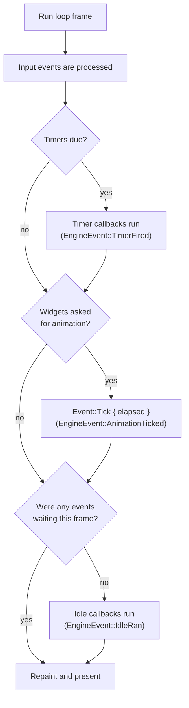

# Timers and idle callbacks

Caret blinking, auto-repeat on an arrow button, a progress bar that moves while it waits, a clock: they all need **time**. Pushrod gives you three tools, from the application side to the widget side.

| Tool | Use it for | Delivered as |
|---|---|---|
| `engine.on_timer(interval, repeat, callback)` | Running application code after a delay, or on a schedule | A callback, `FnMut(&mut S, &mut Ui)` |
| `ctx.request_animation()` | A widget that changes a little every frame | `Event::Tick { elapsed }` |
| `engine.on_idle(callback)` | Work that should yield to input, such as deferred layout or incremental loading | A callback, `FnMut(&mut S, &mut Ui)` |



## Timers

`on_timer` returns a `TimerId`. The callback receives the application state and a `Ui`, like every other callback.

```rust checked title="src/main.rs"
use pushrod::engine::Engine;
use pushrod::geometry::size;
use std::time::Duration;

fn main() {
    let mut engine: Engine<u32> = Engine::new(size(320, 200), 60);

    // Repeats every second: count seconds in the application state.
    let clock = engine.on_timer(Duration::from_secs(1), true, |seconds, _ui| *seconds += 1);

    // Fires once, after ten seconds: stop the clock from inside a callback.
    engine.on_timer(Duration::from_secs(10), false, move |_seconds, ui| {
        ui.cancel_timer(clock);
    });
}
```

- **One-shot or repeating.** `repeat = false` fires once; `repeat = true` fires every `interval`.
- **On time.** Timers are checked once per frame against `std::time::Instant`, so a timer fires within one frame of its interval.
- **No bursts.** If the application falls behind (a slow callback, a stalled frame), a repeating timer fires **once** and keeps its rhythm instead of catching up with a burst of calls.
- **Cancelling.** `ui.cancel_timer(id)` (in a callback) and `engine.cancel_timer(id)` both return `true` if the timer was still waiting. A timer can cancel itself, and a callback can cancel another timer that is due in the same frame; that timer then does not fire.
- **Zero interval.** A repeating timer with a zero interval fires once per frame.

## Animating a widget with `Tick`

A widget that animates asks for the next frame with `ctx.request_animation()` inside `handle_event`. Pushrod then sends it `Event::Tick { elapsed }` on the next frame, where `elapsed` is the time since the previous frame.

```rust checked title="src/spinner.rs"
use pushrod::event::{Event, EventCtx, EventMask, Propagation};
use pushrod::geometry::{point, size};
use pushrod::paint::Painter;
use pushrod::widget::{Widget, WidgetCore};

/// A widget that turns once per second, for as long as it is visible.
pub struct Spinner {
    core: WidgetCore,
    angle: f32,
}

impl Default for Spinner {
    fn default() -> Self {
        let mut core = WidgetCore::new(point(0, 0), size(24, 24));

        // Without TIMER in its mask the widget never receives a Tick.
        core.set_event_mask(EventMask::TIMER);

        Self { core, angle: 0.0 }
    }
}

impl Widget for Spinner {
    fn core(&self) -> &WidgetCore {
        &self.core
    }

    fn core_mut(&mut self) -> &mut WidgetCore {
        &mut self.core
    }

    fn paint(&self, _p: &mut dyn Painter) {
        // Draw the spinner at `self.angle`.
    }

    fn handle_event(&mut self, event: &Event, ctx: &mut EventCtx) -> Propagation {
        if let Event::Tick { elapsed } = event {
            self.angle = (self.angle + elapsed.as_secs_f32() * 360.0) % 360.0;
            self.set_invalidated(true);

            // Ask for the next frame; stop asking to stop animating.
            ctx.request_animation();
        }

        Propagation::Continue
    }
}
```

The rules:

- **A request lasts one frame**, like a browser's `requestAnimationFrame`. A widget that keeps animating calls `ctx.request_animation()` again each time it handles a `Tick`; when it stops asking, `Tick` stops. Nothing ticks while nothing animates, so an idle application uses no extra CPU.
- **The widget needs `EventMask::TIMER`** in its mask, and the run loop's mask must include it too. Disabled and hidden widgets receive no tick.
- **Starting an animation from a callback:** call `ui.request_animation(widget_id)` (or `engine.widgets().request_animation(id)`).
- Widgets that only need a one-off time check, such as a long press, are built on `Tick` too. See [Reusable input controllers](../events/reusable-input-controllers.md).

## Idle callbacks

`engine.on_idle(callback)` registers work for the moments when nothing else is pending: it runs **once per loop iteration in which no events were waiting**. Input always goes first.

```rust checked title="src/main.rs"
use pushrod::engine::Engine;
use pushrod::geometry::size;

fn main() {
    let mut engine: Engine<Vec<u32>> = Engine::new(size(320, 200), 60);

    // Loads one item per idle iteration, so typing and clicking stay responsive.
    engine.on_idle(|loaded, _ui| {
        if loaded.len() < 1000 {
            loaded.push(loaded.len() as u32);
        }
    });
}
```

:::note
While at least one idle callback is registered, the run loop **polls once per frame** instead of sleeping until input arrives. Keep the callback short, and do a small slice of work each time.
:::

## Engine events

Every one of these is an [engine event](../events/engine-events.md):

| Event | Fires when |
|---|---|
| `TimerFired { id, repeat }` | A timer's callback ran. |
| `TimerCancelled { id }` | A waiting timer was cancelled. |
| `AnimationTicked { recipients, elapsed }` | `Tick` was delivered to the widgets that asked for it. |
| `IdleRan { callbacks }` | The idle callbacks ran. |

`IdleRan` and `AnimationTicked` fire every frame while they are active. Use `engine.on_engine_event_filtered(..)` to receive only the kinds you want.

## Where timers run

Timers, ticks, and idle callbacks run in `Engine::run` and in the callback-style event loop, `Engine::next_event_with`. The plain `Engine::next_event` has no application state to pass to a callback, so it delivers only `Tick`.

## Testing without waiting

`engine.advance(now, &mut state)` moves the engine's clock to a time you choose: it runs the timers that are due, delivers `Tick`, and delivers the resulting events. `engine.run_idle(&mut state)` runs the idle callbacks. Both work without a window, so a test never has to sleep. See `examples/timers.rs` in the repository, a clock label updated every second.
