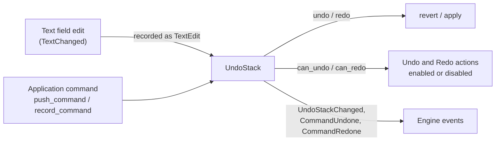

# Undo and redo command stack

Users expect Undo and Redo. The `Engine` owns one **undo stack** that every part of the window shares, so a text edit and an application command undo in the order they happened.



## A command

A `Command<S>` (`S` is your application state) knows how to make a change and how to take it back.

```rust checked title="src/main.rs"
use pushrod::engine::{Engine, Ui};
use pushrod::geometry::size;
use pushrod::undo::Command;

/// Adds an amount to the counter.
struct Add(i32);

impl Command<i32> for Add {
    fn description(&self) -> String {
        format!("Add {}", self.0)
    }

    fn apply(&mut self, total: &mut i32, _ui: &mut Ui<i32>) {
        *total += self.0;
    }

    fn revert(&mut self, total: &mut i32, _ui: &mut Ui<i32>) {
        *total -= self.0;
    }
}

fn main() {
    let mut engine: Engine<i32> = Engine::new(size(320, 160), 30);
    let mut total = 0;

    engine.push_command(Add(5), &mut total);
    engine.undo(&mut total);
    engine.redo(&mut total);
    assert_eq!(total, 5);
}
```

| Method | What it does |
|---|---|
| `push_command(cmd, &mut state)` | Applies the command, then records it. |
| `record_command(cmd)` | Records a change that already happened (it is not applied again until a redo). |
| `undo(&mut state)`, `redo(&mut state)` | Revert or reapply the newest step; return `false` if there is nothing to do. |
| `clear_undo()` | Forgets the history, for example when a document closes. |
| `set_undo_limit(n)` | Keeps at most `n` steps (default 100); the oldest are forgotten first. |
| `undo_stack()` | Read-only view: `can_undo`, `can_redo`, `undo_description`, `redo_description`, `undo_len`, `redo_len`. |

The same methods exist on `Ui`, so a callback can push, undo, and redo. Pushing a command clears the redo history. A command pushed while another is being applied or reverted is ignored, so a command cannot record itself.

## Merging a typing run

A command may override `merge(&mut self, next)` to fold the command pushed after it into itself. Return `true` when it did, and `next` is dropped. A merging command also overrides `as_any` to return `Some(self)` so the other command's type can be read. The default merges nothing.

## Text fields

Text fields push their edits by default, as `TextEdit` commands. Typing `Hello` one letter at a time is **one** undo step. A step ends when:

- the field loses focus;
- the edit changes direction (adding text, then deleting it);
- anything else is pushed in between.

Edits to a password field are never recorded. A text field's text is restored with its `text` property, so undo and redo do not send `TextChanged`. Turn the recording off with `engine.set_text_undo(false)`.

## The Undo and Redo actions

`engine.add_undo_actions()` registers the standard **Undo** and **Redo** [actions](../events/actions-and-keyboard-shortcuts.md) (Cmd+Z and Cmd+Shift+Z on macOS, Ctrl+Z and Ctrl+Y elsewhere) and returns their IDs. They are disabled while there is nothing to undo or redo, and enable themselves as the stack changes. Triggering either one, from a bound control or its shortcut, undoes or redoes.

```rust
let (undo, redo) = engine.add_undo_actions();

engine.bind_widget(undo, undo_button);
engine.bind_widget(redo, redo_button);
```

To use actions you made yourself, call `engine.bind_undo_actions(undo, redo)`.

## Engine events

| Event | When |
|---|---|
| `UndoStackChanged { can_undo, can_redo }` | A command was pushed, merged, undone, redone, or forgotten. |
| `CommandUndone { description }` | A command was undone. |
| `CommandRedone { description }` | A command was redone. |

See [Engine events](../events/engine-events.md).

## Example

`cargo run -p pushrod-widgets --example undo` types into a text field, pushes an application command, and undoes and redoes both. Source: `pushrod-widgets/examples/undo.rs`. Rustdoc: the `pushrod::undo` module.
