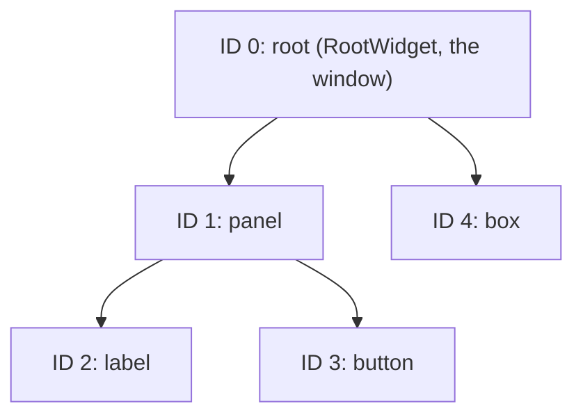
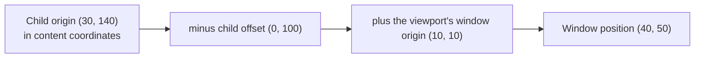

# Widget tree and IDs

Every widget in a window lives in one tree, stored as a flat list and addressed by `WidgetId` (a `u32`):



Origins are relative to the parent. Later siblings draw on top of earlier ones, so the button (ID 3) draws above the label (ID 2).

- **IDs are stable.** They're assigned in the order widgets are added and never change. Callbacks capture them, and in the future, form files will use them to connect designed forms to code. A removed widget leaves a tombstone, and its ID is never reused (see [Edit the widget tree at run time](edit-the-widget-tree-at-run-time.md)).
- **Composites are subtrees.** A [composite widget](../guides/composite-widgets.md)'s parts are its children, with the IDs right after its own.
- **Origins are relative to the parent.** `WidgetCache::absolute_origin(id)` gives window coordinates.
- **Stacking follows insertion order.** Children draw after (on top of) their parent; later siblings draw on top of earlier ones. The pointer always targets the top-most visible widget under it. `widgets.set_stacking_index(id, index)` changes the order, and `widgets.reparent(id, parent)` moves a widget to another parent.
- **Children are clipped to their parent.** A child that sticks out of its parent is cropped and cannot be clicked outside the parent; see [Clip children to their parent's bounds](clip-children-to-their-parent-s-bounds.md).
- **A container's children use content coordinates.** A scrolling [Container](../widgets/container.md) shows its children through a viewport; see [Content coordinates](#content-coordinates).
- **Hiding hides the subtree.** `set_hidden(true)` stops a widget and all its children from drawing or receiving the mouse. Disabled widgets also receive no input; see [Widget behavior flags and visual states](widget-behavior-flags-and-visual-states.md).

## Content coordinates

A widget can show its children through a viewport. Its **child offset** is the point of the child area shown at its upper left-hand corner. A child at `origin` is drawn at `origin - child_offset`, and is still cropped to the widget. Its **child area** is the size of the area the children are placed on, when that differs from the widget's own size.



- A child's origin never changes when the content is panned. Only where it is drawn changes, so nothing is repainted.
- `WidgetCache::absolute_origin(id)`, `visible_rect(id)`, and `widget_at(x, y)` all allow for the offset, so clipping, hit testing, and `EventCtx::origin()` work on scrolled children as on any others.
- A [layout manager](../layouts/layouts-overview.md) arranges children in the child area, not in the widget's own rectangle.

| Call | Does |
|---|---|
| `widget.child_offset()` | How far the widget's children are scrolled; `(0, 0)` for most widgets. |
| `widget.child_area()` | The size of the area the children are placed on, or `None` for the widget's own size. |
| `widgets.set_child_offset(id, point)` | Pans the children. Returns `true` if the offset changed. Repaints nothing. |
| `widgets.set_child_area(id, Some(size))` | Sets the child area and marks layout as needed. |

The [Container](../widgets/container.md) uses these for its `content` part, and clamps the offset to the content. Most applications use a `Container` instead of calling them.

```rust checked
use pushrod::cache::WidgetCache;
use pushrod::geometry::{point, size};
use pushrod::root_widget::RootWidget;
use pushrod::widget::Widget;

fn main() {
    let mut cache = WidgetCache::new();

    cache.add(Box::new(RootWidget::new(size(200, 100))));

    let mut child = RootWidget::new(size(40, 20));

    child.set_origin(point(30, 140));

    let child = cache.add(Box::new(child));

    // Below the window: nothing of it shows.
    assert_eq!(cache.visible_rect(child), None);

    cache.set_child_offset(0, point(0, 100));

    // Its origin is unchanged; it is drawn 100 pixels higher.
    assert_eq!(cache.get(child).map(|w| w.get_origin()), Some(point(30, 140)));
    assert_eq!(cache.absolute_origin(child), point(30, 40));
}
```

## Finding widgets

| Call | Returns |
|---|---|
| `ui.get::<T>(id)` / `ui.get_mut::<T>(id)` | The widget as its concrete type, if it is a `T`. |
| `widgets.get(id)` / `widgets.get_mut(id)` | The widget as `&dyn Widget` (any type). |
| `widgets.children_of(id)` | The IDs of its children, in drawing order. |
| `widgets.widget_at(x, y)` | The top-most visible widget at window coordinates. |
