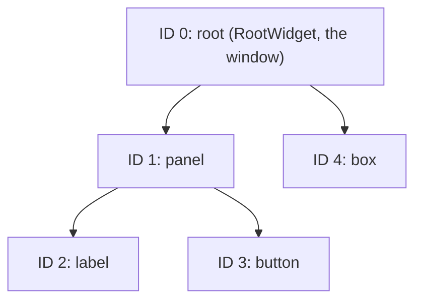

# Widget tree and IDs

Every widget in a window lives in one tree, stored as a flat list and addressed by `WidgetId` (a `u32`):

Origins are relative to the parent. Later siblings draw on top of earlier ones, so the button (ID 3) draws above the label (ID 2).

- **IDs are stable.** They're assigned in the order widgets are added and never change. Callbacks capture them, and in the future, form files will use them to connect designed forms to code. A removed widget's ID is never reused (see [Composite Widgets](../guides/composite-widgets.md)).
- **Composites are subtrees.** A [composite widget](../guides/composite-widgets.md)'s parts are its children, with the IDs right after its own.
- **Origins are relative to the parent.** `WidgetCache::absolute_origin(id)` gives window coordinates.
- **Stacking follows insertion order.** Children draw after (on top of) their parent; later siblings draw on top of earlier ones. The pointer always targets the top-most visible widget under it.
- **Children are clipped to their parent.** A child that sticks out of its parent is cropped and cannot be clicked outside the parent; see [Clip children to their parent's bounds](clip-children-to-their-parent-s-bounds.md).
- **Hiding hides the subtree.** `set_hidden(true)` stops a widget and all its children from drawing or receiving the mouse. Disabled widgets also receive no input; see [Widget behavior flags and visual states](widget-behavior-flags-and-visual-states.md).

## Finding widgets

| Call | Returns |
|---|---|
| `ui.get::<T>(id)` / `ui.get_mut::<T>(id)` | The widget as its concrete type, if it is a `T`. |
| `widgets.get(id)` / `widgets.get_mut(id)` | The widget as `&dyn Widget` (any type). |
| `widgets.children_of(id)` | The IDs of its children, in drawing order. |
| `widgets.widget_at(x, y)` | The top-most visible widget at window coordinates. |
