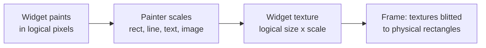
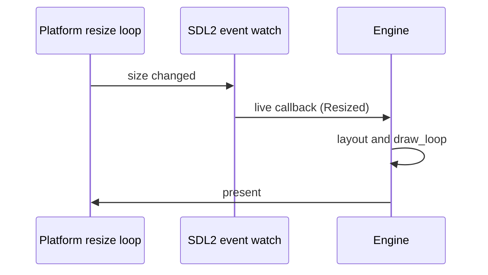

# Window resize and high-DPI rendering

Every position and size in Pushrod is in **logical pixels**. On a high-DPI display (a Retina screen, a 4K monitor at 150% or 200%) the window has more **physical pixels** than logical ones, and Pushrod draws at the physical resolution, so text and lines are sharp instead of a 1x image stretched to fit. When the user resizes the window, the root widget follows it and its [layout](../layouts/layouts-overview.md) arranges the children again.

## Logical and physical pixels

The **scale factor** is the number of physical pixels per logical pixel: `1.0` on a standard display, `1.5` at 150%, `2.0` on a Retina display. A 480 x 320 window at 2x has a 960 x 640 drawing area.

| Thing | Unit |
|---|---|
| Widget origins and sizes, `paint` coordinates, layout rectangles, mouse positions | Logical pixels |
| Each widget's GPU texture, the window's drawing area, screenshots | Physical pixels |

The backend does the conversion, so widget code does not change:

- Each widget's texture is created at **logical size times the scale factor**, rounded up (`geometry::to_physical_size`).
- Rectangles are converted edge by edge (`geometry::to_physical`), so widgets that touch in logical pixels still touch, with no gap or overlap, at fractional scales like 1.5x.
- Text is rasterized at **font size times the scale factor**, so a 14 pt label at 2x uses 28 pt glyphs. `text_width` and `line_height` still answer in logical pixels.
- One-pixel lines and borders cover **whole physical pixels**: 1 at 1x, 2 at 1.5x and 2x, 3 at 3x (`geometry::stroke_width`).
- Images are drawn into the physical rectangle. `image_size` reports the image's own pixel size.



All drawing still goes through SDL2 into each widget's GPU texture, only when the widget is invalidated, and frames are composed by blitting the cached textures. Nothing is drawn pixel by pixel on the CPU each frame.

## Reading the scale factor

A widget rarely needs it, but `paint` can ask, for example to pick a double-resolution image:

```rust
fn paint(&self, p: &mut dyn Painter) {
    let icon = if p.scale_factor() >= 2.0 { "save-2x.png" } else { "save.png" };

    let _ = p.image(icon, Rect::new(0, 0, 16, 16));
}
```

The application reads it with `engine.scale_factor()`. It is `1.0` until a run loop starts, then the backend's value.

## Moving between displays

When the window moves to a display with a different pixel density, the backend reports `InputEvent::ScaleChanged(scale)`. The engine then:

1. records the new scale (an unusable value, such as zero or `NaN`, reads as `1.0`),
2. invalidates every widget, so each is repainted into a texture at the new physical size, and
3. emits the engine event `ScaleFactorChanged { old_percent, new_percent }` (`100` is 1x, `150` is 1.5x).

A window that opens on a high-DPI display emits `ScaleFactorChanged { old_percent: 100, new_percent: 200 }` as the loop starts. Nothing happens when the scale is unchanged.

The SDL2 backend opens every window high-DPI aware. SDL2 has no scale-change event of its own, so the backend compares the drawable size with the window size after each poll. On Windows it turns on SDL's `SDL_WINDOWS_DPI_SCALING` hint, so window sizes are logical there too; set that environment variable yourself to choose otherwise.

## Resizing the window

Make the window resizable with `WindowSettings`:

```rust checked title="src/main.rs"
use pushrod::engine::Engine;
use pushrod::event::EngineEvent;
use pushrod::geometry::size;
use pushrod::layout::{Column, Margin};
use pushrod::widget::ROOT_WIDGET_ID;
use pushrod_sdl2::WindowSettings;
use pushrod_widgets::text_field::TextField;

pub fn main() -> Result<(), pushrod::error::Error> {
    let mut engine: Engine = Engine::new(size(480, 320), 30);

    // The root's layout re-arranges the window's widgets whenever the window is resized.
    if let Some(root) = engine.widgets().get_mut(ROOT_WIDGET_ID) {
        root.set_layout(Box::new(Column::new().spacing(8).margins(Margin::all(16))));
    }

    engine.add_widget(TextField::new().size(280, 24).with_label("Name:"));

    engine.on_engine_event(|_state, _ui, event| match event {
        EngineEvent::ScaleFactorChanged { new_percent, .. } => println!("now {new_percent}%"),
        EngineEvent::MinimumWindowSizeChanged { size } => println!("minimum {size:?}"),
        _ => {}
    });

    let mut settings = WindowSettings::new("Resizable", size(480, 320));

    settings.resizable = true;
    pushrod_sdl2::run(engine, settings, ())?;

    Ok(())
}
```

On `InputEvent::Resized(size)` the engine:

1. sets `engine.get_size()` to the new logical size,
2. resizes the root widget (ID `0`) to fill the window; if the root has a layout, it measures and arranges its children before the next frame (`LayoutChanged { container: 0 }`),
3. redraws the window and broadcasts `Event::WindowResized { size }` to widgets whose mask includes `EventMask::WINDOW`.

After each layout pass the engine reads the root layout's minimum size (`cache.measured_hint(0)`). When it changes, the engine gives it to the backend as the window's **minimum size**, so the user cannot shrink the window below what the layout needs, and emits `MinimumWindowSizeChanged { size }`. `engine.minimum_window_size()` returns the last value. A root without a layout sets no minimum.

A root without a layout is resized too, and its children keep their absolute positions unless they have [anchors](./autoresizing.md), which keep their margins or stretch them.

## Testing

`HeadlessBackend` pretends to be a high-DPI window, with no display:

| Call or field | Does |
|---|---|
| `HeadlessBackend::with_scale_factor(size, 2.0)` | A window that opens at 2x. |
| `backend.set_scale_factor(1.5)` | Changes the scale and queues `InputEvent::ScaleChanged(1.5)`, as a move to another display does. |
| `backend.texture_sizes[&id]` | The physical size of each widget's texture at its latest paint. |
| `backend.minimum_size` | The minimum window size the engine set. |
| `RecordingPainter { scale, .. }` | A painter whose `scale_factor()` returns `scale`. |

The tests in `tests/high_dpi.rs` and `pushrod-sdl2/tests/high_dpi.rs` show each case. Run the [resizable example](https://github.com/KenSuenobu/rust-pushrod/blob/main/pushrod-sdl2/examples/resizable.rs) to try it in a window:

```sh
cargo run -p pushrod-sdl2 --example resizable
```

## Reference

| Item | Where |
|---|---|
| `Painter::scale_factor()` | The scale the painter draws at; `1.0` by default. |
| `Backend::scale_factor()`, `Backend::set_minimum_window_size(size)` | What a backend implements; both have defaults for backends without high-DPI or resizable windows. |
| `InputEvent::ScaleChanged(f32)` | The backend's report of a new scale. Never filtered by the event mask. |
| `EngineEvent::ScaleFactorChanged`, `EngineEvent::MinimumWindowSizeChanged` | See [Engine events](../events/engine-events.md). |
| `geometry::to_physical`, `to_physical_size`, `to_physical_point`, `to_logical_length`, `stroke_width` | The conversions, for a backend of your own. |
| `Sdl2Painter::with_scale(scale)` | An SDL2 painter that draws at a scale. |

## Live resize while dragging

On macOS and Windows the operating system runs its own loop while the user drags a window edge, so the event pump does not return until the mouse is released. Without help, the window would show a stretched copy of the old frame during the drag.

`Sdl2Backend` registers an `SDL2` event watch, which `SDL2` still calls during the drag. Through `Backend::poll_events_live`, the watch hands each size change to the engine, which dispatches it, lays out, and redraws immediately.



Other backends keep the default `poll_events_live`, which simply calls `poll_events`.

The canvas presents with vsync. Without it, frames drawn mid-drag reach the screen a few resize events late, and the operating system stretches them to fit, so the window appears to zoom in and out slightly.
