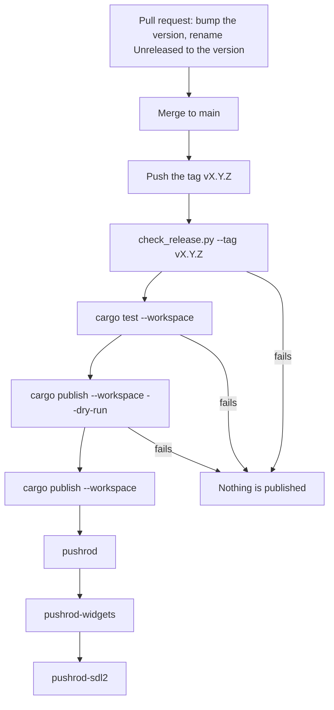

# Changelog, Cargo metadata, and crates.io release

Pushrod is published to crates.io as three crates: `pushrod`, `pushrod-widgets`, and
`pushrod-sdl2`. They are released together and always have the same version, so an application
can't mix a core from one release with widgets from another. This page covers the changelog, the
Cargo metadata, the checks that run on every pull request, and how a release is published.

## The changelog

Release notes are in [`CHANGELOG.md`](https://github.com/KenSuenobu/rust-pushrod/blob/main/CHANGELOG.md)
at the repository root. It follows [Keep a Changelog](https://keepachangelog.com/en/1.1.0/), and
versions follow [Semantic Versioning](https://semver.org/). It starts with the modernized core
(pull request #10). Releases before that, up to 0.5.0, are not recorded.

Every pull request adds one line at the end of the right section under `## [Unreleased]`:

```markdown
## [Unreleased]

### Added

- [#40] Slider widget: drag, click, keys, step, ticks, value text; EventCtx::origin [username]
```

The format is `- [#<issue>] <one-sentence summary> [<username>]`. Use `[0]` for a change with no
issue. The sections are **Added**, **Changed**, **Fixed**, **Examples, tests, and CI**, and
**Documentation and project**.

## Cargo metadata

Each published crate's `Cargo.toml` carries the metadata crates.io and docs.rs show:

| Field | Value |
|---|---|
| `version` | The same for all three crates, such as `0.1.0` |
| `description` | One line saying what the crate contains |
| `license` | `Apache-2.0` (from the workspace) |
| `repository` | `https://github.com/KenSuenobu/rust-pushrod` (from the workspace) |
| `homepage` | `https://pushrod.nobudata.com`, this documentation site (from the workspace) |
| `documentation` | The crate's docs.rs page, such as `https://docs.rs/pushrod` |
| `readme` | The crate's `README.md`, shown on its crates.io page |

Every dependency between the three crates names both a path and the shared version, for example
`pushrod = { path = "..", version = "0.1.0" }`. The path is used inside the workspace, and the
version is used once the crate is on crates.io.

`[package.metadata.docs.rs]` in `pushrod` and `pushrod-sdl2` turns on the `parley` feature, so the
API reference on docs.rs includes the optional Parley text engine. The `bundled` feature is left
off because it compiles SDL2 with CMake.

`pushrod-doc-samples` has `publish = false`. It only compiles the documentation's code samples and
is never published.

## Checks on every pull request

The **Release readiness** job in [CI](ci.md) runs three checks:

| Check | What it catches |
|---|---|
| `python3 scripts/test_check_release.py` | Mistakes in the release check itself |
| `python3 scripts/check_release.py` | Crates with different versions, a dependency between them that asks for an old version, missing or wrong metadata, a `readme` file that doesn't exist, or no `## [Unreleased]` section in the changelog |
| `cargo publish --workspace --dry-run` | Anything crates.io would reject. It packages each crate as it would be uploaded, then builds the package on its own, without the rest of the repository |

Run them locally from the repository root:

```bash
python3 scripts/check_release.py
cargo publish --workspace --dry-run
```

## Publishing a release

Publishing to crates.io is permanent. A version can be *yanked* (hidden from new projects) but
never deleted or replaced, so a release goes through a pull request first and is then tagged.



1. **Open a pull request** that sets `version` in all three crates, and in every dependency
   between them, to the new version.
2. **In the same pull request, rename** `## [Unreleased]` in `CHANGELOG.md` to
   `## [X.Y.Z] - YYYY-MM-DD`, and add a new, empty `## [Unreleased]` above it.
3. **Merge** once CI passes.
4. **Tag the merge commit and push the tag**:

   ```bash
   git checkout main && git pull
   git tag v0.1.0
   git push origin v0.1.0
   ```

5. The [Release workflow](https://github.com/KenSuenobu/rust-pushrod/blob/main/.github/workflows/release.yml)
   runs on the tag. `check_release.py --tag v0.1.0` stops the release unless the tag matches the
   crate version and the changelog has a `## [0.1.0]` section. The workflow then runs the tests and
   the dry run again, and publishes with `cargo publish --workspace`.
6. **Check** that each crate's page on crates.io shows the new version, and that docs.rs has
   finished building its API reference (usually within an hour).

`cargo publish --workspace` uploads the crates in dependency order: `pushrod`, then
`pushrod-widgets`, then `pushrod-sdl2`. `pushrod-sdl2` comes last because its tests and examples
use `pushrod-widgets`, and crates.io rejects a crate whose dependencies, including
dev-dependencies, aren't published yet.

The workflow authenticates with the repository secret `CARGO_REGISTRY_TOKEN`, a crates.io API token
with the *publish-new* and *publish-update* scopes. Only the Release workflow reads it. Pull
requests never do.

### Release plan

| Version | Contents |
|---|---|
| 0.1 | Dialog applications: the core, the standard widgets, layouts, and modal dialogs |
| 0.2 | Forms: form files, the widget registry, and resources |
| 1.0 | After the MVP has been used in real applications |

The crate name `pushrod-sdl3` is not reserved yet. It is published with the SDL3 backend, not as a
placeholder.

### If a release goes wrong

If the Release workflow fails before publishing, nothing was uploaded. Fix the problem in a pull
request, delete the tag (`git push origin :refs/tags/v0.1.0`), and tag again.

If it fails part way, after `pushrod` is uploaded, don't tag again: crates.io refuses a version
that already exists. Publish the rest by hand, in order, from the tagged commit:

```bash
cargo publish -p pushrod-widgets
cargo publish -p pushrod-sdl2
```

If a published version is broken, yank it so new projects don't pick it up, then release a fixed
patch version:

```bash
cargo yank --version 0.1.0 pushrod-sdl2
```

Applications that already use a yanked version keep building, because their `Cargo.lock` still
names it.
