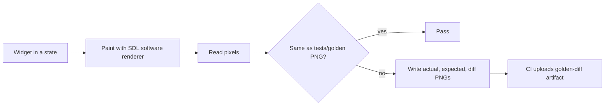

# Golden-image rendering tests

Every widget, in every visual state that changes how it looks, is painted automatically and
compared with a reference PNG (a *golden*). A change that alters how a widget draws fails the test
until the golden is reviewed and updated.

## How it works

The harness is [`pushrod-sdl2/tests/visual.rs`](https://github.com/KenSuenobu/rust-pushrod/blob/main/pushrod-sdl2/tests/visual.rs).
It lives in the SDL backend crate because the core crate has no SDL dependency.



- The **software renderer** is used for the tests only, because it is deterministic. Applications
  draw on the GPU.
- Tests run on SDL's `dummy` video driver. CI runs them under Xvfb with `SDL_VIDEODRIVER=x11`.
- A pixel matches when every channel is within 3 of the golden. A widget passes when at most 0.2%
  of its pixels differ by more.
- Goldens are in `pushrod-sdl2/tests/golden/`, named `<widget>-<state>.png`, for example
  `button-pressed.png`.

## Run them

Text antialiasing differs between platforms, so the comparison only runs when asked for:

```bash
PUSHROD_GOLDEN=1 cargo test -p pushrod-sdl2 --test visual
```

A plain `cargo test` skips the comparison (the tolerance helpers are still tested).

## Update the goldens

After an intended change to how a widget looks, regenerate, then **look at the changed PNGs**
before committing them:

```bash
UPDATE_GOLDEN=1 cargo test -p pushrod-sdl2 --test visual
git diff --stat pushrod-sdl2/tests/golden
```

Generate goldens on the platform CI uses (Linux under Xvfb: `xvfb-run -a` with
`SDL_VIDEODRIVER=x11`), or download the `actual` images from the failed CI run.

## When a comparison fails

A mismatch writes three files per widget to `target/golden-diff/` (or the directory in
`PUSHROD_GOLDEN_DIFF_DIR`):

| File | Shows |
|---|---|
| `<name>.actual.png` | What was rendered |
| `<name>.expected.png` | The golden |
| `<name>.diff.png` | Red where the images differ |

In CI, the **golden** job uploads that directory as the `golden-diff` artifact when it fails.

## Add a widget or state

Add a `case(...)` line to `cases()` in `visual.rs` with a new name, then run the update command
above. Use the widget's builder methods and a `VisualState` flag (`HOVERED`, `PRESSED`,
`FOCUSED`, `DISABLED`, `CHECKED`, `INDETERMINATE`); use fictional placeholder text only.
