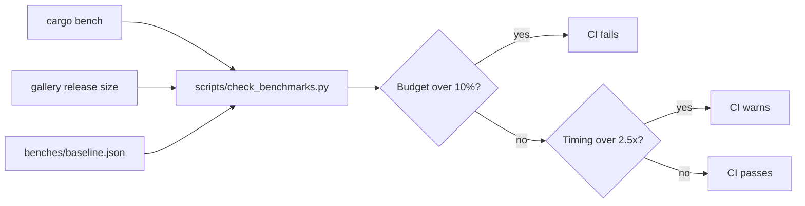

# Performance benchmarks and budgets

Pushrod's premise is small and fast, so performance is measured on every pull request and compared
with a stored baseline. A regression is caught when it is introduced, not when someone notices the
toolkit feels slow.

## What is measured

The benchmarks are
[`pushrod-sdl2/benches/performance.rs`](https://github.com/KenSuenobu/rust-pushrod/blob/main/pushrod-sdl2/benches/performance.rs).
They run headless: the engine draws through `HeadlessBackend`, and the text benchmark uses SDL's
dummy video driver with the software renderer, so no display is needed. Timing is built in (the best
of five runs), so there is no extra dependency.

| Name | What it measures |
|---|---|
| `event_dispatch_ns` | One pointer event routed through a 148-widget gallery-like tree |
| `frame_interactive_us` | One frame under interaction: a slider changes, a click arrives, the frame is drawn |
| `frame_full_us` | A full redraw: every widget repainted and blitted |
| `text_atlas_warmup_us` | The first text layout: font load and glyph atlas warm-up |
| `text_layout_cached_ns` | A repeat layout of the same text |
| `form_load_us` | A form of 40 label and field rows, built and drawn once |
| `texture_bytes_per_widget` | Average texture memory per widget in a full frame, at four bytes per pixel |
| `gallery_widgets` | The widgets in the benchmark tree (keeps the per-widget figures honest) |
| `gallery_binary_bytes` | The size of the release build of the `gallery` example |

## The baseline and the tolerance



[`benches/baseline.json`](https://github.com/KenSuenobu/rust-pushrod/blob/main/benches/baseline.json)
stores the numbers per platform, because timings and binary sizes differ between operating systems.

- **Budgets** (`texture_bytes_per_widget`, `gallery_widgets`, `gallery_binary_bytes`) are stable from
  run to run. Growing more than 10% **fails** the check.
- **Timings** vary with the machine, so getting more than 2.5 times slower than the baseline only
  **warns**, as a GitHub annotation on the run.

The tolerances are `budget_tolerance` and `timing_tolerance` in the baseline file.

## Run them locally

From the repository root:

```bash
cargo bench -p pushrod-sdl2 --bench performance     # the numbers, as a table and a JSON line
python3 scripts/check_benchmarks.py                 # run and compare with the baseline
python3 scripts/check_benchmarks.py --report        # print the README table
```

## Change the baseline

When a change legitimately moves a number (a new widget in the benchmark tree, a bigger binary for a
new feature), record the new baseline in the same pull request and say why in its description:

```bash
python3 scripts/check_benchmarks.py --update
```

This stores this platform's entry only. The CI job uploads its results as the `benchmark-results`
artifact; to record the Linux baseline, run `python3 scripts/check_benchmarks.py --update --from-json
benchmark-results.json` after downloading it. A platform with no stored baseline only warns.

## The low-end target

On a Raspberry Pi 4 class device, one interactive frame of Pushrod's own CPU work should stay under
2 ms (an eighth of a 60 frames-per-second budget), and a dialog application's binary should stay
under 5 MB. The target is a budget, not yet measured on that hardware. The benchmarks time Pushrod's
work (event routing, layout, painting calls, cache bookkeeping), not GPU time.

The current numbers are in the
[README](https://github.com/KenSuenobu/rust-pushrod/blob/main/README.md#performance).

## CI

The **Performance benchmarks** job in
[`.github/workflows/ci.yml`](https://github.com/KenSuenobu/rust-pushrod/blob/main/.github/workflows/ci.yml)
runs the script on Ubuntu; see [CI](ci.md).
