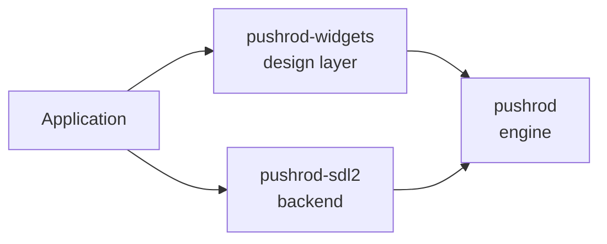

# Specifications

Pushrod's contracts (what a widget must do, how events are routed, what a painter must provide) are
written down in short specs, and each guarantee is checked by a **conformance test**. A contributor,
human or AI-assisted, works against a module's spec instead of reading its code, and an alternative
widget library or backend proves it keeps the same contracts by running the same tests.

The specs live in [`docs/specs/`](https://github.com/KenSuenobu/rust-pushrod/tree/main/docs/specs)
and the tests in [`tests/conformance/`](https://github.com/KenSuenobu/rust-pushrod/tree/main/tests/conformance).

| Spec | What it fixes | Conformance tests |
|---|---|---|
| [Module boundaries](https://github.com/KenSuenobu/rust-pushrod/blob/main/docs/specs/modules.md) | The engine, the design layer, and the crates, and which may depend on which | `boundaries.rs` |
| [Widgets](https://github.com/KenSuenobu/rust-pushrod/blob/main/docs/specs/widget.md) | The widget core, identity, behavior, invalidation, and parts | `widget.rs` |
| [Events](https://github.com/KenSuenobu/rust-pushrod/blob/main/docs/specs/events.md) | Vocabulary, phases, masks, engine events, and ordering | `events.rs` |
| [Painting](https://github.com/KenSuenobu/rust-pushrod/blob/main/docs/specs/paint.md) | The `Painter` trait and the cache policy | `paint.rs` |
| [Forms](https://github.com/KenSuenobu/rust-pushrod/blob/main/docs/specs/forms.md) | Modal dialogs and form layout; the form file format is specified when it lands | none yet |

## Engine and design layer

The **engine** is the widget tree, events, invalidation, and the paint API. The **design layer** is
the widget defaults, appearance, and themes. They are separate in the module layout and in the
docs, so a new look never needs a change to routing or painting.



Four rules keep them apart, and `boundaries.rs` fails when one is broken:

1. The `pushrod` crate depends on no backend and no widget library.
2. The engine modules (`engine`, `cache`, `event`, `input`, `timer`, `backend`) never use `appearance`.
3. `pushrod-widgets` depends on `pushrod` only.
4. A backend implements the `Backend` and `Painter` traits.

## What the tests check

| Area | Guarantees tested |
|---|---|
| Events | Capture, target, then bubble order; `Stop` ends delivery in any phase; hover and semantic events reach one widget; widget and run-loop masks filter; broadcasts run parents first and report their recipients; engine events are emitted in order, reach only widgets that ask, and never loop; callbacks and the event loop see the same sequence |
| Widgets | Defaults of a new widget; IDs are ordered and never reused; `get_as` returns the concrete type; a widget paints only when invalidated; hiding invalidates; parts are child widgets found by name and list |
| Painting | Default cache policy; a painter reports a usable scale; paint calls arrive in order; frames blit cached textures; an expose re-blits and a scale change repaints |
| Boundaries | The four rules above |

## Run the conformance tests

From the repository root:

```bash
cargo test --test conformance
```

CI runs them as part of `cargo test --workspace` (see [CI](ci.md)).

## Prove another widget library or backend

The tests use only the public API of the `pushrod` crate. Copy `tests/conformance/` into the
library's `tests/` directory, replace the sample widgets in `common.rs` and `widget.rs` with the
library's own, and run `cargo test`. The sample data in the specs and tests is fictional.

## Change a guarantee

When a change alters a guarantee, change the spec and its conformance test in the same pull
request. A guarantee a spec states without a test is marked *(not yet tested)*.
