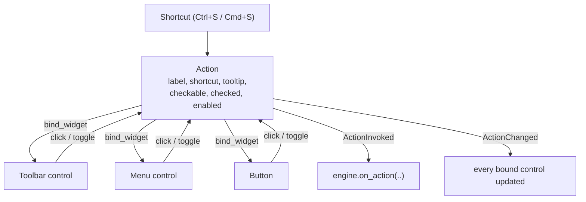

# Actions and Keyboard Shortcuts

The same command (Save, Bold, Undo) often appears in a menu, a toolbar, a button, and a keyboard shortcut. An **action** describes the command once. Every control bound to it shows its label, tooltip, enabled state, and checked state, and changing the action updates all of them.



## Define and use an action

```rust checked title="src/main.rs"
use pushrod::action::{Action, StandardShortcut};
use pushrod::engine::Engine;
use pushrod::geometry::size;
use pushrod_widgets::button::Button;

fn main() {
    let mut engine: Engine<u32> = Engine::new(size(320, 160), 30);

    let save = engine.add_action(
        Action::new("Save")
            .standard_shortcut(StandardShortcut::Save)
            .tooltip("Save the document"),
    );
    let toolbar_button = engine.add_widget(Button::new("").at(10, 10).size(80, 24));

    engine.bind_widget(save, toolbar_button);
    engine.on_action(save, |saves, _ui| *saves += 1);
}
```

`add_action` returns an `ActionId`. `bind_widget(action, widget)` copies the action's label (the `text` property), tooltip, enabled state and, for a checkable action, checked state onto the widget. A widget without one of those properties keeps its own. A widget is bound to one action at a time.

## Action fields

| Field | Meaning |
|---|---|
| `label` | Text shown on bound controls. |
| `icon` | Name of the icon resource for bound controls, or `None`. |
| `shortcut` | A `Shortcut { key, modifiers }`, or `None`. |
| `scope` | Where the shortcut works (see below). Default `ShortcutScope::Window`. |
| `tooltip` | Tooltip for bound controls. |
| `status_text` | Longer description for a status bar. |
| `checkable`, `checked` | An on/off action, such as Bold. |
| `enabled` | A disabled action cannot be triggered, and its controls are disabled. |
| `group` | The `ActionGroupId` the action belongs to, or `None`. |

Build an action with `Action::new("Label")` and the chained methods `icon`, `shortcut`, `standard_shortcut`, `scope`, `tooltip`, `status_text`, `checkable(initially_checked)`, and `enabled`.

## Changing an action

| From | Call |
|---|---|
| `Engine` | `set_action_enabled(id, bool)`, `set_action_checked(id, bool)`, `trigger_action(id)`, `action(id)` |
| A callback (`Ui`) | `set_action_enabled`, `set_action_checked`, `set_action_label`, `trigger_action`, `action` |

Each change that really changes something updates every bound control and queues `EngineEvent::ActionChanged { action }`. Checking a checkable action from a toolbar control checks the same action's menu control too, because both read the action.

## Triggering

An action is triggered when a bound control is clicked or toggled, when its shortcut is pressed (not on auto-repeat), or when the application calls `trigger_action`. A disabled action does nothing. Triggering:

1. Toggles `checked` if the action is checkable (an action in an exclusive group is checked instead).
2. Queues `EngineEvent::ActionInvoked { action }`. This is the action's *Triggered* notification.
3. Runs the callbacks registered with `engine.on_action(action, |state, ui| ..)`. Read the new state with `ui.action(id)`.

A checkable control bound to a non-checkable action is put back in step with the action.

## Shortcuts

`StandardShortcut` names the platform-standard keys. The command key is Cmd on macOS and Ctrl elsewhere.

| `StandardShortcut` | macOS | Windows, Linux |
|---|---|---|
| `New`, `Open`, `Save`, `Close`, `Quit` | Cmd+N, O, S, W, Q | Ctrl+N, O, S, W, Q |
| `Undo` | Cmd+Z | Ctrl+Z |
| `Redo` | Cmd+Shift+Z | Ctrl+Y |
| `Cut`, `Copy`, `Paste`, `SelectAll` | Cmd+X, C, V, A | Ctrl+X, C, V, A |
| `Find`, `Print` | Cmd+F, P | Ctrl+F, P |

For any other key, use `Shortcut::new(Key::Char('b'), Modifiers::CTRL)`. Characters compare in lowercase and the modifiers must match exactly.

`ShortcutScope` limits where a shortcut fires:

| Scope | The shortcut works |
|---|---|
| `Application` | Always, even while a [modal dialog](../forms/modal-dialogs.md) is open. |
| `Window` (default) | Whenever no modal dialog is open. |
| `Subtree(widget)` | Only while the keyboard focus is on `widget` or one of its descendants. |

A matching shortcut is handled before the key reaches the focused widget, so it takes priority over a text field. When two enabled actions share a shortcut and scope, the one registered first wins.

## Action groups

An exclusive group works like radio buttons: checking one action unchecks the others, and the checked action cannot be unchecked by clicking it again.

```rust
let align = engine.add_action_group(true);
let mut left = Action::new("Left").checkable(true);
let mut right = Action::new("Right").checkable(false);

left.group = Some(align);
right.group = Some(align);
```

If several actions join an exclusive group checked, the first stays checked.

## Engine events

| Event | When |
|---|---|
| `ActionAdded { action }` | `add_action` registered an action. |
| `ActionChanged { action }` | An action's enabled state, checked state, or label changed. |
| `ActionInvoked { action }` | An action was triggered. |

See [Engine events](./engine-events.md). The existing `ActionTriggered { id, cancel }` event is unrelated: it reports Return or Escape activating a form's default or cancel widget.

## Menus and toolbars

The menu bar and toolbar widgets are separate work items. They will bind to actions the same way, with `bind_widget`. Until then, bind any widget that has the properties above (`Button`, `CheckBox`, ...).

## Example

`cargo run -p pushrod-widgets --example actions` binds a Save and a Bold action to controls and shortcuts. Source: `pushrod-widgets/examples/actions.rs`. Rustdoc: the `pushrod::action` module.
