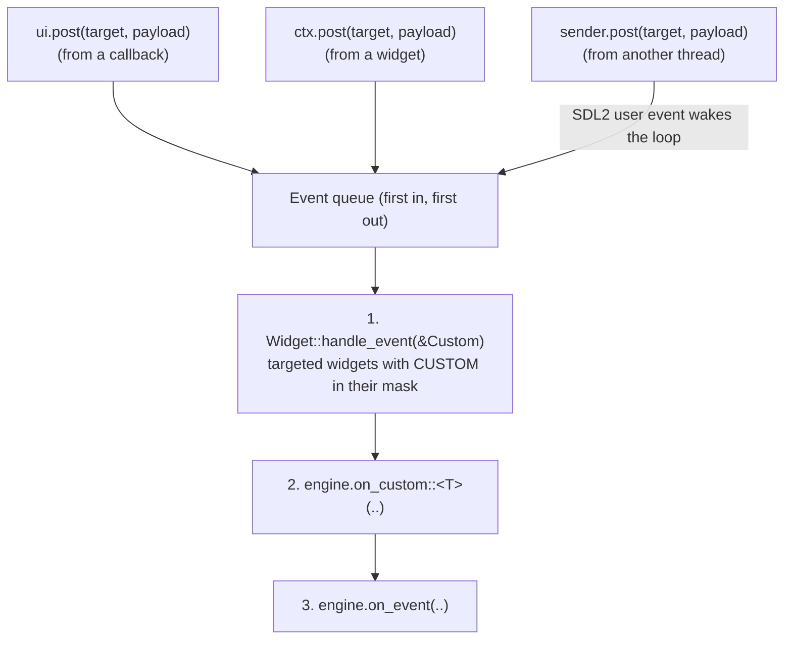

# Custom Events

Applications have events of their own: "document saved", "download 40% done", "refresh the list". A **custom event** carries any value you choose, as its **payload**, and Pushrod delivers it without ever looking inside. It has no side effects on focus, mouse capture, selection, or redrawing.



## Posting

| From | Call | Notes |
|---|---|---|
| A callback | `ui.post(target, payload)` | `source` is `None`. |
| A widget's `handle_event` | `ctx.post(target, payload)` | `source` is the posting widget's ID. |
| Another thread | `engine.sender()` then `sender.post(target, payload)` | The payload must be `Send`. `Sender` is `Clone` and `Send`. `source` is `None`. |

Posting never calls anything directly: the event is queued and delivered in order, after the code that posted it returns.

## Targets

| `EventTarget` | Widgets that see it in `handle_event` |
|---|---|
| `Widget(id)` | That widget. |
| `Subtree(id)` | That widget and all its descendants, parents before children. |
| `Broadcast` | Every visible widget, in drawing order. |
| `ApplicationOnly` | None. |

A widget receives a custom event only when `EventMask::CUSTOM` is in its mask and in the run loop's mask. Custom events are not input, so disabled widgets still receive them. The application's callbacks always run, whatever the target.

## Receiving

Read the payload with `event.payload::<T>()`, which returns `None` for any other type. For callbacks, `engine.on_custom::<T, _>(|state, ui, source, payload| ..)` runs only for payloads of type `T`.

## Limits

Posting while an event is being delivered appends to the same queue. To stop a callback that re-posts forever, at most `MAX_CUSTOM_EVENTS_PER_FRAME` (1000) custom events are delivered per frame; each extra one is discarded and reported as an `EngineEvent::CustomEventDropped { target }`.

## Example: a background thread updates a progress label

```rust checked title="src/main.rs"
use pushrod::engine::Engine;
use pushrod::event::EventTarget;
use pushrod::geometry::size;

struct DownloadProgress {
    percent: u8,
}

#[derive(Default)]
struct AppState {
    last: u8,
}

fn main() {
    let mut engine: Engine<AppState> = Engine::new(size(320, 200), 30);

    // The application reacts to the payload on the UI thread.
    engine.on_custom::<DownloadProgress, _>(|state, _ui, _source, progress| {
        state.last = progress.percent;
    });

    // A background thread posts progress; the run loop wakes and delivers it.
    let sender = engine.sender();

    std::thread::spawn(move || {
        for percent in (0..=100).step_by(20) {
            sender.post(EventTarget::ApplicationOnly, DownloadProgress { percent });
        }
    });
}
```

A widget that wants the same event implements `handle_event`, sets `EventMask::CUSTOM` in its mask, and reads `event.payload::<DownloadProgress>()`. The `base` example in `pushrod-widgets/examples/` shows the thread and an `on_custom` callback updating a label.
