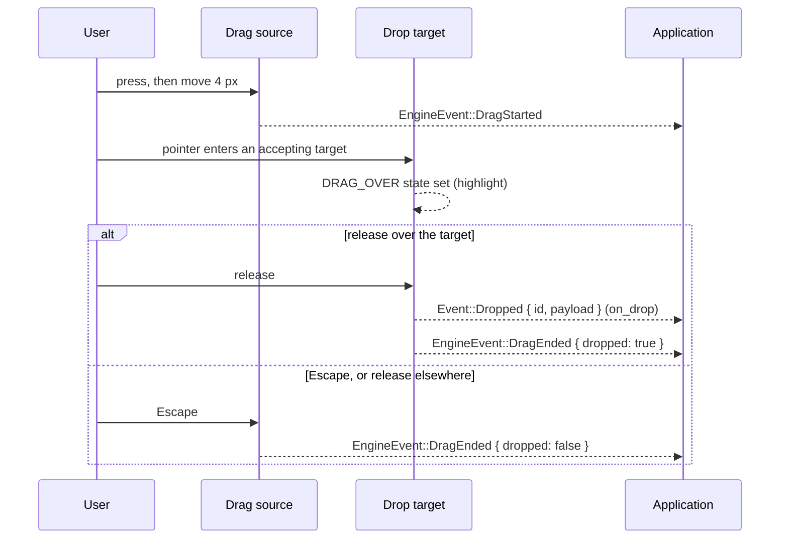

# Drag and Drop within the Application

Dragging an item from one place to another is a basic desktop interaction. In Pushrod a **drag source** produces a typed **payload**, a **drop target** says which payload types it accepts, and the application receives a `Dropped` event when the payload is released over an accepting target.



## Sources and targets

```rust checked title="src/main.rs"
use pushrod::dnd::{DragPayload, DragSource, DropTarget};
use pushrod::engine::Engine;
use pushrod::geometry::size;
use pushrod_widgets::panel::Panel;

struct Row(u32);

fn main() {
    let mut engine: Engine<Vec<u32>> = Engine::new(size(400, 200), 30);
    let from = engine.add_widget(Panel::new().at(0, 0).size(100, 100));
    let to = engine.add_widget(Panel::new().at(150, 0).size(100, 100));

    engine.set_drag_source(from, DragSource::new(|| DragPayload::new(Row(3))));
    engine.set_drop_target(to, DropTarget::new().accepts::<Row>());
    engine.on_drop(to, |rows, _ui, payload| {
        if let Some(Row(n)) = payload.get::<Row>() {
            rows.push(*n);
        }
    });
}
```

| Call | Meaning |
|---|---|
| `engine.set_drag_source(id, DragSource::new(make))` | A press on `id` (or a descendant) followed by a move of 4 pixels starts a drag. `make` is called once, at that moment, and returns the `DragPayload`. |
| `DragSource::image(widget)` | The drag image: a `Widget`, normally added hidden as a child of the root. It is shown on top and kept 12 pixels right of and below the pointer, and hidden again when the drag ends. It is an ordinary cached widget, so moving it costs only a texture blit. |
| `engine.set_drop_target(id, DropTarget::new().accepts::<T>())` | `id` accepts payloads holding a `T`. List several types by chaining `accepts`. |
| `engine.on_drop(id, callback)` | Runs when a payload is dropped on `id`. Read it with `payload.get::<T>()`. |
| `engine.widgets().is_dragging()` | `true` while a drag is in progress. |

A press that never moves 4 pixels is a normal click. Once a drag starts, the press is not a click, and the other widgets receive no pointer events until it ends.

## Drop feedback

While an accepted payload is over a target, or over one of its descendants, the target has the `VisualState::DRAG_OVER` flag, and its [appearance](../concepts/per-state-appearance.md) for that state is used. The flag is removed when the pointer leaves, when the drag ends, and when it is cancelled. Targets that are disabled, or blocked by a [modal dialog](../forms/modal-dialogs.md), do not accept.

## Cancel

Press **Escape** during a drag to cancel it: the highlight and the image go away, `DragEnded { dropped: false }` is emitted, and `on_drop` does not run. Releasing the button anywhere that is not an accepting target cancels it too.

## Files dropped from the operating system

Files dragged onto the window arrive as the same `Dropped` event, with a `Vec<PathBuf>` payload, at the accepting target under the pointer. SDL2 does not report a position for drops, so Pushrod uses the pointer's last position.

```rust
use std::path::PathBuf;

engine.set_drop_target(zone, DropTarget::new().accepts::<Vec<PathBuf>>());
engine.on_drop(zone, |state, _ui, payload| {
    if let Some(paths) = payload.get::<Vec<PathBuf>>() {
        // open the files
    }
});
```

If no widget accepts `Vec<PathBuf>` there, the files are ignored and `FilesDropped { target: None, .. }` is emitted. The headless equivalent for tests is `InputEvent::FilesDropped { position, paths }`.

## Engine events

| Event | When |
|---|---|
| `DragStarted { source }` | The pointer moved past the threshold from a press on a drag source. |
| `DragEnded { source, target, dropped }` | The drag ended. `dropped` is `true` and `target` is set only for a drop on an accepting target. |
| `FilesDropped { target, count }` | Files were dropped on the window from the OS. `target` is the accepting widget, if any. |

See [Engine events](./engine-events.md).

## Example

`cargo run -p pushrod-widgets --example drag_and_drop` reorders a list by dragging one row onto another. Source: `pushrod-widgets/examples/drag_and_drop.rs`. Rustdoc: the `pushrod::dnd` module.
