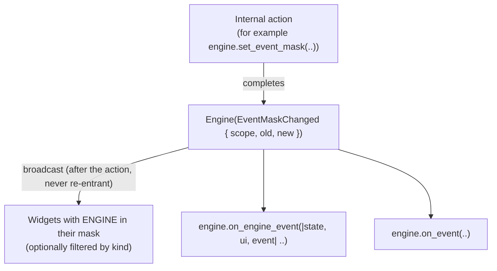

# Engine events

Pushrod changes things on its own: it changes event masks, adds widgets, and (as the library grows) moves focus, opens dialogs, and switches drawing modes. Every one of these **internal actions** emits an **engine event**, `Event::Engine(EngineEvent)`, so an application can keep a status line, a log, or a custom widget in sync.



## When they are delivered

- **After the action completes.** The event describes something that already happened. Callbacks see the new state.
- **Never re-entrant.** An engine event never triggers an internal action by itself, and the events a widget emits in response to one are not broadcast again, so engine events cannot loop. (A callback that *itself* calls an action, such as `ui.set_event_mask(..)`, causes that action's own event, once.)
- **Queued until the next dispatch.** Actions made outside a callback (for example while building the window) are delivered with the next event the run loop processes.

## Events

| Event | Fires when |
|---|---|
| `EventMaskChanged { scope, old, new }` | The run-loop mask or a widget's mask changes to a different value. `scope` is `MaskScope::RunLoop` or `MaskScope::Widget(id)`. |
| `WidgetAdded { id, parent }` | A widget is added to the window. Not sent for the root widget the engine creates. |
| `EventBroadcast { kind, recipients }` | An event was [broadcast](../concepts/broadcast-events-to-all-interested-widgets.md) to every interested widget. `recipients` is how many received it. |
| `CustomEventDropped { target }` | A [custom event](./custom-events.md) was discarded because the per-frame limit was reached. |
| `FontLoaded { font_name, font_size }` | A font was loaded from disk, the first time text was drawn with it. See [GPU text](../concepts/gpu-text.md). |
| `GlyphAtlasPageAdded { pages }` | A glyph atlas texture was created. `pages` is how many exist now. |
| `FocusChanged { old, new }` | The keyboard focus moved, by click, Tab, arrow key, or `set_focus`. `old` and `new` are widget IDs, or `None`. See [Keyboard and focus](../guides/keyboard-and-focus.md). |
| `ActionTriggered { id, cancel }` | Return or Escape activated a form's default (`cancel` is `false`) or cancel (`true`) widget. |
| `TimerFired { id, repeat }` | A timer's callback ran. See [Timers and idle callbacks](../concepts/timers-and-idle-callbacks.md). |
| `TimerCancelled { id }` | A waiting timer was cancelled with `cancel_timer`. |
| `AnimationTicked { recipients, elapsed }` | `Tick` was delivered to the `recipients` widgets that asked for animation. |
| `IdleRan { callbacks }` | The idle callbacks ran because no events were waiting. |
| `Error { error }` | Something failed while the loop was running (a font would not load, a texture could not be created). The loop keeps going. See [Errors](../guides/creating-an-application.md#errors). |

More variants are added by the features that need them (dialogs, menus, timers, windows, drawing modes, ...). `EngineEvent` is `#[non_exhaustive]`, so always include a `_` arm when you `match` on it.

## Receiving engine events

| Way | Receives | Notes |
|---|---|---|
| `engine.on_engine_event(f)` | Every engine event | `FnMut(&mut S, &mut Ui, &EngineEvent)` |
| `engine.on_engine_event_filtered(&kinds, f)` | Only the listed `EngineEventKind`s | Same signature. |
| `engine.on_event(f)` | Every event, including `Event::Engine(..)` | Runs after the engine-event callbacks. |
| A widget | Events in `handle_event` | The widget's mask must include `EventMask::ENGINE`. |
| `engine.next_event(..)` | Every event, in order | Event-loop style; widgets are still notified first. |

A widget receives an engine event only when **both** the run-loop mask and its own mask include `EventMask::ENGINE`. Callbacks always receive engine events. To receive only some kinds in a widget, call `engine.widgets().set_engine_filter(id, Some(vec![EngineEventKind::WidgetAdded]))`; pass `None` to remove the filter.

```rust checked title="src/main.rs"
use pushrod::engine::Engine;
use pushrod::event::{EngineEvent, EngineEventKind, EventMask, MaskScope};
use pushrod::geometry::size;

fn main() {
    let mut engine: Engine<Vec<String>> = Engine::new(size(320, 200), 60);

    // A log of every mask change, as a status line would show it.
    engine.on_engine_event_filtered(&[EngineEventKind::EventMaskChanged], |log, _ui, event| {
        if let EngineEvent::EventMaskChanged { scope, new, .. } = event {
            let who = match scope {
                MaskScope::RunLoop => String::from("window"),
                MaskScope::Widget(id) => format!("widget {}", id),
            };

            log.push(format!("{} now handles {:?}", who, new));
        }
    });

    engine.set_event_mask(EventMask::KEYBOARD | EventMask::ENGINE);
}
```

## For contributors

Any change that adds an internal action **must** add its `EngineEvent` variant (and `EngineEventKind`), document when it fires, emit it after the action completes, and add a test. The pull request template's checklist asks for it.
