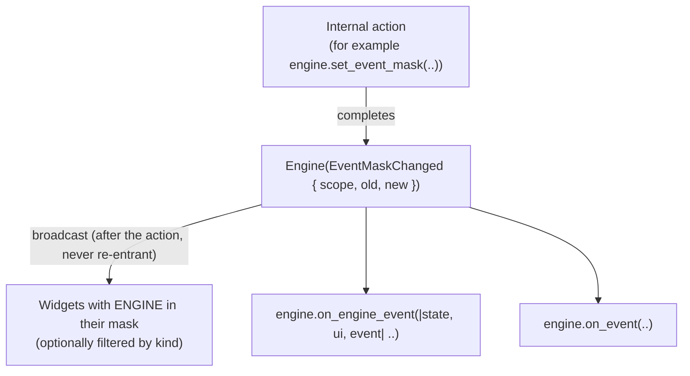

# Engine events

Pushrod changes things on its own: it changes event masks, adds widgets, and (as the library grows) moves focus, opens dialogs, and switches drawing modes. Every one of these **internal actions** emits an **engine event**, `Event::Engine(EngineEvent)`, so an application can keep a status line, a log, or a custom widget in sync.



## When they are delivered

- **After the action completes.** The event describes something that already happened. Callbacks see the new state.
- **Never re-entrant.** An engine event never triggers an internal action by itself, and the events a widget emits in response to one are not broadcast again, so engine events cannot loop. (A callback that *itself* calls an action, such as `ui.set_event_mask(..)`, causes that action's own event, once.)
- **Queued until the next dispatch.** Actions made outside a callback (for example while building the window) are delivered with the next event the run loop processes.

## Events

| Event | Fires when |
|---|---|
| `EventMaskChanged { scope, old, new }` | The run-loop mask or a widget's mask changes to a different value. `scope` is `MaskScope::RunLoop` or `MaskScope::Widget(id)`. |
| `WidgetAdded { id, parent }` | A widget is added to the window. Not sent for the root widget the engine creates. |
| `WidgetRemoved { id, parent }` | A widget was removed with `remove`, or a [composite](../guides/composite-widgets.md) part with `remove_part`. Sent for each widget in the removed subtree, parents first, each followed by `Event::Removed { id }`; the ID is never reused. See [Edit the widget tree at run time](../concepts/edit-the-widget-tree-at-run-time.md). |
| `WidgetReparented { id, old_parent, new_parent }` | A widget was moved, with its descendants, to a new parent with `reparent`. |
| `WidgetRestacked { id, parent, old_index, new_index }` | A widget moved to a new place among its siblings with `set_stacking_index`. Index `0` draws first (bottom-most). |
| `PartsArranged { id, placed }` | A [composite](../guides/composite-widgets.md) laid its parts out, after it was built, a part was added, inserted, or removed, or it asked with `request_arrange_parts` (a [scroll bar](../widgets/scroll-bar.md) moving its thumb). `placed` is how many parts it placed. |
| `LayoutChanged { container }` | A container's [layout](../layouts/layouts-overview.md) arranged its children before a frame. Sent once for each container arranged. |
| `EventBroadcast { kind, recipients }` | An event was [broadcast](../concepts/broadcast-events-to-all-interested-widgets.md) to every interested widget. `recipients` is how many received it. |
| `CustomEventDropped { target }` | A [custom event](./custom-events.md) was discarded because the per-frame limit was reached. |
| `FontLoaded { font_name, font_size }` | A font family was loaded, the first time text was drawn with it; `font_name` is the family name. See [Text and fonts](../concepts/text-and-fonts.md) and [GPU text](../concepts/gpu-text.md). |
| `GlyphAtlasPageAdded { pages }` | A glyph atlas texture was created. `pages` is how many exist now. |
| `FocusChanged { old, new }` | The keyboard focus moved, by click, Tab, arrow key, or `set_focus`. `old` and `new` are widget IDs, or `None`. See [Keyboard and focus](../guides/keyboard-and-focus.md). |
| `ActionTriggered { id, cancel }` | Return or Escape activated a form's default (`cancel` is `false`) or cancel (`true`) widget. |
| `ModalOpened { root }` | A [modal dialog](../forms/modal-dialogs.md) opened with `open_modal`; only its subtree receives input now. |
| `DialogDismissRequested { id }` | A `DISMISSES_DIALOG` widget was clicked or activated. Inside the top modal dialog it closes the dialog; elsewhere it changes nothing. |
| `ModalClosed { root, dismissed_by }` | A modal dialog closed because `dismissed_by` was chosen. Its root is hidden again and its `open_modal` callback has run. |
| `PropertyChanged { id, name }` | A widget's property was changed by name with `set_widget_property` and the value really changed. See [Property introspection](../forms/property-introspection.md). |
| `TimerFired { id, repeat }` | A timer's callback ran. See [Timers and idle callbacks](../concepts/timers-and-idle-callbacks.md). |
| `TimerCancelled { id }` | A waiting timer was cancelled with `cancel_timer`. |
| `AnimationTicked { recipients, elapsed }` | `Tick` was delivered to the `recipients` widgets that asked for animation. |
| `IdleRan { callbacks }` | The idle callbacks ran because no events were waiting. |
| `ScaleFactorChanged { old_percent, new_percent }` | The window's scale factor changed (it moved to a display with another pixel density, or opened on a high-DPI one), and every widget was invalidated to repaint at the new resolution. `100` is 1x, `200` is 2x. See [Window resize and high-DPI rendering](../concepts/window-resize-and-high-dpi-rendering.md). |
| `MinimumWindowSizeChanged { size }` | The root layout's minimum size changed and was given to the backend as the window's minimum size. |
| `CompositionStarted { id }` | An input method began composing text for the focused widget `id`. See [Text input and IME](../guides/text-input-and-ime.md). |
| `CompositionUpdated { id, text, cursor }` | The composition text of `id` changed; `cursor` is the input method's `(start, length)` inside `text`, in characters. |
| `CompositionEnded { id, committed }` | The composition ended: `committed` is `true` when the final text arrived as `TextEntered`, `false` when it was cancelled (the focus moved, or something other than the commit followed an empty composition). |
| `MnemonicActivated { id, key }` | A mnemonic key (Alt plus an underlined letter) activated the widget `id`. See [Keyboard mnemonics](../concepts/keyboard-mnemonics.md). |
| `MnemonicConflict { key, ids }` | Debug builds only: two or more widgets in the active form declare the mnemonic `key`; the lowest ID wins. |
| `AccessibilityChanged { active }` | Assistive technology (a screen reader) started (`true`) or stopped (`false`) using the window; the accessibility tree is built only while active. See [Accessibility](../concepts/accessibility.md). |
| `AccessActionPerformed { id, action }` | An accessibility action (`Click`, `Focus`, `SetValue`, `SetText`) was performed on the widget `id`. |
| `FormLoaded { form, root, widgets }` | A form was loaded with `Engine::load_form`; `root` is the widget made from the form's root object and `widgets` is how many widgets it created. See [Loading forms](../forms/loading-forms.md). |
| `ResourcesLoaded { sets }` | Resource sets were given to the engine with `Engine::set_resources`. See [Resources](../forms/resources.md). |
| `ResourcesFreed { sets }` | The engine's resource sets were replaced or cleared. |
| `Error { error }` | Something failed while the loop was running (a font would not load, a texture could not be created). The loop keeps going. See [Errors](../guides/creating-an-application.md#errors). |

More variants are added by the features that need them (menus, windows, drawing modes, ...). `EngineEvent` is `#[non_exhaustive]`, so always include a `_` arm when you `match` on it.

## Receiving engine events

| Way | Receives | Notes |
|---|---|---|
| `engine.on_engine_event(f)` | Every engine event | `FnMut(&mut S, &mut Ui, &EngineEvent)` |
| `engine.on_engine_event_filtered(&kinds, f)` | Only the listed `EngineEventKind`s | Same signature. |
| `engine.on_event(f)` | Every event, including `Event::Engine(..)` | Runs after the engine-event callbacks. |
| A widget | Events in `handle_event` | The widget's mask must include `EventMask::ENGINE`. |
| `engine.next_event(..)` | Every event, in order | Event-loop style; widgets are still notified first. |

A widget receives an engine event only when **both** the run-loop mask and its own mask include `EventMask::ENGINE`. Callbacks always receive engine events. To receive only some kinds in a widget, call `engine.widgets().set_engine_filter(id, Some(vec![EngineEventKind::WidgetAdded]))`; pass `None` to remove the filter.

```rust checked title="src/main.rs"
use pushrod::engine::Engine;
use pushrod::event::{EngineEvent, EngineEventKind, EventMask, MaskScope};
use pushrod::geometry::size;

fn main() {
    let mut engine: Engine<Vec<String>> = Engine::new(size(320, 200), 60);

    // A log of every mask change, as a status line would show it.
    engine.on_engine_event_filtered(&[EngineEventKind::EventMaskChanged], |log, _ui, event| {
        if let EngineEvent::EventMaskChanged { scope, new, .. } = event {
            let who = match scope {
                MaskScope::RunLoop => String::from("window"),
                MaskScope::Widget(id) => format!("widget {}", id),
                _ => String::from("another scope"),
            };

            log.push(format!("{} now handles {:?}", who, new));
        }
    });

    engine.set_event_mask(EventMask::KEYBOARD | EventMask::ENGINE);
}
```

## For contributors

Any change that adds an internal action **must** add its `EngineEvent` variant (and `EngineEventKind`), document when it fires, emit it after the action completes, and add a test. The pull request template's checklist asks for it.
