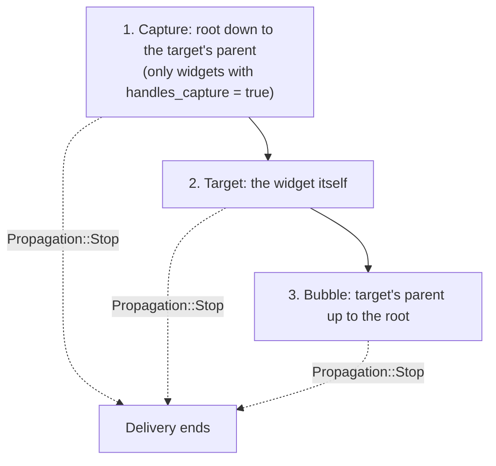

# Event propagation

An input event is for one widget, its **target**: the top-most widget under the pointer (or the widget that captured the mouse), or the focused widget for keys. Containers still need to react, such as a dialog that handles Return when the text field ignored it. So the event travels in three phases.



## What propagates

| Propagates | Does not propagate |
|---|---|
| `PointerPressed`, `PointerReleased`, `PointerMoved`, `Scrolled`, `KeyPressed`, `KeyReleased`, `TextEntered` | `PointerEntered` and `PointerExited` (one widget at a time), semantic events such as `Clicked` and `ValueChanged` (they go to callbacks), broadcasts, custom events |

Disabled and hidden widgets are skipped, and so are widgets whose [event mask](../concepts/event-masks-for-the-run-loop-and-for-widgets.md) excludes the event. The event is handled only when it also passes the run loop's mask.

## Handling and stopping

`Widget::handle_event` returns a `Propagation`:

- `Propagation::Continue` (the default) lets the next widget in the path see the event.
- `Propagation::Stop` ends delivery. No later widget sees the event.

`ctx.phase()` returns an `EventPhase` (`Capture`, `Target`, or `Bubble`), so a widget knows why it received the event. A widget opts in to the capture phase by overriding `handles_capture()` to return `true`; every widget receives events in the bubble phase.

```rust checked title="src/lib.rs"
use pushrod::event::{Event, EventCtx, EventMask, EventPhase, Propagation};
use pushrod::geometry::{Point, Size};
use pushrod::paint::Painter;
use pushrod::widget::{Widget, WidgetCore};
use sdl2::keyboard::Keycode;

/// A dialog that activates its default button when Return reaches it.
pub struct Dialog {
    core: WidgetCore,
    pub confirmed: bool,
}

impl Default for Dialog {
    fn default() -> Self {
        Self::new()
    }
}

impl Dialog {
    pub fn new() -> Self {
        let mut core = WidgetCore::new(Point::new(0, 0), Size::new(200, 100));

        core.set_event_mask(EventMask::KEYBOARD);

        Self { core, confirmed: false }
    }
}

impl Widget for Dialog {
    fn core(&self) -> &WidgetCore { &self.core }
    fn core_mut(&mut self) -> &mut WidgetCore { &mut self.core }

    fn paint(&self, _p: &mut dyn Painter) {}

    fn handle_event(&mut self, event: &Event, ctx: &mut EventCtx) -> Propagation {
        // Only the bubble phase: the focused child had its chance first.
        if ctx.phase() == EventPhase::Bubble
            && matches!(event, Event::KeyPressed { key: Keycode::Return, .. })
        {
            self.confirmed = true;
            return Propagation::Stop;
        }

        Propagation::Continue
    }
}
```

## Sending an event through the phases

The cache routes pointer events itself. Until keyboard focus exists, send a key to a widget with `WidgetCache::propagate(target, &event)`; it returns the events the widgets generated. `propagate_with` does the same into an existing `EventCtx` and returns the final `Propagation`.

## Updating existing widgets

`handle_event` now returns `Propagation`. Existing widgets add `-> Propagation` and end with `Propagation::Continue` (or `Stop` when they consume the event, as `ButtonWidget` does for its pointer events).
