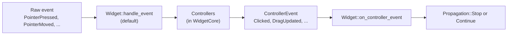

# Reusable input controllers

Buttons, sliders, scroll bars, and list rows all need the same input patterns: press, track, release inside; a drag threshold; long-press timing. A **controller** owns one pattern. It watches the raw events a widget receives and reports a high-level result, so the widget only decides what the result means.



## The controllers

| Controller | Reports | Notes |
|---|---|---|
| `ClickController` | `ClickPressed`, `ClickArmed(bool)`, `Clicked { button, count }`, `ClickCancelled` | Left button by default (`for_button` picks another). A release is a click only while the pointer is inside. Only events addressed to the widget itself count. |
| `DragController` | `DragStarted { start }`, `DragUpdated { start, offset }`, `DragEnded { start, offset }` | Starts after the pointer moves `threshold` pixels (default 4, `with_threshold` changes it). A press and release inside the threshold reports nothing, so it can still be a click. |
| `ScrollController` | `Scrolled { delta }` | Scrolls bubble, so a container sees scrolls over its children. |
| `HoverController` | `HoverEntered`, `HoverExited` | Each is reported once per crossing. |
| `LongPressController` | `LongPressed { position }` | Fires once after the button is held for the delay (default 500 ms, `with_delay` changes it) without moving more than 6 pixels. Time comes from `Event::Tick`, so the widget needs the `TIMER` event class. |
| `KeyController` | `KeyPressed { key, modifiers, repeat }`, `KeyReleased { key, modifiers }` | All keys, or only those given to `for_keys`. Keys bubble. |

Controller results are widget-internal; they are not [engine events](./engine-events.md).

## Using a controller

1. Create the widget's `WidgetCore` and call `core.add_controller(...)`. It also adds the event classes the controller needs to the widget's [event mask](../concepts/event-masks-for-the-run-loop-and-for-widgets.md), so call `set_event_mask` first if you use it.
2. Do **not** override `handle_event`: the default feeds every event to the controllers. If you must override it (to re-emit events, for example), call `self.feed_controllers(event, ctx)` from it.
3. Implement `on_controller_event`. Return `Propagation::Stop` to consume the raw event that produced the result.

```rust checked title="src/handle.rs"
use pushrod::controllers::{ControllerEvent, DragController};
use pushrod::event::{Event, EventCtx, Propagation};
use pushrod::geometry::{Point, Size};
use pushrod::paint::{self, Painter};
use pushrod::widget::{Widget, WidgetCore};

/// A handle that follows a drag and keeps its horizontal offset.
pub struct Handle {
    core: WidgetCore,
    value: i32,
}

impl Handle {
    pub fn new(origin: Point, size: Size) -> Self {
        let mut core = WidgetCore::new(origin, size);

        core.add_controller(DragController::new());

        Self { core, value: 0 }
    }
}

impl Widget for Handle {
    fn core(&self) -> &WidgetCore {
        &self.core
    }

    fn core_mut(&mut self) -> &mut WidgetCore {
        &mut self.core
    }

    fn paint(&self, p: &mut dyn Painter) {
        paint::fill(p, self.get_color());
    }

    fn on_controller_event(&mut self, event: &ControllerEvent, ctx: &mut EventCtx) -> Propagation {
        if let ControllerEvent::DragUpdated { offset, .. } = event {
            self.value = offset.x;
            self.set_invalidated(true);
            ctx.emit(Event::ValueChanged { id: self.get_id() });

            return Propagation::Stop;
        }

        Propagation::Continue
    }
}
```

A runnable version, driven without a window, is `examples/drag_controller.rs`: `cargo run --example drag_controller`.

## Writing your own

Implement the `Controller` trait: `handle(widget, event, out)` pushes results onto `out`, and `event_mask()` names the classes it needs. A controller is a plain state machine that never touches the widget, so test it by feeding it events, as the built-in controllers' tests do.

## Button

`Button` is the reference: it holds a `ClickController`, selects itself on `ClickPressed`, follows `ClickArmed`, and emits `Clicked` on `Clicked`. Its behavior is unchanged.
