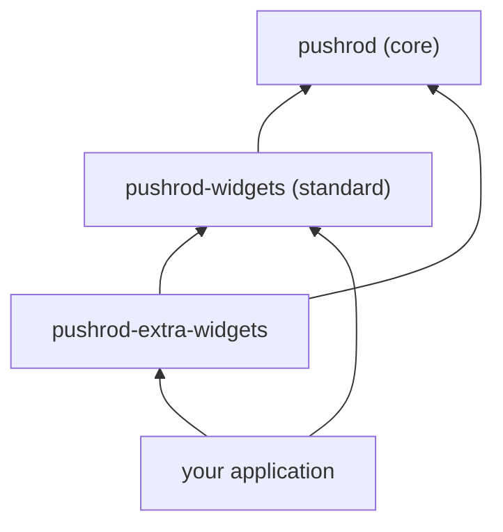

# Extra widgets

`pushrod-extra-widgets` is a separate crate of larger and compound widgets: pickers, trees, property grids, panels, and ready-made dialogs. The [standard widgets](../widgets) in `pushrod-widgets` stay deliberately simple; anything bigger lives here, so applications that don't need it never pay for it.

:::note Planned
The crate is on the roadmap and not released yet. Each widget gets its own page here when it is implemented. The plan, mockups, and order of work are in the [extra widgets roadmap](https://github.com/KenSuenobu/rust-pushrod/blob/main/docs/ROADMAP_EXTRA_WIDGETS.md).
:::

## How it fits

- **Same look.** Extra widgets follow the [design philosophy](../design-philosophy.md): flat fills, one-pixel borders, no bevels, gradients, shadows, glass, or rounded corners. They sit next to standard widgets on the same form.
- **Only public APIs.** The crate uses the public APIs of `pushrod` and `pushrod-widgets`, like any third-party [widget library](../concepts/widget-libraries.md).
- **Built from parts.** Compound widgets reuse standard widgets as parts you can retrieve and restyle.
- **Forms and Chassis.** `pushrod_extra_widgets::register` adds every widget to the widget registry under the `extra.` prefix (`extra.tree_view`), so form files and Chassis load them. Chassis uses the drawer, tool palette, breadcrumb bar, and property grid from this crate.

## Planned widgets

### Crate and foundations

| Widget | What it is | Release |
|---|---|---|
| [Create the pushrod-extra-widgets crate](https://github.com/KenSuenobu/rust-pushrod/blob/main/docs/extra-widgets/crate.md) | The crate, its registration function, its docs section, and its place in CI. | first release |
| [Extra widgets gallery example](https://github.com/KenSuenobu/rust-pushrod/blob/main/docs/extra-widgets/gallery.md) | A runnable gallery showing every extra widget, used for golden screenshots. | first release |
| [Popover: a floating panel anchored to a control](https://github.com/KenSuenobu/rust-pushrod/blob/main/docs/extra-widgets/popover.md) | A borderless panel that opens next to a control, holds any widgets, and closes on Escape or a click outside. | first release |

### Buttons and value controls

| Widget | What it is | Release |
|---|---|---|
| [Menu button and split button](https://github.com/KenSuenobu/rust-pushrod/blob/main/docs/extra-widgets/menu-button.md) | A button that opens a menu, and a button with a separate arrow part that opens one. | first release |
| [Segmented control](https://github.com/KenSuenobu/rust-pushrod/blob/main/docs/extra-widgets/segmented-control.md) | A row of joined buttons: pick one, or toggle several. | first release |
| [Stepper (up and down arrows)](https://github.com/KenSuenobu/rust-pushrod/blob/main/docs/extra-widgets/stepper.md) | A pair of small up/down arrows that step a value, attachable to any field. | first release |
| [Dial (rotary knob)](https://github.com/KenSuenobu/rust-pushrod/blob/main/docs/extra-widgets/dial.md) | A round control turned by dragging, the wheel, or the keyboard, for values like volume, pan, or angle. | first release |
| [Level indicator (meter)](https://github.com/KenSuenobu/rust-pushrod/blob/main/docs/extra-widgets/level-indicator.md) | A bar showing a level against warning and critical thresholds, continuous or in discrete segments. | first release |
| [Tool palette (grid of tool buttons)](https://github.com/KenSuenobu/rust-pushrod/blob/main/docs/extra-widgets/tool-palette.md) | A grid of icon buttons with one-of-many selection and optional drag out, for tools, swatches, or components. | first release |
| [Ruler](https://github.com/KenSuenobu/rust-pushrod/blob/main/docs/extra-widgets/ruler.md) | A horizontal or vertical scale in pixels, points, or units, with markers that can be dragged. | later |
| [Shortcut field (key combination recorder)](https://github.com/KenSuenobu/rust-pushrod/blob/main/docs/extra-widgets/shortcut-field.md) | A field that records the key combination pressed while it has focus. | later |

### Pickers and special fields

| Widget | What it is | Release |
|---|---|---|
| [Calendar (month view)](https://github.com/KenSuenobu/rust-pushrod/blob/main/docs/extra-widgets/calendar.md) | A month grid for choosing a day or a range of days, usable on its own or in the date picker. | first release |
| [Date picker](https://github.com/KenSuenobu/rust-pushrod/blob/main/docs/extra-widgets/date-picker.md) | A date field with a drop-down month calendar. | first release |
| [Time field and date-time field](https://github.com/KenSuenobu/rust-pushrod/blob/main/docs/extra-widgets/time-field.md) | A time entry with steppable parts, and a combined date-and-time field. | first release |
| [Color well and color picker](https://github.com/KenSuenobu/rust-pushrod/blob/main/docs/extra-widgets/color-picker.md) | A swatch button that opens a color picker with swatches, sliders, and a hex field. | first release |
| [Font chooser](https://github.com/KenSuenobu/rust-pushrod/blob/main/docs/extra-widgets/font-chooser.md) | A font button that opens a chooser with family, style, size, and a preview. | first release |
| [Path field (file or folder with Browse)](https://github.com/KenSuenobu/rust-pushrod/blob/main/docs/extra-widgets/path-field.md) | A text field for a file or folder path, with a Browse button and drop support. | first release |
| [Image well](https://github.com/KenSuenobu/rust-pushrod/blob/main/docs/extra-widgets/image-well.md) | A framed area that shows an image and accepts a new one by drop, paste, or Choose. | later |
| [New password (enter, confirm, strength)](https://github.com/KenSuenobu/rust-pushrod/blob/main/docs/extra-widgets/new-password.md) | Two password fields with a strength meter and a match check. | later |
| [Character picker](https://github.com/KenSuenobu/rust-pushrod/blob/main/docs/extra-widgets/character-picker.md) | A searchable grid of characters by block, with a preview and code point. | later |

### Data views

| Widget | What it is | Release |
|---|---|---|
| [Tree view (outline)](https://github.com/KenSuenobu/rust-pushrod/blob/main/docs/extra-widgets/tree-view.md) | A hierarchical list with expand/collapse triangles, backed by a tree data source. | first release |
| [Column browser](https://github.com/KenSuenobu/rust-pushrod/blob/main/docs/extra-widgets/column-browser.md) | Columns of lists where selecting an item in one column fills the next, as in NeXTSTEP and the Mac Finder. | later |
| [Icon grid view](https://github.com/KenSuenobu/rust-pushrod/blob/main/docs/extra-widgets/icon-grid.md) | A scrolling grid of icons with captions, rubber-band selection, and drag and drop. | later |
| [Data grid (editable table)](https://github.com/KenSuenobu/rust-pushrod/blob/main/docs/extra-widgets/data-grid.md) | A table whose cells edit in place with typed editors, with row add and delete. | later |
| [Property grid (name and value inspector)](https://github.com/KenSuenobu/rust-pushrod/blob/main/docs/extra-widgets/property-grid.md) | Categorized name/value rows with an editor per value type. | first release |
| [Check list](https://github.com/KenSuenobu/rust-pushrod/blob/main/docs/extra-widgets/check-list.md) | A list with a check box on every row, separate from the selection. | first release |
| [Editable list (add, remove, reorder)](https://github.com/KenSuenobu/rust-pushrod/blob/main/docs/extra-widgets/editable-list.md) | A list with + and - buttons underneath, in-place editing, and reordering. | first release |
| [Dual list (list builder)](https://github.com/KenSuenobu/rust-pushrod/blob/main/docs/extra-widgets/dual-list.md) | Available and chosen lists side by side, with buttons to move items between them and order the chosen list. | later |
| [Breadcrumb bar (path control)](https://github.com/KenSuenobu/rust-pushrod/blob/main/docs/extra-widgets/breadcrumb-bar.md) | A row of clickable path segments, with a menu of siblings on each separator. | first release |
| [Filter field (live filter for lists, tables, and trees)](https://github.com/KenSuenobu/rust-pushrod/blob/main/docs/extra-widgets/filter-field.md) | A search field bound to a list, table, or tree that hides non-matching rows as you type. | later |
| [Rule editor (query builder)](https://github.com/KenSuenobu/rust-pushrod/blob/main/docs/extra-widgets/rule-editor.md) | Rows of "field, operator, value" with add and remove buttons, joined by All or Any. | later |
| [Image viewer (zoom and pan)](https://github.com/KenSuenobu/rust-pushrod/blob/main/docs/extra-widgets/image-viewer.md) | An image in a scrollable view with zoom to fit, actual size, zoom by wheel, and drag to pan. | later |

### Panels and navigation

| Widget | What it is | Release |
|---|---|---|
| [Drawer (collapsible side panel)](https://github.com/KenSuenobu/rust-pushrod/blob/main/docs/extra-widgets/drawer.md) | A side panel with a title bar that collapses to a thin strip and remembers its width. | first release |
| [Accordion (one section open at a time)](https://github.com/KenSuenobu/rust-pushrod/blob/main/docs/extra-widgets/accordion.md) | A stack of titled sections where opening one closes the others. | first release |
| [Sidebar (navigation list)](https://github.com/KenSuenobu/rust-pushrod/blob/main/docs/extra-widgets/sidebar.md) | A list of sections with icons and headings that switches the page beside it. | first release |
| [Document tabs (closable and reorderable)](https://github.com/KenSuenobu/rust-pushrod/blob/main/docs/extra-widgets/document-tabs.md) | A tab bar for open documents: close buttons, a modified mark, drag to reorder, and overflow. | later |

### Dialogs and assistants

| Widget | What it is | Release |
|---|---|---|
| [Input dialog (ask for one value)](https://github.com/KenSuenobu/rust-pushrod/blob/main/docs/extra-widgets/input-dialog.md) | A one-call modal dialog asking for a single text, number, or choice. | first release |
| [Progress dialog](https://github.com/KenSuenobu/rust-pushrod/blob/main/docs/extra-widgets/progress-dialog.md) | A modal dialog with a message, a progress bar, and Cancel, for long tasks. | first release |
| [Task dialog (alert with details and options)](https://github.com/KenSuenobu/rust-pushrod/blob/main/docs/extra-widgets/task-dialog.md) | An alert with a main instruction, expandable details, a "don't ask again" box, and command choices. | first release |
| [Wizard (step-by-step assistant)](https://github.com/KenSuenobu/rust-pushrod/blob/main/docs/extra-widgets/wizard.md) | Pages shown one at a time with Back, Next, and Finish, and a list of steps. | later |
| [Settings dialog](https://github.com/KenSuenobu/rust-pushrod/blob/main/docs/extra-widgets/settings-dialog.md) | A sidebar of categories, a page per category, and OK, Cancel, and Apply. | later |
| [About dialog](https://github.com/KenSuenobu/rust-pushrod/blob/main/docs/extra-widgets/about-dialog.md) | The application's icon, name, version, copyright, website, and credits and license pages. | later |
| [Find and replace bar](https://github.com/KenSuenobu/rust-pushrod/blob/main/docs/extra-widgets/find-bar.md) | A bar with find and replace fields, match options, a match count, and next and previous. | later |
| [Keyboard shortcuts editor](https://github.com/KenSuenobu/rust-pushrod/blob/main/docs/extra-widgets/shortcuts-editor.md) | A filterable table of actions and their shortcuts, edited with the shortcut field. | later |
