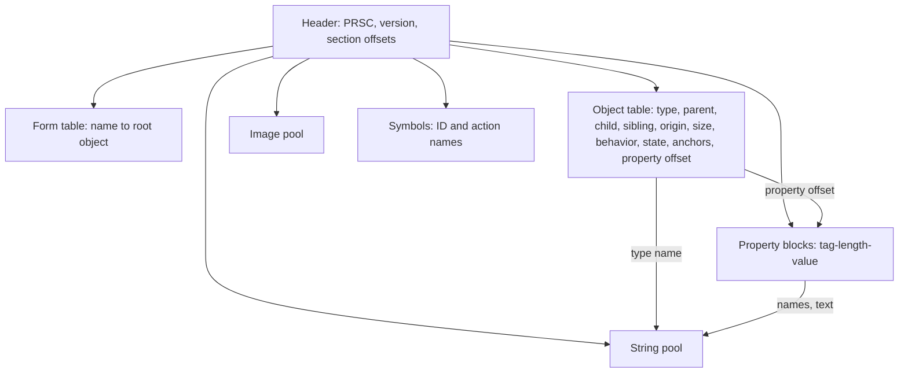

# Form file format

Designed forms are stored in a compact binary **form file**. A program refers to every object by its **number**, as classic resource files did. `pushrod::form::FormFile` reads and writes the format with the standard library only. The byte-level definition is [`docs/FORM_FORMAT.md`](https://github.com/KenSuenobu/rust-pushrod/blob/main/docs/FORM_FORMAT.md), and the conformance tests are in `tests/conformance/forms.rs`.



## What a file holds

| Section | Holds |
| --- | --- |
| Form table | Each form's name and its root object number |
| Object table | One fixed-size record per widget; the record's index is the object number. Widgets form trees through parent, first child, and next sibling numbers |
| Property blocks | Each object's properties: named values (`text`, `value`, ...), the container's **layout** (kind and parameters), and the child's **layout parameters** (stretch, alignment, margins, grid cell) |
| String pool | Every string once; other sections store indexes |
| Image pool | Encoded images (for example PNG files), stored untouched |
| Symbol table | Names for object numbers (`OK_BUTTON`) and for actions (`save`) |

## Write and read a form

```rust checked title="src/main.rs"
use pushrod::form::{
    FORMAT_VERSION, FormFile, FormValue, LayoutSpec, NO_OBJECT, ObjectRecord, Property, SymbolKind,
};

fn main() {
    let mut file = FormFile::new();

    let mut panel = ObjectRecord::new("pushrod.panel");
    panel.width = 240;
    panel.height = 120;
    panel.properties.push(Property::Layout(LayoutSpec {
        kind: 2,
        params: vec![8],
    }));
    let root = file.add_object(None, panel);

    let mut button = ObjectRecord::new("pushrod.button");
    button
        .properties
        .push(Property::named("text", FormValue::Text("OK".to_string())));
    let ok = file.add_object(Some(root), button);

    file.add_form("Sample", root);
    file.add_symbol(SymbolKind::Id, ok, "OK_BUTTON");

    let bytes = file.to_bytes().expect("the form is consistent");
    println!("Form file version {FORMAT_VERSION}, {} bytes", bytes.len());

    let loaded = FormFile::from_bytes(&bytes).expect("the bytes were just written");
    assert_eq!(loaded, file);
    assert_eq!(loaded.objects[ok as usize].parent, root);
    assert_eq!(loaded.objects[root as usize].parent, NO_OBJECT);
    println!("OK_BUTTON is object {}", loaded.id_of("OK_BUTTON").unwrap());
}
```

The same program is the `form_format` example: `cargo run --example form_format`.

## Versions and unknown properties

- The header carries a version. A reader accepts its own version and older, and returns `FormError::UnsupportedVersion` for a newer file.
- Properties are **tag-length-value** entries, so adding a property in a later version does not break older readers: they skip tags (and value kinds) they do not know.

## Damaged files

`FormFile::from_bytes` checks every offset, length, count, string index, and object number, and returns a `FormError` (`BadMagic`, `UnsupportedVersion`, `Truncated`, `Invalid`) instead of panicking. It also rejects broken tree links, an object listed under two parents, and parent cycles. `FormFile::to_bytes` runs the same consistency check (`FormFile::validate`) before it writes.

This page covers the file format only. Loading a form into widgets, saving a widget subtree, and generating ID constants are separate steps built on it. The format is plain data, so it emits no engine events.
