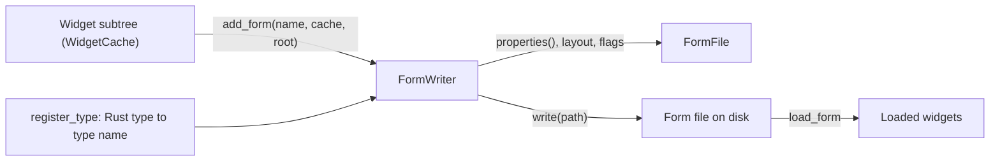

# Form writer

`FormWriter` is the other half of [loading forms](./loading-forms.md): it walks a widget subtree and stores it as a form in a [form file](./form-file-format.md). Chassis uses it to save designs, and tests use it to make files from code-built forms.



## Save a form

```rust checked title="src/main.rs"
use pushrod::engine::Engine;
use pushrod::form::{FormWriter, SymbolKind};
use pushrod::geometry::{point, size};
use pushrod::widget::Widget;
use pushrod_widgets::prelude::*;

fn main() {
    let mut engine: Engine = Engine::new(size(320, 200), 30);
    let mut panel = Panel::new();

    panel.set_size(size(200, 80));
    let panel = engine.add_widget(panel);

    let mut ok = Button::new("OK");

    ok.set_origin(point(10, 40));
    ok.set_size(size(60, 24));
    let ok = engine.add_child_widget(panel, ok);

    let mut writer = FormWriter::new();

    pushrod_widgets::register_form_types(&mut writer);

    // The writer returns the object number of every widget it wrote.
    let numbers = writer
        .add_form("main", engine.widgets(), panel)
        .expect("the form can be saved");

    writer.add_symbol(SymbolKind::Id, numbers[&ok], "OK_BUTTON");
    assert_eq!(writer.file().forms[0].name, "main");

    // writer.write("main.form") saves the file; `to_bytes()` returns the same bytes.
    assert!(writer.to_bytes().is_ok());
}
```

The runnable version also loads the file back: `cargo run -p pushrod-widgets --example form_writer`.

## Telling the writer your widget types

A widget does not know its registry name, so tell the writer which Rust type is saved as which name with `writer.register_type::<MyWidget>("acme.my_widget")`. `pushrod_widgets::register_form_types(&mut writer)` does it for every standard widget, using the same names as `pushrod_widgets::register`. A widget whose type is not registered is an `Error::FormFile` naming the widget.

## What is written

| Stored | How |
| --- | --- |
| Origin, size, behavior, and state | In the object record. |
| Properties | Everything `Widget::properties()` lists, except the ones the record already holds (`x`, `y`, `width`, `height`, `hidden`, `enabled`, `behavior`, `state`, and the layout parameters). |
| A container's layout | `Column` and `Row` (spacing and one margin for all sides). A layout the format cannot store, such as `Column::align` or different margins per side, is an `Error::FormFile`. |
| A child's layout parameters | Only when they differ from the defaults. |
| **Composite parts** | **Not written.** A composite is saved as its own type and rebuilt when it is created. |
| Strings | Once each, by the file's string pool. |
| Images | Once each, in the image pool. |

Two limits of the loader apply to a saved file: a behavior or state of zero keeps what the widget's constructor set, and a layout's alignment and anchors that the loader does not apply yet are stored but ignored.

## Images

`writer.add_image("logo", &bytes)` adds an image to the pool and returns its number; adding the same name and bytes again returns the same number. `writer.image_property("path")` makes a text property with that name (the standard image widget's) store as a reference to the pool when its text is the name of an added image. `register_form_types` already does this for `path`.

## Object numbers and symbols

`add_form` returns a map from each `WidgetId` to its object number. Use it with `writer.add_symbol(SymbolKind::Id, number, "OK_BUTTON")` to give widgets names the loader and ID-constant generator can use. Several forms can be added to one writer; each name may be used once, and an error leaves the file unchanged.

## Errors

| Problem | Error |
| --- | --- |
| The root widget does not exist | `Error::UnknownWidget` |
| A type is not registered, a layout cannot be stored, or the form name is taken | `Error::FormFile` naming the form and widget |
| The file cannot be written | `Error::FormFile` naming the path |

## See also

- [Loading forms](./loading-forms.md): builds the widgets back from the file.
- [Form file format](./form-file-format.md): the file this page writes.
- [Property introspection](./property-introspection.md): how the writer reads properties.
