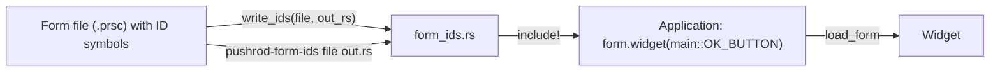

# Generate ID constants from a form file

A callback attaches to a widget by its object number. Writing the number by hand is fragile; writing the name from the form file's symbol table is safe if the compiler checks it. `pushrod::form::codegen` turns every ID symbol into a Rust constant, so a widget that is renamed or removed in the designer **removes the constant and breaks the build**.



## What is generated

For a form named `main` whose `OK_BUTTON` symbol names object 5:

```rust
// Generated by pushrod::form::codegen from a form file.  Do not edit.

#[allow(dead_code)]
pub mod main {
    use pushrod::form::FormIndex;

    /// Object 5 of form `main`.
    pub const OK_BUTTON: FormIndex = FormIndex(5);
}
```

| Rule | Behavior |
| --- | --- |
| One module per form | The form's name in `snake_case`: `Sign In` becomes `sign_in`. |
| One constant per ID symbol | The symbol's name in `SHOUTING_CASE`: `userName` becomes `USER_NAME`. |
| Which symbols | Only `SymbolKind::Id` symbols of an object in that form's tree. Action symbols and symbols that name no object of a form are left out. |
| Order | Forms in file order, constants by object number: the output is deterministic. |
| Formatting | Already `rustfmt`-clean, so regenerating changes nothing. |

An unusable name is an error rather than a silent rename: a name with no letters or digits, one that starts with a digit, a form named like a Rust keyword (`type`), two forms with the same module name, or two symbols with the same constant name in a form.

## From a program

`generate_ids` returns the source text, with no files involved:

```rust checked title="src/main.rs"
use pushrod::form::codegen::generate_ids;
use pushrod::form::{FormFile, ObjectRecord, SymbolKind};

fn main() {
    let mut file = FormFile::new();
    let root = file.add_object(None, ObjectRecord::new("pushrod.panel"));
    let ok = file.add_object(Some(root), ObjectRecord::new("pushrod.button"));

    file.add_form("main", root);
    file.add_symbol(SymbolKind::Id, ok, "OK_BUTTON");

    let source = generate_ids(&file).expect("the names are valid identifiers");

    assert!(source.contains("pub const OK_BUTTON: FormIndex = FormIndex(1);"));
}
```

## From build.rs

`write_ids(file, out_rs)` reads a form file and writes the constants. It leaves the output alone when its text would not change, so an unchanged form does not rebuild your program.

```rust title="build.rs"
use std::path::PathBuf;

fn main() {
    println!("cargo:rerun-if-changed=forms/app.prsc");

    let out = PathBuf::from(std::env::var_os("OUT_DIR").unwrap());

    pushrod::form::codegen::write_ids("forms/app.prsc", out.join("form_ids.rs"))
        .expect("the ID constants are generated");
}
```

List `pushrod` under `[build-dependencies]` in `Cargo.toml`. Include the result and attach by constant. `FormHandle::widget` takes a `FormIndex`:

```rust title="src/main.rs"
include!(concat!(env!("OUT_DIR"), "/form_ids.rs"));

// ...
let ok = form.widget(main::OK_BUTTON).expect("the form has an OK button");
```

The runnable version is the `form` example: its `build.rs` writes a sample form file and generates its constants. Run it with `cargo run -p pushrod-widgets --example form`.

## From a shell

```text
pushrod-form-ids forms/app.prsc src/form_ids.rs
```

Build it with `cargo run --bin pushrod-form-ids -- <form-file> <out.rs>`. It exits with status 0 on success. With the wrong number of arguments, or a file that is missing or damaged, it prints the reason and exits with status 1.

## Errors

| Problem | Error |
| --- | --- |
| A file cannot be read or written, or the form file is damaged | `Error::FormFile` naming the path |
| A name is not a usable identifier, or two names collide | `Error::FormFile` (`FormError::Invalid` from `generate_ids`) |

Generation is an offline build step with no running engine, so it emits no engine event.

## See also

- [Loading forms](./loading-forms.md): `FormHandle::widget` and `FormHandle::id` find the widget for a constant.
- [Form writer](./form-writer.md): `add_symbol` names the widgets that become constants.
- [Form file format](./form-file-format.md): the symbol table this page reads.
