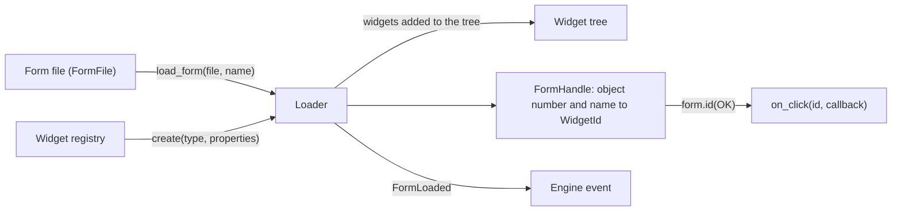

# Loading forms

A form file stores the widgets of a window. Your code does not rebuild them: it **loads** the form and **attaches callbacks**. `Engine::load_form(&file, "main")` creates every widget through the [widget registry](./widget-registry-and-factory.md), applies its properties, and returns a `FormHandle` that maps the file's object numbers to widget IDs.



## Load a form

```rust checked title="src/main.rs"
use pushrod::engine::Engine;
use pushrod::form::{FormFile, FormValue, ObjectRecord, Property, SymbolKind};
use pushrod::geometry::size;

/// The object number of the OK button, as an ID constant.
const OK: u32 = 1;

fn main() {
    // Normally the file is read from disk with `FormFile::from_bytes`.
    let mut file = FormFile::new();
    let mut panel = ObjectRecord::new("pushrod.panel");

    panel.width = 200;
    panel.height = 80;

    let root = file.add_object(None, panel);
    let mut button = ObjectRecord::new("pushrod.button");

    button.width = 60;
    button.height = 24;
    button
        .properties
        .push(Property::named("text", FormValue::Text("OK".into())));
    file.add_object(Some(root), button);
    file.add_form("main", root);
    file.add_symbol(SymbolKind::Id, OK, "OK_BUTTON");

    let mut engine: Engine<u32> = Engine::new(size(320, 200), 30);

    pushrod_widgets::register(engine.widget_registry());

    let form = engine.load_form(&file, "main").expect("the form is valid");
    let ok = form.id(OK).expect("the form has an OK button");

    engine.on_click(ok, |clicks, _ui| *clicks += 1);
    assert_eq!(form.named("OK_BUTTON"), Some(ok));
}
```

The runnable version is `pushrod-widgets/examples/form.rs`: `cargo run -p pushrod-widgets --example form`.

`Engine::widget_registry()` starts empty. Register the standard widgets with `pushrod_widgets::register`, and any of your own types, **before** loading.

## The form handle

| Method | Returns |
| --- | --- |
| `form.root()` | The widget made from the form's root object |
| `form.id(number)` | The widget for a form-local object number (an ID constant), or `None` |
| `form.widget(main::OK_BUTTON)` | The widget for a generated [`FormIndex` constant](./generate-id-constants-from-a-form-file.md), or `None` |
| `form.named("OK_BUTTON")` | The widget for a name in the file's symbol table, or `None` |
| `form.action("save")` | The number of an action symbol, or `None` |
| `form.name()`, `form.len()` | The form's name and how many widgets it created |

`Engine::load_form_into(parent, &file, name)` loads the form as a child of another widget (a tab page, a container) instead of the window's root.

## What the loader applies

For each object, in this order:

1. The **named properties** are passed to the registered constructor (`text`, `value`, ...). An image property becomes a text property holding the image's name in the file's image pool.
2. The record's **origin** is applied, and its **size** when the width or height is not zero (zero keeps the widget's own size).
3. **Behavior** and **state** flags replace the widget's flags when not zero (zero keeps what the constructor set).
4. The container's **layout** and the child's **layout parameters** are applied.

| Layout kind | Layout | Parameters |
| --- | --- | --- |
| `0` | None: children keep their positions | |
| `1` | `Column` (top to bottom) | spacing, then a margin on every side (both optional) |
| `2` | `Row` (left to right) | spacing, then a margin on every side (both optional) |

Alignment codes in a child layout: `0` start, `1` center, `2` end, `3` fill. The grid cell is stored in the file and not applied yet. The object's `anchors` are applied as [`Anchors`](../concepts/autoresizing.md); `0` means none, and a value with unknown bits is rejected.

## Errors

Loading is **all or nothing**: every widget is built before any is added, so a failed load leaves the window as it was. Each error names the object and, when there is one, the property:

| Problem | Error |
| --- | --- |
| A damaged or inconsistent file, or an unknown form name | `Error::FormFile`, naming the form |
| A type that is not registered | `Error::FormFile`: `object 3 (acme.missing): widget type "acme.missing" is not registered` |
| A missing or wrong property | `Error::Property`: `text: object 2 (pushrod.button): required text property is missing` |
| An unknown layout kind or alignment code | `Error::FormFile`: `object 0 (pushrod.panel): unknown layout kind 99` |
| An unknown parent for `load_form_into` | `Error::UnknownWidget` |

## Engine event

A successful load queues `EngineEvent::FormLoaded { form, root, widgets }` after the `WidgetAdded` events of the form's widgets. See [Engine events](../events/engine-events.md).

## See also

- [Form file format](./form-file-format.md): the file this page loads.
- [Generate ID constants](./generate-id-constants-from-a-form-file.md): names for the object numbers.
- [Widget registry and factory](./widget-registry-and-factory.md): how a type name becomes a widget.
