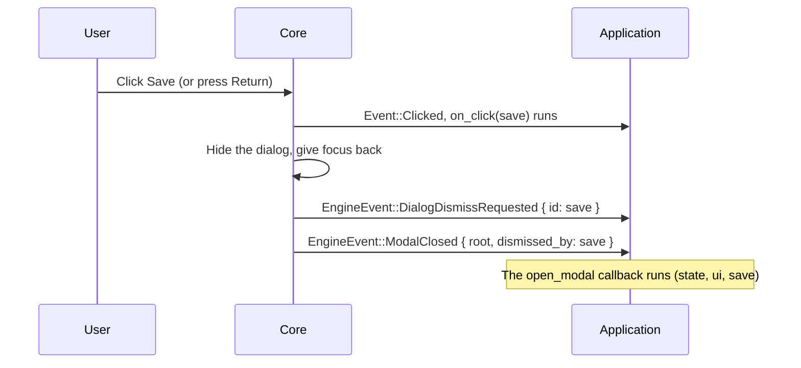

# Modal dialogs

A **modal dialog** takes all the input until it is dismissed. Alerts, file choosers, and settings dialogs work this way. Open one from any callback with `ui.open_modal(root, |state, ui, dismissed_by| ..)`:

- `root` is the dialog's root widget. Usually it is a hidden `Panel` that holds the dialog's controls and is built with the rest of the window.
- The callback runs **once**, when a dismissing control inside the dialog is chosen. It receives the application state, a `Ui`, and the ID of the control that closed the dialog.


## Running a dialog

```rust checked title="src/settings.rs"
use pushrod::engine::Engine;
use pushrod::widget::{Widget, WidgetId};
use pushrod_widgets::button::Button;
use pushrod_widgets::check_box::CheckBox;
use pushrod_widgets::panel::Panel;

/// The saved settings.
#[derive(Default)]
pub struct Settings {
    pub autosave: bool,
}

/// Builds a Settings... button and the hidden dialog it opens.
pub fn build(engine: &mut Engine<Settings>) {
    let open = engine.add_widget(Button::new("Settings...").at(20, 20).size(120, 24));

    // The dialog starts hidden; `open_modal` shows it.
    let dialog = engine.add_widget(Panel::new().at(60, 40).size(300, 140));
    engine.widgets().get_mut(dialog).unwrap().set_hidden(true);

    let autosave = engine.add_child_widget(dialog, CheckBox::new("Autosave").at(16, 16).size(200, 24));
    let _cancel = engine.add_child_widget(
        dialog,
        Button::new("Cancel").at(100, 100).size(84, 24).cancel_action().dismisses_dialog(),
    );
    let save: WidgetId = engine.add_child_widget(
        dialog,
        Button::new("Save").at(196, 100).size(84, 24).default_action().dismisses_dialog(),
    );

    engine.on_click(open, move |settings, ui| {
        if let Some(check) = ui.get_mut::<CheckBox>(autosave) {
            check.set_checked(settings.autosave);
        }

        // Runs once, when Save or Cancel (or Return or Escape) closes the dialog.
        let _ = ui.open_modal(dialog, move |settings, ui, dismissed_by| {
            if dismissed_by == save {
                settings.autosave = ui.get::<CheckBox>(autosave).is_some_and(|c| c.is_checked());
            }
        });
    });
}
```

The complete program, with a nested confirmation alert and a status line of engine events, is `pushrod-sdl2/examples/settings_dialog.rs`. Run it with `cargo run -p pushrod-sdl2 --example settings_dialog`.

## While a dialog is open

| What | Behavior |
|---|---|
| **Drawing** | The dialog's root is shown and raised above its siblings. The rest of the window is still drawn. |
| **Input** | Only the dialog's root and its descendants receive pointer, key, and text input. Everything else is **inert**: clicks, hover, and the wheel do nothing there, and it never looks hovered or pressed. |
| **Focus** | Focus moves to the dialog's first focusable widget in Tab order, or is cleared if it has none. Tab and Shift-Tab stay inside the dialog, and inert widgets cannot take focus, even with `set_focus`. |
| **Return / Escape** | Return activates the dialog's `DEFAULT_ACTION` widget and Escape (or Cmd-. on macOS) its `CANCEL_ACTION` widget. The search stops at the dialog's root, so the main window's default button is never pressed. |
| **Not blocked** | Timers, animation ticks, idle callbacks, custom events, and broadcasts (such as a window resize) still reach every widget, because they are not input. |

`WidgetCache::is_inert(id)` tells whether a widget is blocked, `top_modal()` returns the dialog that has the input, and `open_modals()` lists every open dialog, first opened first.

## Dismissing a dialog

A widget with `Behavior::DISMISSES_DIALOG` closes the dialog that holds it when it is clicked or activated. On a `Button`, set it with `dismisses_dialog()`. A button that is also `default_action()` or `cancel_action()` closes the dialog on Return or Escape too.



When a dialog closes:

1. Its root is hidden again, so the same dialog can be opened again later.
2. Focus goes back to the widget that had it when the dialog opened, or to the next dialog down.
3. The dismissing control's own callbacks run first (`on_click`, `on_activate`), then the `open_modal` callback runs with the control's ID.

A dismissing control outside every open dialog, or with no dialog open, does nothing. If a dialog's root is removed from the tree while the dialog is open, the dialog is forgotten and its callback never runs.

## Nested dialogs

Dialogs nest. Opening a dialog while another is open (for example an "Are you sure?" alert from a dialog's Reset... button) makes the new one the only one that takes input. The dialog underneath is drawn but inert until the alert closes. Then focus goes back to where it was in that dialog. A dismissal callback can also open the next dialog.

```rust
engine.on_click(reset, move |_state, ui| {
    let _ = ui.open_modal(alert, move |_state, ui, dismissed_by| {
        if dismissed_by == confirm {
            // Put the dialog's controls back to their defaults.
        }
    });
});
```

## Errors

`open_modal` returns `Result<()>`. The dialog does not open, and the callback is dropped, when:

| Error | Cause |
|---|---|
| `Error::UnknownWidget { id }` | `root` does not exist, or was removed. |
| `Error::Tree { id, .. }` | `root` is the window's root widget, or that dialog is already open. |

## Engine events

| Event | Fires when |
|---|---|
| `EngineEvent::ModalOpened { root }` | A dialog opened. |
| `EngineEvent::DialogDismissRequested { id }` | A `DISMISSES_DIALOG` widget was clicked or activated. A `Button` emits it itself. |
| `EngineEvent::ModalClosed { root, dismissed_by }` | The dialog closed. The `open_modal` callback runs just before the other callbacks see this event. |

See [Engine events](../events/engine-events.md).

## Reference

| Call | Meaning |
|---|---|
| `Ui::open_modal(root, callback)` | Open a dialog and run `callback(state, ui, dismissed_by)` once when it is dismissed. |
| `WidgetCache::open_modal(root)` | Open a dialog without a callback (the `ModalClosed` event still reports the dismissal). |
| `WidgetCache::top_modal()` | The root of the dialog that has the input, or `None`. |
| `WidgetCache::open_modals()` | Every open dialog's root, first opened first. |
| `WidgetCache::is_inert(id)` | Whether an open dialog blocks a widget from input. |

See also [Keyboard and focus](../guides/keyboard-and-focus.md#dialogs) and [Button](../widgets/button.md#behaviors).
