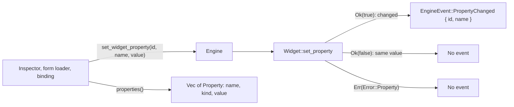

# Property introspection

Saving and loading forms, property bindings, and a visual designer's inspector all need to list and change a widget's values **without knowing its concrete type**. Every `Widget` can do this with two methods: `properties()` lists them, and `set_property(name, value)` changes one.



## Listing and setting properties

```rust checked title="src/main.rs"
use pushrod::prelude::*;
use pushrod::registry::PropertyValue;
use pushrod::root_widget::RootWidget;

fn main() {
    let mut engine: Engine<()> = Engine::new(size(200, 100), 30);
    let id = engine.add_widget(RootWidget::new(size(50, 20)));

    // List: every property has a name, a kind, and a value.
    let listed = engine.widgets().get(id).unwrap().properties();

    assert!(listed.iter().any(|p| p.name == "width"));

    // Set: `Ok(true)` means the value changed, `Ok(false)` that it already had it.
    assert_eq!(engine.set_widget_property(id, "x", &PropertyValue::Int(5)), Ok(true));
    assert_eq!(engine.set_widget_property(id, "x", &PropertyValue::Int(5)), Ok(false));

    // A bad name, kind, or value is an error, not a panic.
    assert!(engine.set_widget_property(id, "nope", &PropertyValue::Int(1)).is_err());
}
```

A `Property` is `{ name, kind, value }`. The `kind` is one of `Bool`, `Int`, `Float`, `Text`, or `Color`, and `value` is the same `PropertyValue` the [widget registry](widget-registry-and-factory.md) and form files use, so a listed property can be written straight back.

Call `engine.set_widget_property(id, name, &value)` (or `ui.set_widget_property(..)` inside a callback) to change a property **and** emit the event. Calling `widget.set_property(..)` directly changes the widget but emits nothing, because a widget cannot reach the engine.

## Properties every widget has

| Name | Kind | Meaning |
|---|---|---|
| `x`, `y` | Int | Origin, relative to the parent. |
| `width`, `height` | Int | Size in pixels (0 or more). |
| `color` | Color | Background color. |
| `hidden` | Bool | Hidden widgets and their children are not drawn. |
| `enabled` | Bool | Disabled widgets receive no input. |
| `tooltip` | Text | Tooltip text; empty for none. It is stored only: showing it is not part of this step. |
| `behavior` | Int | The `Behavior` flag bits. Unknown bits are an error. |
| `state` | Int | The `VisualState` flag bits. Unknown bits are an error. |
| `stretch` | Int | Layout stretch factor. |
| `margin_left`, `margin_top`, `margin_right`, `margin_bottom` | Int | Layout margin in pixels. |
| `align_horizontal`, `align_vertical` | Text | `start`, `center`, `end`, or `fill`. |

`stretch`, the margins, and the alignments are the widget's `LayoutParams`, which is how a widget is placed in a layout.

## Properties of the standard widgets

These come after the core properties.

| Widget | Properties |
|---|---|
| `Button` | `text`, `checked`, `border_width` |
| `CheckBox` | `text`, `checked`, `indeterminate` |
| `RadioButton` | `text`, `checked` |
| `Text` | `text`, `font_color` |
| `BoxedLabel` | `text`, `border_color` |
| `GroupBox` | `title`, `border_color` |
| `GlyphButton` | `glyph` (one character), `font_color` |
| `ImageWidget` | `path` |
| `ProgressBar` | `max`, `value`, `indeterminate`, `outline` |
| `Slider` | `min`, `max`, `step`, `value`, `vertical` (read only) |
| `ScrollBar` | `value`, `step`, `page_size` (all fractions from 0 to 1), `vertical` (read only) |
| `Separator` | `etched`, `line_color`, `vertical` (read only) |
| `Frame` | `border_width`, `border_color` |
| `TextField` | `text` |
| `Container` | `line_step` |
| `Alert`, `Panel`, `CustomPaint` | core properties only |

A read-only property is listed but `set_property` returns an `Error::Property`; it is fixed when the widget is built. A setter that clamps a value (a slider's `value` past its range) reports `Ok(false)` if the clamped result is what the widget already had.

## The PropertyChanged event

`EngineEvent::PropertyChanged { id, name }` is emitted after a property **actually changed**. It is not sent when the value was already the one given, or when the call failed. Listen for it like any [engine event](../events/engine-events.md):

```rust
engine.on_engine_event_filtered(&[EngineEventKind::PropertyChanged], |state, ui, event| {
    // Read the new value with `ui.get::<T>(id)` or `properties()`.
});
```

## Errors

| Error | When |
|---|---|
| `Error::UnknownWidget` | `set_widget_property` was given an ID that does not exist. |
| `Error::Property` | There is no such property, it is read only, or the value has the wrong kind or is out of range. |

## Writing properties for your own widget

The defaults cover the core properties. A widget with more overrides both methods: add to `core_properties(self)`, and fall back to `set_core_property` for any other name.

```rust
use pushrod::properties::{Property, core_properties, expect_text, set_core_property, track};
use pushrod::registry::PropertyValue;

fn properties(&self) -> Vec<Property> {
    let mut list = core_properties(self);

    list.push(Property::text("caption", self.caption()));
    list
}

fn set_property(&mut self, name: &str, value: &PropertyValue) -> Result<bool> {
    match name {
        "caption" => {
            let text = expect_text(name, value)?.to_string();

            // `track` reports whether any property differs afterward.
            track(self, |w| w.set_caption(text))
        }
        _ => set_core_property(self, name, value),
    }
}
```

Run `cargo run -p pushrod-widgets --example properties` to see a slider's properties listed and changed.
