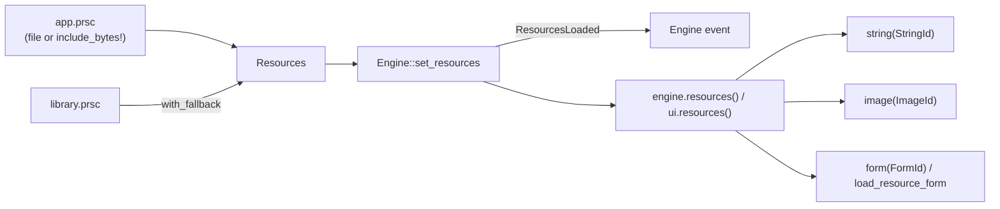

# Resources

An application's text, pictures, icons, and data files belong with its user interface, not scattered across the disk or hard-coded. You **load a resource file once** and ask for each piece **by ID**, the way GEM, the Macintosh, and Windows applications do. A `Resources` value holds the loaded file (a *set*), and the `Engine` owns the one you give it.



## Loading

```rust
use pushrod::resource::Resources;

// From a file ...
let from_file = Resources::load("app.prsc")?;

// ... or embedded in the executable: one binary, nothing to install beside it.
let embedded = Resources::from_bytes(include_bytes!("app.prsc"))?;
# Ok::<(), pushrod::error::Error>(())
```

Both give the same results. The data is checked once at load and returns `Result`: a missing file, a wrong magic, a truncated or inconsistent file is an `Error::FormFile`, never a panic. Dropping the set frees it.

Give the set to the engine so callbacks can reach it:

```rust,ignore
engine.set_resources(embedded);

// In a callback:
let text = ui.resources().string(strings::HELLO);
```

`Engine::set_resources` queues `EngineEvent::ResourcesLoaded { sets }`, and, if it replaced sets, `EngineEvent::ResourcesFreed { sets }` first. `Engine::clear_resources` frees them. See [Engine events](../events/engine-events.md).

## Getting resources by ID

One typed getter per kind. Each returns `None` when no set has that ID.

| Getter | Returns |
| --- | --- |
| `string(StringId)` | `&str` |
| `image(ImageId)` | `ImageHandle` (shared bytes and a texture cache key) |
| `icon(IconId)` | `IconHandle` (`image`, `mask`, `selected`, `caption`) |
| `file(FileId)` | `&[u8]` |
| `menu(MenuId)` | `&MenuResource` |
| `alert(AlertId)` | `&AlertResource` |
| `form(FormId)` | the set and form name; build it with `Engine::load_resource_form(FormId)` |

IDs are [typed per kind](./generate-id-constants-from-a-form-file.md), so `resources.image(strings::HELLO)` does not compile.

`engine.load_resource_form(forms::MAIN)` builds the widget tree through the [widget registry](./widget-registry-and-factory.md) and returns a [`FormHandle`](./loading-forms.md).

### Images

`image` returns the same shared handle every time: cloning it shares the bytes, `ImageHandle::is_same` tells whether two handles are one image, and `ImageHandle::key` is the name a backend caches its GPU texture under, so an image used by many widgets is uploaded once.

## Stacking sets

`Resources::with_fallback(other)` appends the sets of `other` after this manager's own. Lookups search the sets in order, so an application set overrides a library set that ships defaults:

```rust
use pushrod::resource::Resources;

fn build(app: &[u8], library: &[u8]) -> pushrod::error::Result<Resources> {
    Ok(Resources::from_bytes(app)?.with_fallback(Resources::from_bytes(library)?))
}
```

IDs are numbers in each file, so a library and an application that use the same ID are the same slot: the application's wins.

## Finding by name

`resources.find::<ImageId>("LOGO")` returns an ID from a resource's name, for tools and debugging. Applications use the generated constants.

## Example

`cargo run --example resources` loads two sets, stacks them, and prints a string, an image's key, and a file.

## Not yet

Properties that reference a resource ID (an Image widget's `image`, a Label's `text`) need a form-format extension and are a later addition, as is hot reload and uploading images through the backend.
