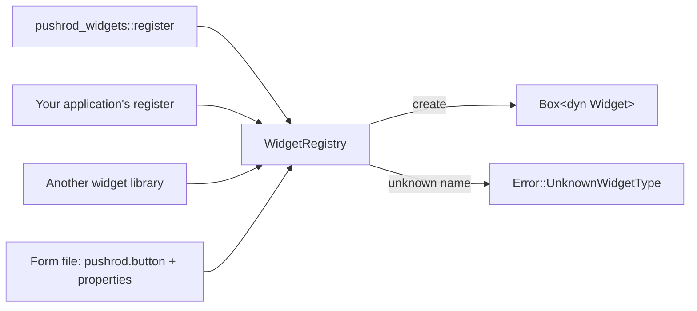
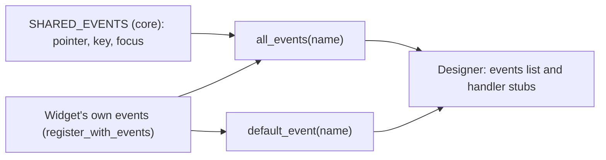

# Widget registry and factory

A form file stores "a button with these properties". To load it, Pushrod has to build a widget from a **type name** such as `pushrod.button`, including widgets your application or another widget library defines. A `WidgetRegistry` does that: it maps stable type names to constructors that build a widget from `Properties`.



## Creating widgets by name

```rust checked title="src/main.rs"
use pushrod::registry::{Properties, WidgetRegistry};

fn main() {
    let mut registry = WidgetRegistry::new();

    pushrod_widgets::register(&mut registry);

    let props = Properties::new()
        .with_text("text", "Save")
        .with_int("x", 10)
        .with_int("y", 50)
        .with_int("width", 80);
    let button = registry.create("pushrod.button", &props).unwrap();

    assert_eq!(button.get_size().w, 80);

    // An unknown name is an error, not a panic.
    assert!(registry.create("acme.tree_view", &Properties::new()).is_err());
}
```

`create` returns a `Box<dyn Widget>` that is not yet in a tree; add it with `WidgetCache::add_child`.

## Properties

`Properties` is a set of named values. Each value is a `PropertyValue`: `Bool`, `Int`, `Float`, `Text`, or `Color`. Build one with `with_bool`, `with_int`, `with_float`, `with_text`, and `with_color`, and read one with `get_bool`, `get_int`, `get_float` (a whole number converts), `get_text`, and `get_color`.

These **common properties** are applied by `create` to every widget, so a constructor never reads them:

| Property | Kind | Effect |
| --- | --- | --- |
| `x`, `y` | `Int` | Origin relative to the parent |
| `width`, `height` | `Int` | Size in pixels |
| `color` | `Color` | Background color |
| `hidden` | `Bool` | Hide the widget and its children |

## The standard widgets

`pushrod_widgets::register(&mut registry)` adds these types:

| Type name | Properties |
| --- | --- |
| `pushrod.button` | `text` |
| `pushrod.check_box` | `text`, `checked` |
| `pushrod.radio_button` | `text`, `checked` |
| `pushrod.text` | `text` |
| `pushrod.boxed_label` | `text` |
| `pushrod.group_box` | `title` |
| `pushrod.glyph_button` | `glyph` (exactly one character) |
| `pushrod.image` | `path` |
| `pushrod.progress_bar` | `max` (default 100), `value` |
| `pushrod.slider` | `min` (default 0), `max` (default 100), `step`, `value`, `vertical` |
| `pushrod.separator` | `vertical` |
| `pushrod.text_field` | none |
| `pushrod.frame` | none |
| `pushrod.panel` | none |

`CustomPaint` needs code rather than data, and `Container`, `ScrollBar`, and `Alert` are built from other widgets, so they are not registered. A missing required property (such as `text` for a button) is an `Error::Property`.

## Event metadata

A designer lists the events a widget supports and writes handler stubs for them, so a registry entry can also declare its **events**. Each is an `EventInfo`:

| Field | Meaning |
| --- | --- |
| `name` | The event's name, the same as its `Event` variant (`"Clicked"`) |
| `description` | One line saying when it happens |
| `kind` | The `EventKind` the engine reports for it |
| `payload` | The `PayloadField`s (`name` and `type_name`) besides the widget `id`, which every widget-addressed event carries |
| `is_default` | `true` for the widget's default event; at most one event is the default |
| `callback` | The `Engine` registration that handles it (`Some("on_click")`), or `None` if only `Engine::on_event` sees it |



Events every widget can receive come from the core as `SHARED_EVENTS`, so a widget declares only its own. Read them with:

| Method | Returns |
| --- | --- |
| `events(name)` | The widget's own events (`None` if the name is not registered) |
| `all_events(name)` | Its own events, then the shared ones: the list a designer shows |
| `default_event(name)` | The event marked as default, if any |

`pushrod_widgets::register` declares these:

| Type name | Own events (default first) |
| --- | --- |
| `pushrod.button`, `pushrod.glyph_button` | `Clicked` (`on_click`) |
| `pushrod.check_box`, `pushrod.radio_button` | `Toggled` (`on_toggle`) |
| `pushrod.slider` | `ValueChanged` (`on_value_change`), `EditingFinished` (`on_editing_finished`) |
| `pushrod.text_field` | `TextChanged` (`on_text_change`), `EditingFinished` (`on_editing_finished`) |
| Every other standard type | none, so no default event |

`pushrod.image` is display only when built from properties, so it declares no `Clicked`. A test builds every standard widget, feeds it hover, click, key, and text input, and checks that the events it emits (besides the shared ones) are exactly the ones it declares.

## Registering your own widgets

Give each library its own prefix and a `register` function. Use `register_with_events` to declare the widget's events:

```rust checked title="src/acme.rs"
use pushrod::error::Error;
use pushrod::event::EventKind;
use pushrod::geometry::size;
use pushrod::registry::{EventInfo, PayloadField, WidgetRegistry};
use pushrod::root_widget::RootWidget;

const SWITCH_EVENTS: &[EventInfo] = &[EventInfo {
    name: "Toggled",
    description: "The switch was flipped.",
    kind: EventKind::Toggled,
    payload: &[PayloadField { name: "checked", type_name: "bool" }],
    is_default: true,
    callback: Some("on_toggle"),
}];

pub fn register(registry: &mut WidgetRegistry) {
    registry.register_with_events("acme.blank", SWITCH_EVENTS, |props| {
        let side = props
            .get_int("side")
            .ok_or_else(|| Error::property("side", "required"))?;

        Ok(Box::new(RootWidget::new(size(side as u32, side as u32))))
    });
}
```

`register` and `register_with_events` return `true` when they replaced an existing entry. A library can use this to **replace a standard type** such as `pushrod.button` so existing forms get a new look without changing. `register` keeps the events the replaced entry declared; `register_with_events` replaces them.

## Errors

| Error | When |
| --- | --- |
| `Error::UnknownWidgetType` | The type name is not registered |
| `Error::Property` | A constructor's required property is missing or has the wrong kind |

The registry only builds widgets. To list and change the properties of a live widget, see [Property introspection](property-introspection.md).

Run `cargo run -p pushrod-widgets --example registry` to see a form built from type names.
