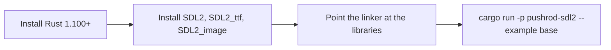

# Installation

Pushrod needs Rust 1.100 or newer (edition 2024) and three system libraries: SDL2, SDL2_ttf, and SDL2_image. Follow the step-by-step guide for your platform:

| Platform | Guide | Libraries come from |
|---|---|---|
| Linux | [Installing on Linux](./installation-linux.md) | `apt` or `dnf` |
| macOS | [Installing on macOS](./installation-macos.md) | Homebrew |
| Windows | [Installing on Windows](./installation-windows.md) | The SDL2 development zips (MSVC) |

Each guide ends with a check: it runs the `base` example from the repository. If that example opens a window, everything Pushrod needs is installed.



## Adding Pushrod to a project

Pushrod is three crates:

| Crate | What it contains |
|---|---|
| `pushrod` | The core: the engine, the widget tree and IDs, events, input types, the `Backend` and `Painter` traits, the `paint` helpers, and the headless test backend. It has no SDL dependency and contains no widgets except the window's root. |
| `pushrod-widgets` | The standard widgets: buttons, text, boxes, panels, and the rest of the widget set. Simple and flat, per the [design philosophy](../design-philosophy.md). It depends on `pushrod` only. |
| `pushrod-sdl2` | The SDL2 [backend](../platforms/backends.md): the window, input, GPU textures, and text drawing. |

Most applications use all three: pick a backend crate to run on. A different widget library can extend or replace `pushrod-widgets`; see [Widget libraries](../concepts/widget-libraries.md).

```toml
[dependencies]
pushrod = { git = "https://github.com/KenSuenobu/rust-pushrod" }
pushrod-widgets = { git = "https://github.com/KenSuenobu/rust-pushrod" }
pushrod-sdl2 = { git = "https://github.com/KenSuenobu/rust-pushrod" }
```

Your application does not depend on the `sdl2` crate; `pushrod-sdl2` does.

## Cargo features of `pushrod-sdl2`

| Feature | What it does | What the build machine needs |
|---|---|---|
| *(none)* | Links the system SDL2, SDL2_ttf, and SDL2_image. | The three libraries, from the platform guide |
| `bundled` | Compiles SDL2 from source instead of using the system SDL2. | CMake and a C compiler, plus SDL2_ttf and SDL2_image from the system |
| `static-link` | Links SDL2 into your executable instead of loading it at run time. | `bundled`, or a static SDL2 library on the system |
| `parley` | Lays out text with Parley and rasterizes glyphs with swash. | Nothing extra |

### Building SDL2 from source: the `bundled` feature

Enable `bundled` and Cargo compiles SDL2 from source instead of using the system library. Add `static-link` to link it into your executable:

```toml
[dependencies]
pushrod = { git = "https://github.com/KenSuenobu/rust-pushrod" }
pushrod-widgets = { git = "https://github.com/KenSuenobu/rust-pushrod" }
pushrod-sdl2 = { git = "https://github.com/KenSuenobu/rust-pushrod", features = ["bundled", "static-link"] }
```

CI builds `pushrod-sdl2` this way on macOS and Windows on every pull request.

:::caution[`bundled` is not yet self-contained]
`bundled` covers SDL2 only. The `sdl2` crate doesn't build SDL2_ttf or SDL2_image from source, so you still install those from the system. The system SDL2_ttf and SDL2_image are themselves linked against the system SDL2, so on macOS and Windows a `bundled` build still loads a system SDL2 at run time. Until Pushrod draws text and decodes images without SDL2_ttf and SDL2_image (a follow-up to [10.6 (#134)](https://github.com/KenSuenobu/rust-pushrod/issues/134)), installing all three libraries from your platform guide is the simplest route.
:::

:::note
`pushrod-sdl2` uses the `sdl2` crate's 0.38 series. Version 0.39.0 doesn't compile with the `unsafe_textures` feature that Pushrod needs, so stay on 0.38 if you also depend on `sdl2` directly.
:::

## Running the examples

```bash
git clone https://github.com/KenSuenobu/rust-pushrod
cd rust-pushrod
cargo run -p pushrod-sdl2 --example base
```
