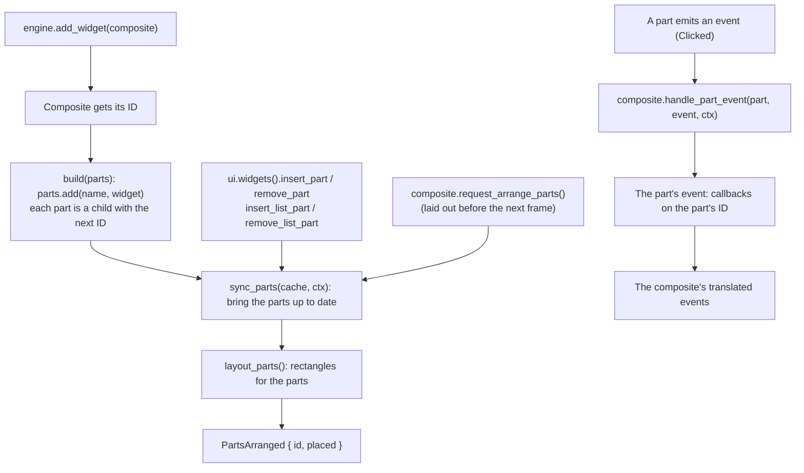

# Composite Widgets

A **composite** is a widget made of simpler widgets: an alert is an icon, a title, a message, and buttons; a scroll bar is two arrows, a track, and a thumb. In Pushrod a composite's **parts are ordinary child widgets with their own IDs**, not hidden internals. An application finds a part by its stable name and changes it with the normal API, exactly like any other widget.

```text
ButtonBar (composite, id 1)
 ├── "title"     Text    id 2   <- app: set_font(..), set_font_color(..), set_text(..)
 ├── "button:0"  Button  id 3   Open
 ├── "button:1"  Button  id 4   Save
 └── "button:2"  Button  id 5   Help   <- app: insert_list_part(bar, "button", ..)
```

The `Composite` trait lives in `pushrod::composite`. The alert is built on it later (roadmap step 52); its proposed look, customized through its parts, is [mockup 5.2-1](https://github.com/KenSuenobu/rust-pushrod/blob/main/docs/mockups/5.2-1.png).

## How it works



- **Built when added.** `Composite::build` runs when the composite is added (`engine.add_widget`, `add_child_widget`, or `WidgetCache::add_child`). The composite already has its ID, and each part gets the next free ID and emits `WidgetAdded`. A part that is itself a composite is built in turn.
- **Found by name.** `parts()` lists every part as `(name, id)`, and `part(name)` finds one. The same lookups are on the cache: `ui.widgets().part(bar, "title")` and `ui.widgets().parts(bar)`. A composite also implements `TypedParts` to return its structure as a struct of IDs, such as `ButtonBarParts { title, buttons }`.
- **Changed through the normal API.** `ui.get_mut::<Text>(title)?.set_font_color(Color::RED)` changes a part and invalidates it, so it is repainted on the next frame.
- **Lists of parts.** Parts that form a list are named `"<kind>:<n>"` (`"button:0"`, `"item:3"`). `insert_list_part(composite, kind, index, widget)` and `remove_list_part(composite, kind, index)` add and remove items and renumber the list. `add_part`, `insert_part`, and `remove_part` work with any name. After every change the composite's `layout_parts` runs again.
- **Part events reach the composite first.** `handle_part_event` sees each event a part emits and can emit its own through `ctx` (a scroll bar turns an arrow's `Clicked` into its own `ValueChanged`). The part's event is still delivered, so callbacks registered on the part's ID run, followed by the composite's events. Translation climbs through nested composites one level at a time; an event a composite emits for one of its own parts is not handed back to it.
- **Moving parts from inside.** A composite has no access to the cache in `handle_event` or `handle_part_event`, so it cannot move its parts itself. When its own state changes where a part goes (a scroll bar's value moves its thumb), it calls `self.request_arrange_parts()`, and `layout_parts` runs again before the next frame is drawn. Several requests in one frame arrange the parts once.
- **Changing parts from inside.** `sync_parts(cache, ctx)` runs just before `layout_parts`, every time the parts are arranged, with the whole cache at hand. The composite uses it to set a part's value, hide a part, or read what its parts hold: a [container](../widgets/container.md) sets its scroll bars' thumbs and pans its content there. While it runs the composite is out of the cache, so it reaches itself through `self`. Events emitted through `ctx` are delivered to the application.
- **Resizing arranges the parts.** `set_size` on a composite (or a layout manager resizing it) lays its parts out again before the next frame, as `request_arrange_parts` does.
- **Hearing about changes below.** `Widget::descendant_changed` is called on every widget above one that was added, removed, moved, resized, repainted, or given the focus, at most once per frame. A composite that follows its content overrides it to call `request_arrange_parts`.
- **Removing.** `remove_part` removes the part and everything inside it and emits `WidgetRemoved` for each. Removed IDs are never reused: `get` returns `None`, and callbacks registered on them never run again. Focus on a removed widget is cleared (`FocusChanged`).

## Writing a composite widget

A composite is a widget that also implements `Composite`. It stores a `PartList`, creates its parts in `build`, and overrides `as_composite` and `as_composite_mut` so the cache can find it.

```rust checked title="src/notice.rs"
use pushrod::composite::{Composite, PartList, PartsBuilder, TypedParts};
use pushrod::event::{Event, EventCtx};
use pushrod::geometry::{Rect, point, size};
use pushrod::paint::{self, Painter};
use pushrod::widget::{Widget, WidgetCore, WidgetId};
use pushrod_widgets::button::Button;
use pushrod_widgets::text::Text;

/// A message above a row of buttons.
pub struct Notice {
    core: WidgetCore,
    parts: PartList,
}

/// The notice's structure, by role.
pub struct NoticeParts {
    /// The message text.
    pub message: Option<WidgetId>,
    /// The buttons, left to right.
    pub buttons: Vec<WidgetId>,
}

impl Notice {
    /// Creates a notice at (10, 10).
    ///
    /// # Returns
    ///
    /// The notice, with no parts until it is added to a window.
    pub fn new() -> Self {
        Self {
            core: WidgetCore::new(point(10, 10), size(300, 70)),
            parts: PartList::new(),
        }
    }
}

impl Default for Notice {
    /// Creates a notice; the same as [`Notice::new`].
    ///
    /// # Returns
    ///
    /// The notice.
    fn default() -> Self {
        Self::new()
    }
}

impl Widget for Notice {
    fn core(&self) -> &WidgetCore {
        &self.core
    }

    fn core_mut(&mut self) -> &mut WidgetCore {
        &mut self.core
    }

    fn paint(&self, p: &mut dyn Painter) {
        paint::fill(p, self.get_color());
    }

    fn as_composite(&self) -> Option<&dyn Composite> {
        Some(self)
    }

    fn as_composite_mut(&mut self) -> Option<&mut dyn Composite> {
        Some(self)
    }
}

impl Composite for Notice {
    fn build(&mut self, parts: &mut PartsBuilder) {
        parts.add("message", Text::new("Saved."));
        parts.add("button:0", Button::new("OK"));
    }

    fn part_list(&self) -> &PartList {
        &self.parts
    }

    fn part_list_mut(&mut self) -> &mut PartList {
        &mut self.parts
    }

    /// The message across the top, then the buttons left to right.
    fn layout_parts(&self) -> Vec<(WidgetId, Rect)> {
        let mut placed = Vec::new();

        if let Some(message) = self.parts.get("message") {
            placed.push((message, Rect::new(10, 10, 280, 20)));
        }

        for (index, button) in self.parts.list("button").into_iter().enumerate() {
            placed.push((button, Rect::new(10 + index as i32 * 70, 40, 60, 20)));
        }

        placed
    }

    /// A click on any button becomes the notice's own `Activated`.
    fn handle_part_event(&mut self, part: WidgetId, event: &Event, ctx: &mut EventCtx) {
        if matches!(event, Event::Clicked { .. }) && self.parts.list("button").contains(&part) {
            ctx.emit(Event::Activated { id: self.get_id() });
        }
    }
}

impl TypedParts for Notice {
    type Parts = NoticeParts;

    fn typed_parts(&self) -> NoticeParts {
        NoticeParts {
            message: self.parts.get("message"),
            buttons: self.parts.list("button"),
        }
    }
}
```

## Using it from an application

```rust checked title="src/main.rs"
use pushrod::color::{Color, FontStyle};
use pushrod::composite::{Composite, PartList, PartsBuilder};
use pushrod::engine::Engine;
use pushrod::font::Font;
use pushrod::geometry::{point, size};
use pushrod::paint::Painter;
use pushrod::widget::{Widget, WidgetCore};
use pushrod_widgets::button::Button;
use pushrod_widgets::text::Text;

/// A one-part composite, so this sample stands alone; see the notice above for a full one.
struct Notice {
    core: WidgetCore,
    parts: PartList,
}

impl Widget for Notice {
    fn core(&self) -> &WidgetCore {
        &self.core
    }

    fn core_mut(&mut self) -> &mut WidgetCore {
        &mut self.core
    }

    fn paint(&self, _p: &mut dyn Painter) {}

    fn as_composite(&self) -> Option<&dyn Composite> {
        Some(self)
    }

    fn as_composite_mut(&mut self) -> Option<&mut dyn Composite> {
        Some(self)
    }
}

impl Composite for Notice {
    fn build(&mut self, parts: &mut PartsBuilder) {
        parts.add("message", Text::new("Saved.").size(280, 20));
    }

    fn part_list(&self) -> &PartList {
        &self.parts
    }

    fn part_list_mut(&mut self) -> &mut PartList {
        &mut self.parts
    }
}

fn main() {
    let mut engine: Engine<()> = Engine::new(size(320, 100), 30);
    let notice = engine.add_widget(Notice {
        core: WidgetCore::new(point(10, 10), size(300, 70)),
        parts: PartList::new(),
    });
    let message = engine.widgets().part(notice, "message").unwrap();

    // Restyle a part through the normal API; it repaints on the next frame.
    let text = engine.widgets().get_as_mut::<Text>(message).unwrap();

    text.set_font(Font::new("", 16, FontStyle::BOLD));
    text.set_font_color(Color::RED);
    text.set_text("Saved, and restyled.".to_string());

    // Add a "Help" button as the next item of the "button" list, then react to it directly.
    let help = engine
        .widgets()
        .insert_list_part(notice, "button", usize::MAX, Box::new(Button::new("Help")))
        .unwrap();

    engine.on_click(help, |_state, _ui| println!("Help clicked"));
    assert_eq!(engine.widgets().part(notice, "button:0"), Some(help));
}
```

Inside a callback, the same calls go through `ui`: `ui.get_mut::<Text>(message)`, `ui.widgets().remove_list_part(notice, "button", 0)`.

## API summary

| Item | Does |
|---|---|
| `Composite::build(&mut self, parts)` | Creates the parts with `parts.add(name, widget) -> WidgetId`. Runs once, when the composite is added. |
| `Composite::parts()` / `part(name)` | Every part as `(name, id)`; one part by name. |
| `Composite::sync_parts(cache, ctx)` | Brings the parts up to date with the composite's state, with access to the cache; runs just before `layout_parts`. The default does nothing. |
| `Composite::layout_parts()` | Rectangles (relative to the composite) for the parts; runs after the build and after every part change. |
| `Composite::handle_part_event(part, event, ctx)` | Sees each event a part emits; emit translated events through `ctx`. |
| `TypedParts::typed_parts()` | The composite's structure as a struct of IDs. |
| `PartList` | The parts by name: `get`, `name_of`, `contains`, `ids`, `list(kind)`, `list_position(kind, index)`, `renumber(kind)`. |
| `WidgetCache::part` / `parts` | Find parts from outside the composite. |
| `WidgetCache::add_part` / `insert_part` / `remove_part` | Add, insert at a position, or remove a part by name. |
| `WidgetCache::insert_list_part` / `remove_list_part` | Add or remove an item of a `"<kind>:<n>"` list, and renumber it. |
| `WidgetCache::arrange_parts(composite)` | Lay the parts out again, for example after resizing the composite. |
| `Widget::request_arrange_parts()` | From inside the composite: lay the parts out again before the next frame. `set_size` asks for it too. |
| `Widget::descendant_changed()` | Called when something below the widget changed; override it to follow the content. The default does nothing. |

Errors are `Error::UnknownWidget` for an ID that does not exist and `Error::Composite { id, message }` for a widget that is not a composite, a part name already used, or a part that does not exist. `PartsBuilder::add` panics on a name already used, because that is a mistake in the composite's own code.

## Engine events

| Event | Fires when |
|---|---|
| `WidgetAdded { id, parent }` | Each part is created, during the build or by `add_part` and friends. |
| `WidgetRemoved { id, parent }` | Each widget removed with its part. |
| `PartsArranged { id, placed }` | The composite laid its parts out (including after `request_arrange_parts`); `placed` is how many it placed. |

See [Engine events](../events/engine-events.md).

## Try it

`cargo run -p pushrod-sdl2 --example composite` opens a button bar with **Add button**, **Insert first**, **Remove last**, and **Restyle title** controls. The status lines show the bar's translated `BarPressed` event, a callback on the `"button:0"` part, and the engine events each change emits.

## Planned

- The [scroll bar](../widgets/scroll-bar.md) and the [container](../widgets/container.md) are built on `Composite`, with their typed `ScrollBarParts` and `ContainerParts`. The alert ([roadmap step 52](https://github.com/KenSuenobu/rust-pushrod/blob/main/docs/roadmaps/ORDER_OF_EXECUTION.md)) follows.
- Form files store a composite's part overrides and added or removed parts once the form writer exists (step 65).

Related: [Creating widgets](creating-widgets.md), [Widget tree and IDs](../concepts/widget-tree-and-ids.md), [Handling events](handling-events.md).
