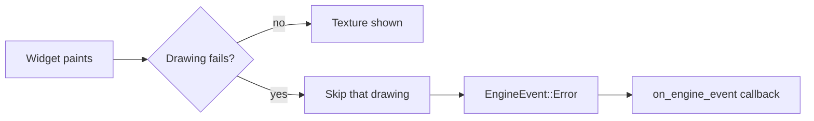

# Creating an application

A Pushrod application has three parts: an **engine** that owns the window's widgets, an **application state**, and the code that reacts to widget events, either **callbacks** (Pushrod runs the loop) or **your own event loop** (you call `next_event`). This guide uses callbacks; see [Two ways to handle events](./handling-events.md#two-ways-to-handle-events) for the event-loop style.

## The engine and application state

```rust
#[derive(Default)]
struct AppState {
    saves: u32,
}

let mut engine: Engine<AppState> = Engine::new(size(320, 200), 60);
```

`Engine::new(size, frame_rate)` creates the window's root widget (ID `0`, white) at the given size. The second argument is the target frames per second. `AppState` is any type you like; use `()` if you don't need state.

Run the engine on a [backend](../platforms/backends.md): `pushrod_sdl2::run` opens a window from `WindowSettings` (title and size) and drives the engine. `run` blocks until the window closes (or a callback calls `ui.shutdown()`) and then returns your state:

```rust
let state = pushrod_sdl2::run(engine, WindowSettings::new("Events", size(320, 200)), AppState::default())?;
```

## Adding widgets

`add_widget` adds a widget to the window's root and returns its `WidgetId`. `add_child_widget(parent, widget)` adds it inside another widget; a child's origin is **relative to its parent**, and later siblings are drawn on top of earlier ones.

```rust
// A gray panel; its children are positioned relative to it.
let mut panel = Panel::new().at(10, 10).size(300, 180);
panel.set_color(Color::RGB(220, 220, 220));
let panel_id = engine.add_widget(panel);

let indicator = engine.add_child_widget(
    panel_id,
    Frame::new().at(20, 20).size(40, 40),
);
```

A widget is created with a short constructor and chained setters; anything you leave out has a default (see each widget's page). Keep the IDs you need in callbacks. IDs are assigned in the order widgets are added and never change.

## Connecting callbacks

```rust
engine.on_click(save, move |state, ui| {
    state.saves += 1;
    ui.widgets().get_mut(indicator).unwrap().set_color(Color::RGB(70, 160, 70));
});

engine.on_click(quit, |_, ui| ui.shutdown());
```

Callbacks receive `&mut AppState` and a `Ui` handle. See [Handling events](./handling-events.md) for everything `Ui` can do.

## A complete application


```rust checked title="src/main.rs"
use pushrod::prelude::*;
use pushrod_sdl2::WindowSettings;
use pushrod_widgets::prelude::*;

#[derive(Default)]
struct AppState {
    saves: u32,
}

fn main() -> Result<(), pushrod::error::Error> {
    let mut engine: Engine<AppState> = Engine::new(size(320, 200), 60);

    // A gray panel; its children are positioned relative to it.
    let mut panel = Panel::new().at(10, 10).size(300, 180);
    panel.set_color(Color::RGB(220, 220, 220));
    let panel_id = engine.add_widget(panel);

    let indicator = engine.add_child_widget(panel_id, Frame::new().at(20, 20).size(40, 40));

    let save = engine.add_child_widget(
        panel_id,
        Button::new("Save").at(20, 80).size(100, 28),
    );
    let quit = engine.add_child_widget(
        panel_id,
        Button::new("Quit").at(140, 80).size(100, 28),
    );

    // Per-widget callback: runs only when `save` is clicked.
    engine.on_click(save, move |state, ui| {
        state.saves += 1;
        ui.widgets().get_mut(indicator).unwrap().set_color(Color::RGB(70, 160, 70));
    });

    // Stop the engine from a callback.
    engine.on_click(quit, |_, ui| ui.shutdown());

    // Catch-all callback: sees every event any widget generates.
    engine.on_event(|_, _, event| {
        if let Event::Clicked { id, count, .. } = event {
            println!("widget {} clicked ({} click(s))", id, count);
        }
    });

    let state = pushrod_sdl2::run(engine, WindowSettings::new("Events", size(320, 200)), AppState::default())?;
    println!("saved {} time(s)", state.saves);

    Ok(())
}
```

## Errors

Pushrod never panics because a file is missing or a driver fails. Fallible functions return `pushrod::error::Result<T>`, whose error is a `pushrod::error::Error`:

| Variant | Means |
|---|---|
| `Backend { message }` | The backend could not start (no window, renderer or text library). |
| `Font { path, message }` | A font file could not be loaded. |
| `Image { path, message }` | An image could not be read, decoded or written. |
| `Texture { message }` | A texture could not be created, updated or drawn. |
| `UnknownWidget { id }` | A widget ID does not exist. |
| `FormFile { path, message }` | A form file could not be read or is not valid. |

`Error` implements `std::error::Error` and `Display`, so `?` works in `main`. `pushrod_sdl2::run` and `pushrod_sdl2::event_loop` return an error if the window cannot open, and `engine.try_add_child_widget(parent, widget)` returns `Error::UnknownWidget` where `add_child_widget` would panic on a bad parent.

A failure *after* the window is open (a font that will not load while text is drawn, a texture the driver refuses) has no caller to return to. The engine keeps running, skips the drawing that failed, and delivers an `EngineEvent::Error { error }` [engine event](../events/engine-events.md). Each distinct failure is reported once, not on every repaint:



```rust checked
use pushrod::engine::Engine;
use pushrod::error::Error;
use pushrod::event::EngineEvent;
use pushrod::geometry::size;
use pushrod_sdl2::{WindowSettings, run};

fn main() -> Result<(), Error> {
    let mut engine: Engine<u32> = Engine::new(size(320, 200), 60);

    // Count failures instead of crashing; a real application might show a message.
    engine.on_engine_event(|failures, _ui, event| {
        if let EngineEvent::Error { error } = event {
            eprintln!("drawing failed: {error}");
            *failures += 1;
        }
    });

    let failures = run(engine, WindowSettings::new("Errors", size(320, 200)), 0)?;

    println!("{failures} failure(s)");

    Ok(())
}
```

## Tips

- Changing a widget (`set_text`, `set_color`, `set_size`, ...) marks it for repainting; Pushrod repaints it and refreshes the screen on the next frame. You never draw directly.
- Keep callbacks short; they run on the UI thread between frames.
- Hide a widget and its children with `set_hidden(true)`; hidden widgets are neither drawn nor clicked.
