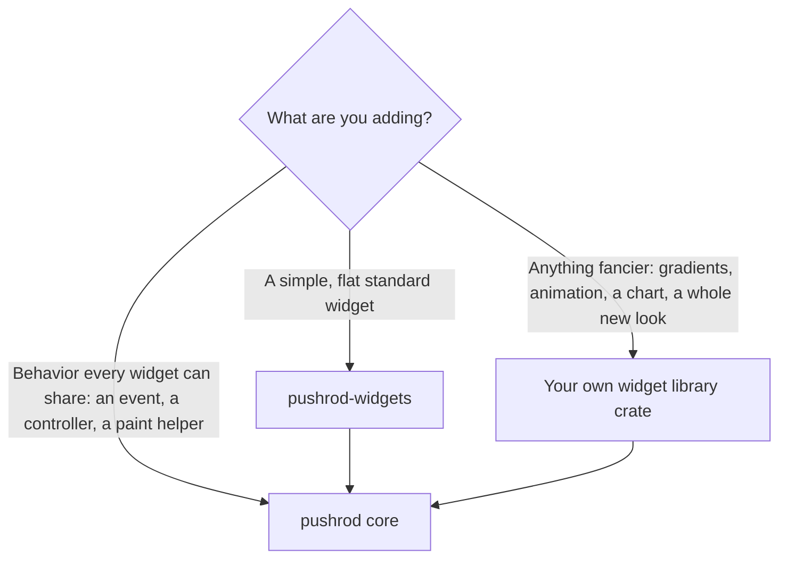

# Creating widgets

This guide walks through extending Pushrod, one step per section: a paint-only widget, an
interactive widget with events and callbacks, behavior and state, input controllers, composites,
custom events, registry and properties, and testing. Every sample on this page is compiled by the
`pushrod-doc-samples` crate on each `cargo test`, so it matches the current library. The same guide
is kept in the repository as [`docs/WRITING_WIDGETS.md`](https://github.com/KenSuenobu/rust-pushrod/blob/main/docs/WRITING_WIDGETS.md).

A widget is a struct that stores a `WidgetCore` and implements the `Widget` trait. Widgets contributed to Pushrod document every non-private function and type with a full header (summary, `# Arguments`, `# Returns`, and so on); see [Writing documentation](../writing-documentation.md#documenting-the-code). Only three functions are required:

| Function | Purpose |
|---|---|
| `core(&self) -> &WidgetCore` | Gives Pushrod access to the shared state (ID, origin, size, color, visibility, texture). |
| `core_mut(&mut self) -> &mut WidgetCore` | Mutable access to the same. |
| `paint(&self, painter)` | Draws the widget through the backend-neutral [`Painter`](../platforms/backend-neutral-paint-api.md), from `(0, 0)` to `get_size()`. |

Everything else (`get_id`, `get_origin`, `get_size`, `set_color`, `set_size`, `set_hidden`, `set_invalidated`, ...) has a default implementation. Interactive widgets also implement `handle_event` or `on_controller_event`.

## Where the code goes



- **`pushrod` (the core):** shared behavior that any widget may need, such as events, input
  controllers, `paint` helpers, and the `Widget` trait itself. It contains no widgets except the
  window's `RootWidget`.
- **`pushrod-widgets`:** the standard widgets, simple and predictable, following the
  [design philosophy](../design-philosophy.md).
- **A separate widget library:** anything more ambitious lives in its own crate that depends on
  `pushrod` (and, if it wants, `pushrod-widgets`). See [Widget libraries](../concepts/widget-libraries.md).

Everything a widget needs is in the `pushrod` core's public API, so your widgets don't depend on
`pushrod-widgets`. The standard widgets are built exactly the same way.

## Rules every widget follows

- **Rendering:** all drawing goes through the `Painter` into the widget's own GPU texture, only
  when the widget is invalidated. Frames are composed by blitting cached textures. No OS-native
  menus, dialogs, or controls, and no per-frame CPU pixel work.
- **Events:** a widget reports what happened by emitting an event (`ctx.emit` or `ctx.post`), never
  by calling application code. Any *internal* action added to the core must also emit an
  [engine event](../events/engine-events.md) (`Event::Engine`).
- **Sample data:** examples, tests, mockups, and docs use fictional placeholders only, such as
  "Jane Doe", `jane.doe@example.com`, and "Anytown". No real names or personal information (see
  [CONTRIBUTING.md](https://github.com/KenSuenobu/rust-pushrod/blob/main/CONTRIBUTING.md)).

## A paint-only widget

The simplest widget draws and handles nothing. This level meter fills part of its width to show a
value; its event mask stays `EventMask::NONE`, so the engine never delivers events to it.

```rust checked title="src/meter.rs"
use pushrod::color::Color;
use pushrod::engine::Engine;
use pushrod::geometry::{point, size, Point, Rect, Size};
use pushrod::paint::{self, Painter};
use pushrod::widget::{Widget, WidgetCore};

/// A bar that fills part of its width to show a level from 0 to 100.
pub struct Meter {
    core: WidgetCore,
    level: u8,
}

impl Meter {
    /// Creates an empty meter.
    ///
    /// # Arguments
    ///
    /// * `origin` - The upper left-hand corner, relative to the parent widget.
    /// * `size` - The width and height in pixels.
    ///
    /// # Returns
    ///
    /// The new `Meter`, at level 0.
    pub fn new(origin: Point, size: Size) -> Self {
        Self {
            core: WidgetCore::new(origin, size),
            level: 0,
        }
    }

    /// Sets the level and repaints the meter.
    ///
    /// # Arguments
    ///
    /// * `level` - The new level; values above 100 are treated as 100.
    pub fn set_level(&mut self, level: u8) {
        self.level = level.min(100);
        self.set_invalidated(true);
    }
}

impl Widget for Meter {
    fn core(&self) -> &WidgetCore {
        &self.core
    }

    fn core_mut(&mut self) -> &mut WidgetCore {
        &mut self.core
    }

    /// Fills the background, the filled share, and a one-pixel frame.
    fn paint(&self, p: &mut dyn Painter) {
        let bounds = self.get_size();
        let filled = bounds.w * u32::from(self.level) / 100;

        paint::fill(p, Color::WHITE);
        p.fill_rect(Rect::new(0, 0, filled, bounds.h), Color::RGB(70, 130, 200));
        paint::border(p, bounds, Color::BLACK, 1);
    }
}

fn main() {
    let mut engine: Engine<()> = Engine::new(size(220, 60), 30);
    let meter = engine.add_widget(Meter::new(point(10, 20), size(200, 20)));

    engine.widgets().get_as_mut::<Meter>(meter).unwrap().set_level(40);
}
```

### Painting

`paint` runs only when the widget is *invalidated* (after creation, or after you call `set_invalidated(true)` or any setter that changes its look). The painter already targets the widget's own surface (a GPU texture with the SDL2 backend), so you always draw from `(0, 0)`. Compose the look from the helpers in `pushrod::paint` and the `Painter` calls:

| Helper | Draws |
|---|---|
| `paint::fill(painter, color)` | Fills the whole texture. |
| `paint::border(painter, size, color, width)` | A border `width` pixels wide. |
| `paint::text(painter, bounds, &style, color, text)` | Text in `bounds`, justified by the `TextStyle`, centered vertically when it fits. |

Pushrod's own widgets are built the same way: a box is `fill` + `border`, a button is `fill` + `text` + `border`. For a one-off drawing, skip the struct: [Custom Paint](../widgets/custom-paint.md) draws with a closure.

## An interactive widget with events and callbacks

This swatch switches between two colors each time it is clicked and emits `Clicked` so
applications can react. A widget receives only the event classes in its *event mask*, so the
swatch asks for pointer buttons when it is created.


```rust checked title="src/swatch.rs"
use pushrod::color::Color;
use pushrod::engine::Engine;
use pushrod::event::{Event, EventCtx, EventMask, Propagation};
use pushrod::geometry::{point, size, Point, Size};
use pushrod::input::MouseButton;
use pushrod::paint::{self, Painter};
use pushrod::widget::{Widget, WidgetCore};
use pushrod_sdl2::WindowSettings;

/// A square that switches between two colors each time it is clicked.
pub struct SwatchWidget {
    core: WidgetCore,
    colors: [Color; 2],
    current: usize,
}

impl SwatchWidget {
    /// Creates a swatch showing `first` until it is clicked.
    ///
    /// # Arguments
    ///
    /// * `origin` - The upper left-hand corner, relative to the parent widget.
    /// * `size` - The width and height in pixels.
    /// * `first` - The color shown first.
    /// * `second` - The color shown after the first click.
    ///
    /// # Returns
    ///
    /// The new `SwatchWidget`.
    pub fn new(origin: Point, size: Size, first: Color, second: Color) -> Self {
        let mut core = WidgetCore::new(origin, size);

        core.set_event_mask(EventMask::POINTER_BUTTONS);

        Self {
            core,
            colors: [first, second],
            current: 0,
        }
    }

    /// Returns the color currently shown.
    ///
    /// # Returns
    ///
    /// The current color.
    pub fn current_color(&self) -> Color {
        self.colors[self.current]
    }
}

impl Widget for SwatchWidget {
    fn core(&self) -> &WidgetCore {
        &self.core
    }

    fn core_mut(&mut self) -> &mut WidgetCore {
        &mut self.core
    }

    /// Fills the swatch with its current color and draws a one-pixel black frame.
    fn paint(&self, p: &mut dyn Painter) {
        paint::fill(p, self.current_color());
        paint::border(p, self.get_size(), Color::BLACK, 1);
    }

    /// Switches colors on each left-button release and emits `Clicked`.
    ///
    /// # Returns
    ///
    /// `Stop` after a click, so parents do not see the release; otherwise `Continue`.
    fn handle_event(&mut self, event: &Event, ctx: &mut EventCtx) -> Propagation {
        if let Event::PointerReleased {
            button: MouseButton::Left,
            count,
            ..
        } = event
        {
            self.current = 1 - self.current;
            self.set_invalidated(true);
            ctx.emit(Event::Clicked {
                id: self.get_id(),
                button: MouseButton::Left,
                count: *count,
            });
            return Propagation::Stop;
        }

        Propagation::Continue
    }
}

fn main() -> Result<(), pushrod::error::Error> {
    let mut engine: Engine<()> = Engine::new(size(200, 140), 60);

    let swatch = engine.add_widget(SwatchWidget::new(
        point(50, 20),
        size(100, 100),
        Color::RGB(70, 130, 200),
        Color::RGB(200, 200, 200),
    ));

    engine.on_click(swatch, move |_, ui| {
        if let Some(widget) = ui.get::<SwatchWidget>(swatch) {
            println!("Swatch is now {:?}", widget.current_color());
        }
    });

    pushrod_sdl2::run(engine, WindowSettings::new("Swatch", size(200, 140)), ())?;

    Ok(())
}
```

`handle_event` receives each event routed to the widget (see [Handling events](./handling-events.md)). Change the widget's state, call `set_invalidated(true)` if its look changed, and queue events for the application with `ctx.emit(...)`. Mouse events arrive as `Event::PointerPressed`, `Event::PointerReleased`, and `Event::PointerMoved`, plus `Event::PointerEntered` and `Event::PointerExited` when the pointer crosses the widget's edge. `handle_event` returns a [`Propagation`](../events/event-propagation.md): `Stop` consumes an input event, `Continue` lets parents see it. See the [Event reference](../events/event-reference.md) and [Event masks](../concepts/event-masks-for-the-run-loop-and-for-widgets.md).

`ui.get::<SwatchWidget>(id)` returns your concrete type, so callbacks can call your own methods.

## Behavior and state

Two sets of flags on `WidgetCore` describe how a widget acts and how it looks right now (see
[Widget behavior flags and visual states](../concepts/widget-behavior-flags-and-visual-states.md)):

- `Behavior` is what the widget *does*: `FOCUSABLE`, `TOGGLE`, `DEFAULT_ACTION`, `CANCEL_ACTION`,
  and so on. The engine reads it for Tab order, Return and Escape, and dialogs.
- `VisualState` is what the widget *is*: `PRESSED`, `CHECKED`, `DISABLED`, `FOCUSED`, `HOVERED`.
  The engine sets `FOCUSED` and `DISABLED`; the widget sets the rest and reads them all in `paint`.

Keep the widget's own data (a value, a list of items) in its struct, and keep the look decided by
the flags, so one `paint` covers every state.

```rust checked title="src/toggle.rs"
use pushrod::color::Color;
use pushrod::geometry::{point, size, Point, Size};
use pushrod::paint::{self, Painter};
use pushrod::widget::{Behavior, VisualState, Widget, WidgetCore};

/// A focusable square that shows whether it is on.
pub struct Toggle {
    core: WidgetCore,
}

impl Toggle {
    /// Creates a toggle that is off.
    ///
    /// # Arguments
    ///
    /// * `origin` - The upper left-hand corner, relative to the parent widget.
    /// * `size` - The width and height in pixels.
    ///
    /// # Returns
    ///
    /// The new `Toggle`, focusable and off.
    pub fn new(origin: Point, size: Size) -> Self {
        let mut toggle = Self {
            core: WidgetCore::new(origin, size),
        };

        toggle.set_behavior(Behavior::FOCUSABLE | Behavior::TOGGLE);
        toggle
    }

    /// Turns the toggle on or off and repaints it.
    ///
    /// # Arguments
    ///
    /// * `on` - `true` to turn it on.
    pub fn set_on(&mut self, on: bool) {
        let mut state = self.state();

        state.set(VisualState::CHECKED, on);
        self.set_state(state);
        self.set_invalidated(true);
    }
}

impl Widget for Toggle {
    fn core(&self) -> &WidgetCore {
        &self.core
    }

    fn core_mut(&mut self) -> &mut WidgetCore {
        &mut self.core
    }

    /// Chooses the colors from the visual state, so one `paint` covers every state.
    fn paint(&self, p: &mut dyn Painter) {
        let state = self.state();
        let fill = if state.contains(VisualState::DISABLED) {
            Color::RGB(220, 220, 220)
        } else if state.contains(VisualState::CHECKED) {
            Color::RGB(70, 130, 200)
        } else {
            Color::WHITE
        };
        let frame = if state.contains(VisualState::FOCUSED) { 2 } else { 1 };

        paint::fill(p, fill);
        paint::border(p, self.get_size(), Color::BLACK, frame);
    }
}

fn main() {
    let mut toggle = Toggle::new(point(10, 10), size(20, 20));

    toggle.set_on(true);
    assert!(toggle.state().contains(VisualState::CHECKED));
    assert!(toggle.is_focusable());
}
```

## Using input controllers

Instead of tracking presses, drags, and timing yourself, attach a controller with
`core.add_controller(...)` and implement `on_controller_event`. The default `handle_event` feeds
the controllers, and adding one also adds the event classes it needs to the widget's mask. The
controllers are `ClickController`, `DragController`, `ScrollController`, `HoverController`,
`LongPressController`, and `KeyController`; see [Reusable input controllers](../events/reusable-input-controllers.md).

This is the swatch again, with a `ClickController` doing the click tracking. A press that ends
outside the widget is now cancelled rather than counted as a click.

```rust checked title="src/swatch.rs"
use pushrod::color::Color;
use pushrod::controllers::{ClickController, ControllerEvent};
use pushrod::event::{Event, EventCtx, Propagation};
use pushrod::geometry::{Point, Size};
use pushrod::input::MouseButton;
use pushrod::paint::{self, Painter};
use pushrod::widget::{Widget, WidgetCore};

/// A square that switches between two colors each time it is clicked.
pub struct SwatchWidget {
    core: WidgetCore,
    colors: [Color; 2],
    current: usize,
}

impl SwatchWidget {
    /// Creates a swatch showing `first` until it is clicked.
    ///
    /// # Arguments
    ///
    /// * `origin` - The upper left-hand corner, relative to the parent widget.
    /// * `size` - The width and height in pixels.
    /// * `first` - The color shown first.
    /// * `second` - The color shown after the first click.
    ///
    /// # Returns
    ///
    /// The new `SwatchWidget`, with a `ClickController` attached.
    pub fn new(origin: Point, size: Size, first: Color, second: Color) -> Self {
        let mut core = WidgetCore::new(origin, size);

        core.add_controller(ClickController::new());

        Self {
            core,
            colors: [first, second],
            current: 0,
        }
    }

    /// Returns the color currently shown.
    ///
    /// # Returns
    ///
    /// The current color.
    pub fn current_color(&self) -> Color {
        self.colors[self.current]
    }
}

impl Widget for SwatchWidget {
    fn core(&self) -> &WidgetCore {
        &self.core
    }

    fn core_mut(&mut self) -> &mut WidgetCore {
        &mut self.core
    }

    fn paint(&self, p: &mut dyn Painter) {
        paint::fill(p, self.current_color());
        paint::border(p, self.get_size(), Color::BLACK, 1);
    }

    /// Switches colors when the click controller reports a click, and emits `Clicked`.
    ///
    /// # Returns
    ///
    /// `Stop` after a click; otherwise `Continue`.
    fn on_controller_event(&mut self, event: &ControllerEvent, ctx: &mut EventCtx) -> Propagation {
        if let ControllerEvent::Clicked { count, .. } = event {
            self.current = 1 - self.current;
            self.set_invalidated(true);
            ctx.emit(Event::Clicked {
                id: self.get_id(),
                button: MouseButton::Left,
                count: *count,
            });
            return Propagation::Stop;
        }

        Propagation::Continue
    }
}
```

## Composites

To build a widget out of other widgets (a title and buttons, arrows and a thumb), make it a
composite: it implements `Composite` as well as `Widget`, names its parts in `build`, places them
in `layout_parts`, and turns their events into its own in `handle_part_event`. The parts stay
ordinary widgets that applications can retrieve and restyle with `engine.widgets().part(id, "name")`.
[Composite widgets](composite-widgets.md) covers the full pattern, including typed parts and part
lists; this is the smallest one.

```rust checked title="src/labelled.rs"
use pushrod::composite::{Composite, PartList, PartsBuilder};
use pushrod::engine::Engine;
use pushrod::event::{Event, EventCtx};
use pushrod::geometry::{point, size, Rect};
use pushrod::paint::Painter;
use pushrod::widget::{Widget, WidgetCore, WidgetId};
use pushrod_widgets::button::Button;
use pushrod_widgets::text::Text;

/// A caption next to a button; a click on the button activates the whole widget.
pub struct LabelledButton {
    core: WidgetCore,
    parts: PartList,
}

impl LabelledButton {
    /// Creates the widget; its parts are built when it is added to a window.
    ///
    /// # Returns
    ///
    /// The new `LabelledButton`.
    pub fn new() -> Self {
        Self {
            core: WidgetCore::new(point(10, 10), size(260, 30)),
            parts: PartList::new(),
        }
    }
}

impl Default for LabelledButton {
    /// Creates the widget; the same as [`LabelledButton::new`].
    ///
    /// # Returns
    ///
    /// The new `LabelledButton`.
    fn default() -> Self {
        Self::new()
    }
}

impl Widget for LabelledButton {
    fn core(&self) -> &WidgetCore {
        &self.core
    }

    fn core_mut(&mut self) -> &mut WidgetCore {
        &mut self.core
    }

    /// Draws nothing itself; the parts draw the caption and the button.
    fn paint(&self, _p: &mut dyn Painter) {}

    fn as_composite(&self) -> Option<&dyn Composite> {
        Some(self)
    }

    fn as_composite_mut(&mut self) -> Option<&mut dyn Composite> {
        Some(self)
    }
}

impl Composite for LabelledButton {
    fn build(&mut self, parts: &mut PartsBuilder) {
        parts.add("caption", Text::new("Owner: Jane Doe"));
        parts.add("button", Button::new("Change"));
    }

    fn part_list(&self) -> &PartList {
        &self.parts
    }

    fn part_list_mut(&mut self) -> &mut PartList {
        &mut self.parts
    }

    /// The caption on the left, the button on the right.
    fn layout_parts(&self) -> Vec<(WidgetId, Rect)> {
        let mut placed = Vec::new();

        if let Some(caption) = self.parts.get("caption") {
            placed.push((caption, Rect::new(0, 5, 170, 20)));
        }

        if let Some(button) = self.parts.get("button") {
            placed.push((button, Rect::new(180, 0, 80, 30)));
        }

        placed
    }

    /// A click on the button becomes the widget's own `Activated`.
    fn handle_part_event(&mut self, part: WidgetId, event: &Event, ctx: &mut EventCtx) {
        if matches!(event, Event::Clicked { .. }) && self.parts.get("button") == Some(part) {
            ctx.emit(Event::Activated { id: self.get_id() });
        }
    }
}

fn main() {
    let mut engine: Engine<()> = Engine::new(size(280, 50), 30);
    let widget = engine.add_widget(LabelledButton::new());

    assert!(engine.widgets().part(widget, "button").is_some());
}
```

## Custom events

When a widget has something to report that no standard event describes, it posts a custom event
with `ctx.post(target, payload)`. The payload is any `'static` value. The application receives it
with `engine.on_custom::<T, _>`, and widgets receive it as `Event::Custom` when the target includes
them. See [Custom events](../events/custom-events.md) for targets and background-thread posting.

```rust checked title="src/rating.rs"
use pushrod::controllers::{ClickController, ControllerEvent};
use pushrod::engine::Engine;
use pushrod::event::{EventCtx, EventTarget, Propagation};
use pushrod::geometry::{point, size};
use pushrod::paint::{self, Painter};
use pushrod::widget::{Widget, WidgetCore};

/// The payload a `Rating` posts when it is clicked.
pub struct Rated {
    /// The new number of stars, 1 to 5.
    pub stars: u8,
}

/// Counts stars up on each click and reports each new value as a custom event.
pub struct Rating {
    core: WidgetCore,
    stars: u8,
}

impl Widget for Rating {
    fn core(&self) -> &WidgetCore {
        &self.core
    }

    fn core_mut(&mut self) -> &mut WidgetCore {
        &mut self.core
    }

    fn paint(&self, p: &mut dyn Painter) {
        paint::fill(p, self.get_color());
    }

    /// Advances the rating on each click and posts `Rated` to the application.
    fn on_controller_event(&mut self, event: &ControllerEvent, ctx: &mut EventCtx) -> Propagation {
        if let ControllerEvent::Clicked { .. } = event {
            self.stars = self.stars % 5 + 1;
            self.set_invalidated(true);
            ctx.post(EventTarget::ApplicationOnly, Rated { stars: self.stars });
            return Propagation::Stop;
        }

        Propagation::Continue
    }
}

#[derive(Default)]
struct AppState {
    stars: u8,
}

fn main() {
    let mut engine: Engine<AppState> = Engine::new(size(200, 60), 30);
    let mut core = WidgetCore::new(point(10, 10), size(100, 20));

    core.add_controller(ClickController::new());
    engine.add_widget(Rating { core, stars: 0 });

    engine.on_custom::<Rated, _>(|state, _ui, _source, rated| {
        state.stars = rated.stars;
    });
}
```

## Registry and properties

Form files and the Chassis designer create widgets by type name and read and write their
properties by name. That chapter arrives with
[property introspection](https://github.com/KenSuenobu/rust-pushrod/issues/61) in v0.2; until
then, give each widget plain setters and getters, as the samples above do, so it can be described
by name later without changing how applications use it.

## Testing a widget

Test widgets without a window. Two kinds of test cover most of what a widget does.

**Behavior, with `Engine::dispatch`.** `Engine::dispatch` runs an `InputEvent` through routing,
`handle_event`, controllers, and callbacks, just as a backend would deliver it:

```rust checked title="tests/swatch.rs"
use pushrod::color::Color;
use pushrod::controllers::{ClickController, ControllerEvent};
use pushrod::engine::Engine;
use pushrod::event::{Event, EventCtx, Propagation};
use pushrod::geometry::{point, size};
use pushrod::input::{InputEvent, MouseButton};
use pushrod::paint::{self, Painter};
use pushrod::widget::{Widget, WidgetCore};

/// The swatch from "Using input controllers", reduced to what the test needs.
struct SwatchWidget {
    core: WidgetCore,
    colors: [Color; 2],
    current: usize,
}

impl Widget for SwatchWidget {
    fn core(&self) -> &WidgetCore {
        &self.core
    }

    fn core_mut(&mut self) -> &mut WidgetCore {
        &mut self.core
    }

    fn paint(&self, p: &mut dyn Painter) {
        paint::fill(p, self.colors[self.current]);
    }

    fn on_controller_event(&mut self, event: &ControllerEvent, ctx: &mut EventCtx) -> Propagation {
        if let ControllerEvent::Clicked { count, .. } = event {
            self.current = 1 - self.current;
            ctx.emit(Event::Clicked { id: self.get_id(), button: MouseButton::Left, count: *count });
            return Propagation::Stop;
        }

        Propagation::Continue
    }
}

/// Builds a left-button press or release at `(x, y)`.
fn mouse(down: bool, x: i32, y: i32) -> InputEvent {
    let (position, button, clicks) = (point(x, y), MouseButton::Left, 1);

    if down {
        InputEvent::MouseDown { position, button, clicks }
    } else {
        InputEvent::MouseUp { position, button, clicks }
    }
}

#[test]
fn swatch_toggles_and_reports_clicks() {
    let mut engine: Engine<u32> = Engine::new(size(200, 140), 60);
    let mut core = WidgetCore::new(point(50, 20), size(100, 100));

    core.add_controller(ClickController::new());

    let swatch = engine.add_widget(SwatchWidget { core, colors: [Color::RED, Color::BLUE], current: 0 });

    engine.on_click(swatch, |clicks, _ui| *clicks += 1);

    let mut clicks = 0;
    engine.dispatch(mouse(true, 60, 30), &mut clicks);
    engine.dispatch(mouse(false, 60, 30), &mut clicks);

    assert_eq!(clicks, 1);
    assert_eq!(engine.widgets().get_as::<SwatchWidget>(swatch).unwrap().current, 1);
}
```

**Drawing, with a `RecordingPainter`.** `pushrod::backend::headless::RecordingPainter` draws nothing
and records every call, so a test can check what `paint` asks for in each state:

```rust checked title="tests/meter_paint.rs"
use pushrod::backend::headless::{PaintCall, RecordingPainter};
use pushrod::color::Color;
use pushrod::geometry::{point, size, Rect};
use pushrod::paint::{self, Painter};
use pushrod::widget::{Widget, WidgetCore};

/// The meter from "A paint-only widget", reduced to its `paint`.
struct Meter {
    core: WidgetCore,
    level: u8,
}

impl Widget for Meter {
    fn core(&self) -> &WidgetCore {
        &self.core
    }

    fn core_mut(&mut self) -> &mut WidgetCore {
        &mut self.core
    }

    fn paint(&self, p: &mut dyn Painter) {
        let bounds = self.get_size();
        let filled = bounds.w * u32::from(self.level) / 100;

        paint::fill(p, Color::WHITE);
        p.fill_rect(Rect::new(0, 0, filled, bounds.h), Color::BLUE);
    }
}

#[test]
fn meter_fills_its_share() {
    let meter = Meter { core: WidgetCore::new(point(0, 0), size(200, 20)), level: 25 };
    let mut p = RecordingPainter::default();

    meter.paint(&mut p);

    assert_eq!(
        p.calls,
        vec![
            PaintCall::Fill(Color::WHITE),
            PaintCall::FillRect(Rect::new(0, 0, 50, 20), Color::BLUE),
        ]
    );
}
```

**Pixels, with golden images.** A widget contributed to `pushrod-widgets` is also painted in every
visual state with the SDL software renderer and compared with a reference PNG. Add one entry per
state to `pushrod-sdl2/tests/visual.rs` and create its golden with `UPDATE_GOLDEN=1`; see
[Golden-image rendering tests](../contributing/golden-image-rendering-tests.md).

## High-DPI notes

Write `paint` in **logical pixels** and let the backend handle the display: on a 2x screen the widget's texture is twice the size, text is rasterized at twice the font size, and a one-pixel `rect` or `line` becomes two physical pixels thick. So:

- Do not multiply coordinates or font sizes by the scale yourself; every `Painter` call is already scaled.
- Size the widget from `text_width` and `line_height`; they answer in logical pixels at any scale.
- To pick a sharper image on a high-DPI display, check `p.scale_factor()` (`1.0`, `1.5`, `2.0`, ...).
- When the window moves to another display, every widget is repainted; nothing in the widget needs to listen for it.

See [Window resize and high-DPI rendering](../concepts/window-resize-and-high-dpi-rendering.md) for the details.

## Checklist for a new widget

- Store a `WidgetCore`; create it with `WidgetCore::new(origin, size)`.
- Set an event mask, or attach a controller, if the widget handles events.
- Draw only with `paint` helpers (or `Painter` calls) inside `paint`; never draw elsewhere.
- Call `set_invalidated(true)` whenever the look changes.
- Emit events with `ctx.emit` or `ctx.post` rather than calling application code.
- Choose the look from `VisualState` in `paint`, not from extra flags of your own.
- Test it with `Engine::dispatch` and a `RecordingPainter`; add goldens for a standard widget.
- Use fictional placeholder data in its samples and tests.
- Add a page for it under **Widgets** in this site (see [Writing documentation](../writing-documentation.md)).
