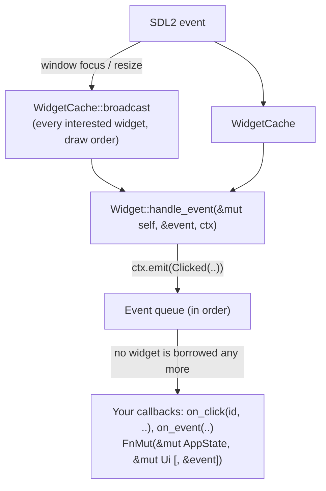

# Handling events

## Two ways to handle events

Pushrod supports two styles. Both route input through the same widgets and produce the same events.

| | Callbacks | Your own event loop |
|---|---|---|
| Who runs the loop | Pushrod (`engine.run`) | You (`while let Some(event) = engine.next_event(&mut events)`) |
| Where your code goes | `on_click`, `on_event` closures | A `match` on each returned `Event` |
| Application state | Passed to callbacks as `&mut S` | Ordinary local variables |
| Changing widgets | `ui.get_mut::<T>(id)` | `engine.widgets().get_as_mut::<T>(id)` |
| Good for | Many independent widgets, Visual Basic-style event procedures | Central dispatch, state machines, porting code written for GEM-style event loops |

Both styles deliver every event in the same order: semantic events, engine events, then any others, with the run-loop event mask applied to both. `next_event` returns events without running callbacks; `next_event_with` runs the registered callbacks first. See [Mixing the styles](#mixing-the-styles).

### Event-loop style

```rust
let mut events = engine.event_loop(&sdl, window);

while let Some(event) = engine.next_event(&mut events) {
    match event {
        Event::Clicked { id, .. } if id == button => {
            clicks += 1;

            if let Some(text) = engine.widgets().get_as_mut::<TextWidget>(label) {
                text.set_text(format!("Clicked {} time(s).", clicks));
            }
        }

        _ => {}
    }
}
```

`next_event` repaints any widgets you changed and presents the frame, waits for input (up to one frame at a time, without using the CPU while idle), routes the input through the widgets, and returns the events they generated, one at a time. It returns `None` after the window is closed or `engine.shutdown()` is called. See the [quick start](../getting-started/quick-start.mdx) for a complete program.

### Mixing the styles

`engine.next_event_with(&mut events, &mut state)` runs the callbacks registered with `on_click`, `on_engine_event` and `on_event` for the event, then returns it. Use callbacks for most widgets and a loop for the main window's logic:

```rust
engine.on_click(button, |clicks, _ui| *clicks += 1);

while let Some(event) = engine.next_event_with(&mut events, &mut clicks) {
    if let Event::Engine(engine_event) = event {
        println!("{:?}", engine_event);
    }
}
```

Events a callback's own actions cause (for example changing the event mask) are returned by later calls, after the events already waiting, exactly as `engine.run` delivers them.

The rest of this page describes the callback style and the event flow common to both.

## How events flow

In both styles:



1. Pushrod reads events from SDL2 and routes each one to a widget:
   - **Mouse button down** sends `PointerPressed` to the top-most visible widget under the pointer, which then *captures* the mouse until the button is released.
   - **Mouse motion** sends `PointerExited` to the widget the pointer left and `PointerEntered` to the one it entered, then `PointerMoved` to the captured widget (or the one under the pointer).
   - **Mouse button up** sends `PointerReleased` to the captured widget, then releases the capture.
   - **Window focus gained or lost, and window resize** are [broadcast](../concepts/broadcast-events-to-all-interested-widgets.md) as `WindowFocusChanged` and `WindowResized` to every visible, enabled widget whose mask includes `WINDOW`, in draw order.
2. The widget updates itself and may queue events with `ctx.emit(...)`. A button, for example, emits `Clicked` when released while still pressed.
3. After routing, Pushrod delivers each queued event, in order: to your callbacks (callback style), or as the return value of `next_event` (event-loop style). Because no widget is borrowed at that point, your code can freely change your state and any widget.

## Choosing which events to receive

By default every widget has an empty [event mask](../concepts/event-masks-for-the-run-loop-and-for-widgets.md) and receives nothing; widgets that handle events (such as `ButtonWidget`) ask for the classes they need. Use `Engine::set_event_mask` to drop whole classes, such as pointer motion, for the entire window.

## Events

The pointer events a widget receives, and the most common events it emits, are below. The [Event reference](../events/event-reference.md) lists every event.

| Event | Sent when |
|---|---|
| `Event::PointerExited { id }` | The pointer leaves widget `id`. |
| `Event::PointerEntered { id }` | The pointer enters widget `id`. |
| `Event::PointerMoved { id, position }` | The pointer moves; sent to the captured widget, or the one under the pointer. |
| `Event::PointerPressed { id, button, position, count }` | A mouse button goes down over widget `id`. |
| `Event::PointerReleased { id, button, position, count }` | A mouse button goes up; sent to the widget that captured the press. |
| `Event::Clicked { id, button, count }` | A widget was clicked; `count` is 1 for a single click, 2 for a double click. Emitted by buttons and by your own widgets. |

Every event has `event.kind()` (an `EventKind`, used by masks and the callback registry) and `event.widget()` (the widget it concerns, if any).

:::note[Planned changes]
Propagation, keyboard focus, and more callbacks are on the [roadmap](https://github.com/KenSuenobu/rust-pushrod/blob/main/docs/ROADMAP_EXTENSIBLE_WIDGET_LIBRARY.md). This page will change with them.
:::

## Disabled widgets

A disabled widget (`set_enabled(false)`) receives no mouse events, so it never emits `Clicked` and your callbacks don't fire. See [Widget behavior flags and visual states](../concepts/widget-behavior-flags-and-visual-states.md).

## Callbacks

| Method | Runs when | Signature |
|---|---|---|
| `engine.on_click(id, f)` | Widget `id` emits `Clicked` | `FnMut(&mut S, &mut Ui)` |
| `engine.on_press(id, f)` | A mouse button goes down on the widget (`PointerPressed`) | `FnMut(&mut S, &mut Ui)` |
| `engine.on_release(id, f)` | A mouse button goes up, inside or outside the widget (`PointerReleased`) | `FnMut(&mut S, &mut Ui)` |
| `engine.on_activate(id, f)` | The widget is activated (`Activated`) | `FnMut(&mut S, &mut Ui)` |
| `engine.on_toggle(id, f)` | A checkable widget changes state (`Toggled`) | `FnMut(&mut S, &mut Ui, checked: bool)` |
| `engine.on_value_change(id, f)` | The widget's value changes (`ValueChanged`) | `FnMut(&mut S, &mut Ui)` |
| `engine.on_viewport_change(id, f)` | A scrolling widget's visible area moves (`ViewportChanged`) | `FnMut(&mut S, &mut Ui, offset: Point)` |
| `engine.on_selection_change(id, f)` | The selection changes (`SelectionChanged`) | `FnMut(&mut S, &mut Ui)` |
| `engine.on_text_change(id, f)` | The text changes (`TextChanged`) | `FnMut(&mut S, &mut Ui)` |
| `engine.on_editing_finished(id, f)` | Editing finishes (`EditingFinished`) | `FnMut(&mut S, &mut Ui)` |
| `engine.on_key_press(id, f)` | A key goes down or repeats while the widget has the keyboard (`KeyPressed`) | `FnMut(&mut S, &mut Ui, Keycode, Mod)` |
| `engine.on_focus_change(id, f)` | The widget gains (`true`) or loses (`false`) focus | `FnMut(&mut S, &mut Ui, gained: bool)` |
| `engine.on_hover(id, f)` | The pointer enters (`true`) or leaves (`false`) the widget | `FnMut(&mut S, &mut Ui, inside: bool)` |
| `engine.on_engine_event(f)` | Pushrod completes an internal action | `FnMut(&mut S, &mut Ui, &EngineEvent)` |
| `engine.on_engine_event_filtered(&kinds, f)` | Same, for the listed kinds only | `FnMut(&mut S, &mut Ui, &EngineEvent)` |
| `engine.on_event(f)` | Any widget emits any event | `FnMut(&mut S, &mut Ui, &Event)` |

Every `on_*` method fires only for its widget and event kind, after the widget has updated itself, and returns a `CallbackId`. Several callbacks can be registered for the same widget; they run in the order they were registered, and `on_event` callbacks run after the widget-specific ones and the engine-event ones. Pushrod's own actions (such as a mask change or a widget being added) arrive as [engine events](../events/engine-events.md).

## The `Ui` handle

| Method | Does |
|---|---|
| `ui.get::<T>(id)` | Returns `Option<&T>` for the widget with that ID, if it is a `T`. |
| `ui.get_mut::<T>(id)` | Returns `Option<&mut T>`; use it to change a widget (`set_text`, `set_color`, ...). |
| `ui.widgets()` | The whole `WidgetCache`: add widgets, or reach a widget without knowing its type (`get_mut(id)`). |
| `ui.shutdown()` | Stops the engine after the current frame. |

```rust
engine.on_click(save, move |state, ui| {
    state.saves += 1;
    ui.widgets().get_mut(indicator).unwrap().set_color(Color::RGB(70, 160, 70));
});

engine.on_click(quit, |_, ui| ui.shutdown());

engine.on_event(|_, _, event| {
    if let Event::Clicked { id, count, .. } = event {
        println!("widget {} clicked ({} click(s))", id, count);
    }
});
```

## Emitting events from a widget

Inside `handle_event`, call `ctx.emit(...)` to queue an event for the callbacks. See [Creating widgets](./creating-widgets.md).

## Testing without a window

`Engine::dispatch(event, &mut state)` processes one SDL2 event exactly as the run loop would, including callbacks, so you can test event handling without opening a window. See [Testing a widget](./creating-widgets.md#testing-a-widget).
