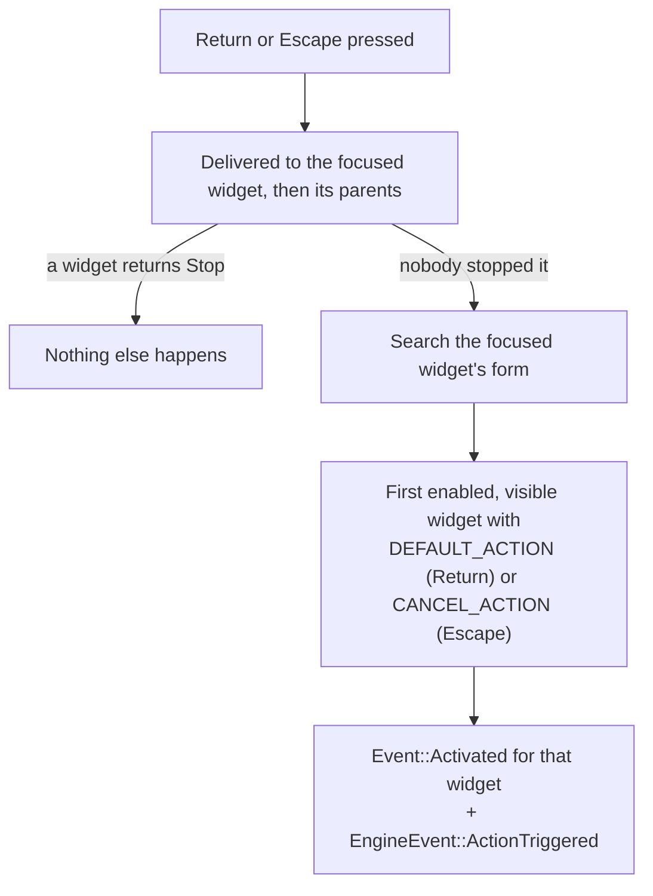

# Keyboard and focus

One widget at a time has the **keyboard focus**. Key presses and typed text go to it, and a dotted outline is drawn on it (`VisualState::FOCUSED`, drawn by `paint::state_overlay`). With no focus, key presses go to the root widget, so Return and Escape still work in a form.

A widget can take focus when it is `Behavior::FOCUSABLE`, enabled, and not hidden (nor inside a hidden parent).

## Moving focus

| Input | What happens |
|---|---|
| **Click** | Focuses the nearest focusable widget at or above the one clicked. A label in a [Form Layout](../layouts/form-layout.md) focuses its field. Clicking something that cannot take focus leaves focus where it is. |
| **Tab** / **Shift-Tab** | Next / previous focus group, in `WidgetId` order (the order the form was designed in). Wraps at the ends. |
| **Arrow keys** | Move within a radio group: Right and Down go forward, Left and Up go back, wrapping at the ends. |
| `set_focus(id)` | Focuses a widget from code. Returns `false` if it cannot take focus. |

A **focus group** is a set of focusable siblings that are all `Behavior::EXCLUSIVE` (a radio group). Tab visits a group once, at its checked member (or its first); arrows move inside it. Every other focusable widget is a group of its own.

Tab and the arrow keys are delivered to the focused widget first, through the [capture, target, and bubble phases](../events/event-propagation.md). If any widget returns `Propagation::Stop`, focus does not move, so a text editor can keep Tab for itself. Tab with Ctrl, Alt, or Cmd held does not move focus.

## Return and Escape



- **Return** (and keypad Enter) activates the `Behavior::DEFAULT_ACTION` widget of the current form.
- **Escape**, and **Cmd-.** on macOS, activates the `Behavior::CANCEL_ACTION` widget.
- The **form** is the nearest ancestor of the focused widget (or the root) that contains such a widget; the lowest `WidgetId` wins. A dialog's OK button is therefore found before the window's own default button.
- Key repeat does not activate a button.

The activated widget receives no key; the application hears `Event::Activated { id }`, so register it with `engine.on_activate(id, ...)`.

## Events

Focus changes deliver `Event::FocusLost` to the old widget, then `Event::FocusGained` to the new one. Both are also sent to the application, so `engine.on_focus_change(id, |state, ui, gained| ...)` works. A widget receives them when `EventMask::FOCUS` is in its mask. Every change also emits `EngineEvent::FocusChanged { old, new }`, and Return or Escape emit `EngineEvent::ActionTriggered { id, cancel }`; see [Engine events](../events/engine-events.md).

## Text input

A widget that edits text overrides `Widget::accepts_text_input` to return `true`. While it has focus the engine starts SDL text input, so typed characters arrive as `Event::TextEntered`; focus moving elsewhere stops it.

## Example

A form with two fields and OK and Cancel. The complete program is `examples/focus.rs`; run it with `cargo run --example focus`.

```rust checked title="src/lib.rs"
use pushrod::engine::Engine;
use pushrod::geometry::{point, size};
use pushrod::paint::Painter;
use pushrod::widget::{Behavior, Widget, WidgetCore};

/// A control that can take focus.
pub struct Control {
    core: WidgetCore,
}

impl Widget for Control {
    fn core(&self) -> &WidgetCore { &self.core }
    fn core_mut(&mut self) -> &mut WidgetCore { &mut self.core }
    fn paint(&self, _p: &mut dyn Painter) {}
}

/// Adds a control with the given behavior to the engine.
pub fn add(engine: &mut Engine<u32>, x: i32, behavior: Behavior) -> u32 {
    let id = engine.add_widget(Control {
        core: WidgetCore::new(point(x, 0), size(40, 20)),
    });

    engine
        .widgets()
        .get_mut(id)
        .unwrap()
        .set_behavior(Behavior::FOCUSABLE | behavior);

    id
}

/// Builds the form and focuses the first field.
pub fn build(engine: &mut Engine<u32>) {
    let name = add(engine, 0, Behavior::empty());
    let _email = add(engine, 50, Behavior::empty());
    let ok = add(engine, 100, Behavior::DEFAULT_ACTION);
    let _cancel = add(engine, 150, Behavior::CANCEL_ACTION);

    // Return anywhere in the form arrives here.
    engine.on_activate(ok, |presses, _ui| *presses += 1);

    // From a callback, `ui.set_focus(id)` and `ui.focused()` do the same.
    engine.widgets().set_focus(name);
}
```

## Reference

| Call | Meaning |
|---|---|
| `WidgetCache::focused()` / `Ui::focused()` | The focused widget's ID, or `None`. |
| `WidgetCache::set_focus(id)` / `Ui::set_focus(id)` | Focus a widget; `false` if it cannot take focus. |
| `WidgetCache::clear_focus()` | Remove focus. |
| `WidgetCache::focus_next(backward)` | What Tab (`false`) and Shift-Tab (`true`) call. |
| `WidgetCache::focus_in_group(forward)` | What the arrow keys call. |
